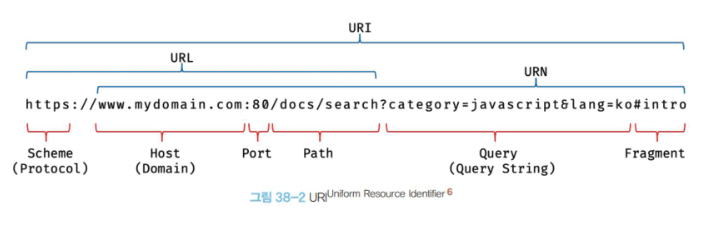

# 34. 이터러블

## 34.1 이터레이션 프로토콜

- ES6에서 도입된 이터레이션 프로토콜은 순화 가능한 데이터 컬렉션(자료구조)을 만들기 위해 ECMAScript 사양에 정의하여 미리 약속한 규칙입니다.
- ES6 이전의 순회 가능한 데이터 컬렉션(배열), 문자열, 유사 배열 객체, DOM 컬렉션 등은 통일된 규약 없이 각자 나름의 구조를 가지고 for 문, for...in 문, forEach 메서드 등 다양한 방법으로 순회할 수 있었습니다.
- ES6에서 순회 가능한 데이터 컬렉션을 이터레이션 프로토콜을 준수하는 이터러블로 통일하여 for...of 문, 스프레드 문법, 배열 디스트럭처링 할당의 대상으로 일원화 하였습니다.
- 이터레이션 프로토콜에는 이터러블 프로토콜과 이터레이터 프로토콜이 있습니다.
  #### 이터러블 프로토콜
  - Well-known Symbol인 Symbol.iterator를 프로퍼티 키로 사용한 메서드를 직접 구현하거나 프로토타입 체인을 통해 상속받은 Symbol.iterator 메서드를 호출하면 이터레이터 프로토콜을 준수한 이터레이터를 반환합니다.
  - 이러한 규약을 이러터블 프로토콜이라 하며, **이터러블 프로토콜을 준수한 객체를 이터러블이라 합니다**
  - **이터러블은 for...of 문으로 순회할 수 있으며 스프레드 문법과 배열 디스트럭처링 할당의 대상으로 사용할 수 있습니다**
  #### 이터레이터 프로토콜
  - 이터러블의 Symbol.iterator 메서드를 호출하면 이터레이터 프로토콜을 준수한 이터레이터를 반환합니다.
  - 이터레이터는 next 메서드를 소유하며 next 메서드를 호출하면 이터러블을 순회하며 value와 done 프로퍼티를 갖는 **이터레이터 리절트 객체**를 반환합니다.
  - 이러한 규약을 이터레이터 프로토콜이라 하며, **이터레이터 프로토콜을 준수한 객체를 이터레이터라 합니다**
  - 이터레이터는 이터러블의 요소를 탐색하기 위한 포인터 역할을 합니다.

## 34.1.1 이터러블

- 이터러블 프로토콜을 준수한 객체를 이터러블이라 합니다.
- 즉, 이터러블은 Symbol.iterator를 프로퍼티 키로 사용한 메서드를 직접 구현하거나 프로토타입 체인을 통해 상속받은 객체를 이야기합니다.
  - 이터러블인지 확인하는 함수는 아래와 같이 구현 가능합니다.

    ```js
    const isIterable = (v) =>
      v !== null && typeof v[Symbol.iterator] === "function";

    // 배열, 문자열, Map, Set 등은 이터러블이다.
    isIterable([]); // → true
    isIterable(""); // → true
    isIterable(new Map()); // → true
    isIterable(new Set()); // → true
    isIterable({}); // → false
    ```

  - 예를들어, 배열은 Array.prototype의 Symbol.iterator 메서드를 상속받는 이터러블 입니다.
  - 이터러블은 for...of 문으로 순회할 수 있으며, 스프레드 문법과 배열 디스트럭처링 할당의 대상으로 사용할 수 있습니다.

## 34.1.2 이터레이터

- 이터러블의 Symbol.iterator 메서드를 호출하면 이터레이터 프로토콜을 준수한 이터레이터를 반환합니다.
- **이터러블의 Symbol.iterator 메서드가 반환한 이터레이터는 next 메서드를 갖습니다**

  ```js
  // 배열은 이터러블 프로토콜을 준수한 이터러블이다.
  const array = [1, 2, 3];

  // Symbol.iterator 메서드는 이터레이터를 반환한다.
  const iterator = array[Symbol.iterator]();

  // Symbol.iterator 메서드가 반환한 이터레이터는 next 메서드를 갖는다.
  console.log("next" in iterator); // true
  ```

  - 이터레이터의 next 메서드는 이터러블의 각 요소를 순회하기 위한 포인터 역할을 합니다.
  - 즉, next 메서드를 호출하면 이터러블을 순차적으로 한 단계씩 순회하며 순회 결과를 나타내는 이터레이터 리절트 객체를 반환합니다. iterator result object
  - 이터레이터의 next 메서드가 반환하는 이터레이터 리절트 객체의 value 프로퍼티는 현재 순회중인 이터러블의 값을 나타내며 done 프로퍼티는 이터러블의 순회 완료 여부를 나타냅니다.

## 34.3 for ... of 문

- for ... of 문은 이터러블을 순회하면서 이터러블의 요소를 변수에 할당합니다.

  ```js
  for (변수선언문 of 이터러블) { ... }
  ```

  - for ... in 문의 형식과 매우 유사하죠?

    ```js
    for  (변수선언문 in 객체) { ... }
    ```

  - for ... in 문은 객체의 프로토타입 체인 상에 존재하는 모든 프로토타입의 프로퍼티 중에서 프로퍼티 어트리뷰트 `[[Enumerable]]`의 값이 true인 프로퍼티를 순회하며 열거 합니다.
    - 이때 프로퍼티 키가 심벌인 프로퍼티는 열거하지 않습니다.
  - for ... of 문은 내부적으로 이터레이터의 next 메서드를 호출하여 이터러블을 순회하며 next 메서드가 반환한 이터레이터 리절트 객체의 value 프로퍼티 값을 for... of 문의 변수에 할당합니다.
  - 그리고 이터레이터 리절트 객체의 done 프로퍼티 값이 false 이면 이터러블의 순회를 계속하고 true이면 이터러블의 순회를 중단합니다.

## 34.5 이터레이션 프로토콜의 필요성

- 앞서 서술했지만 ES6 이전의 순회 가능한 데이터 컬렉션(배열), 문자열, 유사객체, DOM 컬렉션 등은 통일된 규약 없이 각자 나름의 구조를 가지고 다양한 방법들로 순회할 수 있었습니다.
- ES6에서는 순회 가능한 데이터 컬렉션을 이터레이션 프로토콜을 준수하는 이터러블로 통일하여 for..of 문, 스프레드 문법, 배열 디스트럭처링 할당의 대상으로 사용할 수 있도록 일원화 했습니다.
- 이터러블을 for...of 문, 스프레드 문법, 배열 디스트럭처링 할당과 같은 데이터 소비자에 의해 사용되므로 데이터 공급자의 역할을 한다고 할 수 있습니다.
- 만약 다양한 데이터 공급자들이 각자의 순회 방식을 갖는다면 데이터 소비자는 다양한 데이터 공급자의 순회 방식을 모두 지원해야 합니다.
- 하지만 이터레이션 프로토콜을 준수하도록 규정하면 데이터 소비자는 이터레이션 프로토콜만 지원하도록 구현하면 됩니다.
  - **즉, 이터레이션 프로토콜은 다양한 데이터 공급자가 하나의 순회 방식을 갖도록 규정하여 데이터 소비자가 효율적으로 다양한 데이터 공급자를 사용할 수 있도록 데이터 소비자와 데이터 공급자를 연결하는 인터페이스의 역할을 합니다**

---

# 35장. 스프레드 문법

- ES6에서 도입된 스프레드 문법은 하나로 뭉쳐있는 여러 값들의 집합을 전개하여, 분산하여, spread 하여 개별적인 값들의 목록으로 만듭니다.
- 스프레드 문법을 사용할 수 있는 대상은 Array, String, Map, Set, DOM 컬렉션(NodeList, HTMLCollection), arguments와 같이 for...of 문으로 순회할 수 있는 이터러블에 한정됩니다.

  ```js
  // ...[1, 2, 3]은 [1, 2, 3]을 개별 요소로 분리한다(→ 1, 2, 3).
  console.log(...[1, 2, 3]); // 1 2 3

  // 문자열은 이터러블이다.
  console.log(..."Hello"); // H e l l o

  // Map과 Set은 이터러블이다.
  console.log(
    ...new Map([
      ["a", "1"],
      ["b", "2"],
    ]),
  ); // ['a', '1'] ['b', '2']
  console.log(...new Set([1, 2, 3])); // 1 2 3

  // 이터러블이 아닌 일반 객체는 스프레드 문법의 대상이 될 수 없다.
  console.log(...{ a: 1, b: 2 });
  // TypeError: Found non-callable @@iterator
  ```

  - 스프레드 문법의 결과는 값이 아닙니다.
    - 이는 스프레드 문법 ... 이 피연산자를 연산하여 값을 생성하는 연산자가 아님을 의미합니다.
    - 따라서 스프레드 문법의 결과는 변수에 할당할 수 없습니다.

- 스프레드 문법의 결과물은 값으로 사용할 수 없고, 쉼표로 구분한 값의 목록을 사용하는 문맥에서만 사용할 수 있습니다.
  - 함수 호출문의 인수 목록
  - 배열 리터럴의 요소 목록
  - 객체 리터럴의 프로퍼티 목록

## 35.1 함수 호출문의 인수 목록에서 사용하는 경우

- 스프레드 문법은 여러 개의 값이 하나로 뭉쳐 있는 배열과 같은 이터러블을 펼쳐서 개발적인 값들의 목록을 만드는 것 입니다.
- 따라서 Rest 파라미터와 스프레드 문법은 서로 반대의 개념입니다.

  ```js
  // Rest 파라미터는 인수들의 목록을 배열로 전달받는다.
  function foo(...rest) {
    console.log(rest); // 1, 2, 3 → [ 1, 2, 3 ]
  }

  // 스프레드 문법은 배열과 같은 이터러블을 펼쳐서 개별적인 값들의 목록을 만든다.
  // [1, 2, 3] → 1, 2, 3
  foo(...[1, 2, 3]);
  ```

## 35.2 배얼 리터럴 내부에서 사용하는 경우

### 배열 복사

- ES5에서 배열을 복사하려면 slice 메서드를 사용해야 했습니다.

  ```js
  // ES5
  var origin = [1, 2];
  var copy = origin.slice();

  console.log(copy); // [1, 2]
  console.log(copy === origin); // false
  ```

- 스프레드 문법을 사용하면 더 간결하고 가독성 좋게 표현 가능합니다.

  ```js
  // ES6
  const origin = [1, 2];
  const copy = [...origin];

  console.log(copy); // [1, 2]
  console.log(copy === origin); // false
  ```

- 이때 원본 배열의 각 요소를 얕은 복사하여 새로운 복사본을 생성합니다. 이는 slice 메서드도 동일합니다.

#### 배열에서의 얕은복사

- 얕은 복사는 바깥 배열 객체만 새로 만들고, 그 칸에는 1단계 요소만 넣습니다. `[...origin]`과 `origin.slice()`가 이 방식입니다. 그래서 `copy === origin`은 false입니다. copy와 origin은 서로 다른 배열을 가리킵니다
- 요소가 1, 2 같은 원시 값이면 그 값 자체가 새 배열의 칸에 복사됩니다. `copy[0] = 99`를 해도 `origin[0]`은 1 그대로입니다.
- 요소가 객체나 배열이면 복사되는 것은 그 객체를 가리키는 참조입니다. 안쪽 객체는 새로 만들어지지 않고, 두 배열이 같은 객체를 공유합니다.

  ```js
  const obj = { name: "Lee" };
  const origin = [1, obj];
  const copy = [...origin];

  copy[0] = 100;
  console.log(origin[0]); // 1

  copy[1].name = "Kim";
  console.log(origin[1].name); // 'Kim'
  console.log(copy[1] === origin[1]); // true
  ```

  - `copy[0]`을 바꿔도 origin은 그대로인 이유는 숫자 1이 값으로 복사됐기 때문입니다. `copy[1].name`을 바꾸면 origin도 바뀌는 이유는 `{ name: 'Lee' }`가 한 번만 만들어지고, 두 배열의 두 번째 칸이 그 같은 객체를 가리키기 때문입니다.

### 이터러블을 배열로 변환

- ES5에서 이터러블을 배열로 변환하려면 apply, call 메서드를 사용하여 slice 메서드를 호출해야 합니다.

  ```js
  // ES5
  function sum() {
    // 이터러블이면서 유사 배열 객체인 arguments를 배열로 변환
    var args = Array.prototype.slice.call(arguments);

    return args.reduce(function (pre, cur) {
      return pre + cur;
    }, 0);
  }

  console.log(sum(1, 2, 3)); // 6
  ```

  - 이 방법은 이터러블 뿐만 아니라 이터러블이 아닌 유사 배열 객체도 배열로 변환할 수 있습니다.

- 스프레드 문법을 사용하면 좀 더 간편하게 이터러블을 배열로 변환할 수 있습니다.
- arguments 객체는 이터러블이면서 유사 배열 객체입니다. 따라서 스프레드 문법 사용이 가능합니다.
- 사실 Rest 파라미터를 사용해서 처리해도 됩니다.
- 이터러블이 아닌 유사 배열 객체를 배열로 변경하려면 ES6에서 도입된 Array.from 메서드를 사용하면 됩니다.
- Array.from 메서드는 유사 배열 객체 또는 이터러블을 인수로 전달받아 배열로 변환하여 반환홥니다.

---

# 36장. 디스트럭처링 할당

- 디스트럭처링 할당(구조 분해 할당)은 구조화된 배열과 같은 이터러블 또는 객체를 destructuring(비구조화, 구조파괴)하여 1개 이상의 변수에 개별적으로 할당하는 것을 이야기합니다.
- 배열과 같은 이터러블 또는 객체 리터럴에서 필요한 값만 추출하여 변수에 할당할 때 유용합니다.

## 36.1 배열 디스트럭처링 할당

- ES6의 배열 디스트럭처링 할당은 배열의 각 요소를 배열로부터 추출하여 1개 이상의 변수에 할당합니다.
- **이때 배열 디스트럭처링 할당의 대상(할당문의 우변)은 이터러블이어야 하며, 할당 기준은 배열의 인덱스 입니다.**
  - 쉽게말해서 순서대로 할당됩니다.

  ```js
  const arr = [1, 2, 3];

  // ES6 배열 디스트럭처링 할당
  // 변수 one, two, three를 선언하고 배열 arr를 디스트럭처링하여 할당한다.
  // 이때 할당 기준은 배열의 인덱스다.
  const [one, two, three] = arr;

  console.log(one, two, three); // 1 2 3
  ```

- 배열 디스트럭처링 할당은 배열과 같은 이터러블에서 필요한 요소만 추출하여 변수에 할당하고 싶을 때 유용합니다.
  - 아래 예제는 URL을 파싱하여 protocol, host, path 프로퍼티를 갖는 객체를 생성하여 반환홥니다.

    ```js
    // url을 파싱하여 protocol, host, path 프로퍼티를 갖는 객체를 생성해 반환한다.
    function parseURL(url = "") {
      // '://' 앞의 문자열(protocol)과 '/' 이전의 '/'로 시작하지 않는 문자열(host)과
      // '/' 이후의 문자열(path)을 검색한다.
      const parsedURL = url.match(/^(\w+):\/\/([^/]+)\/(.*)$/);
      console.log(parsedURL);
      /*
      [
        'https://developer.mozilla.org/ko/docs/Web/JavaScript',
        'https',
        'developer.mozilla.org',
        'ko/docs/Web/JavaScript',
        index: 0,
        input: 'https://developer.mozilla.org/ko/docs/Web/JavaScript',
        groups: undefined
      ]
      */
      if (!parsedURL) return {};

      // 배열 디스트럭처링 할당을 사용하여 이터러블에서 필요한 요소만 추출한다.
      const [, protocol, host, path] = parsedURL;
      return { protocol, host, path };
    }

    const parsedURL = parseURL(
      "https://developer.mozilla.org/ko/docs/Web/JavaScript",
    );
    console.log(parsedURL);
    /*
    {
      protocol: 'https',
      host: 'developer.mozilla.org',
      path: 'ko/docs/Web/JavaScript'
    }
    */
    ```

## 36.2 객체 디스트럭처링 할당

---

# 37장. Set과 Map

## 37.1 Set

- Set 객체는 중복되지 않는 유일한 값들의 집합 입니다.
- Set 객체는 배열과 유사하지만 다음과 같은 차이가 있습니다.
  | 구분 | 배열 | Set 객체 |
  | -------------------------------- | ---- | -------- |
  | 동일한 값을 중복하여 포함할 수 있다. | ○ | × |
  | 요소 순서에 의미가 있다. | ○ | × |
  | 인덱스로 요소에 접근할 수 있다. | ○ | × |
  - 이러한 Set 객체의 특성은 수학적 집합의 특성과 일치합니다.
  - Set은 수학적 집합을 구현하기 위한 자료구조 입니다.
  - 따라서 Set을 통해 교집합, 합집합, 차집합, 여집합 등을 구현할 수 있습니다.

### 37.1.1 Set 객체의 생성

- Set 객체는 Set 생성자 함수로 생성합니다. Set 생성자 함수에 인수를 전달하지 않으면 빈 Set 객체가 생성됩니다.
- **Set 생성자 함수는 이터러블을 인수로 전달받아 Set 객체를 생성합니다. 이때 이터러블의 중복된 값은 Set 객체에 요소로 저장되지 않습니다.**

  ```js
  const set1 = new Set([1, 2, 3, 3]);
  console.log(set1); // Set(3) {1, 2, 3}

  const set2 = new Set("hello");
  console.log(set2); // Set(4) {"h", "e", "l", "o"}
  ```

  - 중복을 허용하지 않는 Set 객체의 특성을 활용하여 배열에서 중복된 요소를 제거할 수도 있습니다.

### 37.1.2 요소 개수 확인

- Set 객체의 요소 개수를 확인할 때는 Set.prototype.size 프로퍼티를 사용합니다.

### 37.1.3 요소 추가

- Set 객체에 요소를 추가할 때는 Set.prototype.add 메서드를 사용합니다.
- 이때 객체에 중복 추가는 허용되지 않고 무시됩니다.
  - 앞서 배웠듯 자바스크립트는 `NaN === NaN`을 false로 평가합니다.
  - 하지만 Set에서는 동일하다고 평가되어 중복 추가를 허용하지 않습니다.
- Set 객체는 객체나 배열과 같이 자바스크립트의 모든 값을 요소로 저장할 수 있습니다.

  ```js
  const set = new Set();

  set
    .add(1)
    .add("a")
    .add(true)
    .add(undefined)
    .add(null)
    .add({})
    .add([])
    .add(() => {});

  console.log(set); // Set(8) {1, "a", true, undefined, null, {}, [], () => {}}
  ```

### 37.1.4 요소 존재 여부 확인

### 37.1.5 요소 삭제

### 37.1.6 요소 일괄 삭제

### 37.1.7 요소 순회

- Set 객체의 요소를 순회하려면 Set.prototype.forEach 메서드를 사용해야 합니다.
- Set.prototype.forEach 메서드는 Array.prototype.forEach 메서드와 유사하게 콜백 함수와 forEach 메서드의 콜백 함수 내부에서 this로 사용될 객체를 인수로 전달합니다.
- 이때 콜백 함수는 다음과 같이 3개의 인수를 전달받습니다.
  - 첫 번째 인수: 현재 순회 중인 요소값
  - 두 번째 인수: 현재 순회 중인 요소값
  - 세 번째 인수: 현재 순회 중인 Set 객체 자체
- 첫 번째 인수와 두 번째 인수는 같은 값입니다.
  - 이처럼 동작하는 이유는 Array.prototype.forEach 메서드와 인터페이스를 통일하기 위함이며 다른 의미는 없습니다
  - Array에서는 콜백 함수에서 두 번째 인수로 현재 순회 중인 요소의 인덱스를 전달받습니다.
  - 하지만 Set 객체는 순서에 의미가 없으므로 배열과 같이 인덱스를 갖지 않습니다.
- **Set 객체는 이터러블 입니다**
  - 따라서 for ... of 문으로 순회할 수 있으며, 스프레드 문법과 배열 디스트럭처링의 대상이 될 수도 있습니다.

  ```js
  const set = new Set([1, 2, 3]);

  // Set 객체는 Set.prototype의 Symbol.iterator 메서드를 상속받는 이터러블이다.
  console.log(Symbol.iterator in set); // true

  // 이터러블인 Set 객체는 for...of 문으로 순회할 수 있다.
  for (const value of set) {
    console.log(value); // 1 2 3
  }

  // 이터러블인 Set 객체는 스프레드 문법의 대상이 될 수 있다.
  console.log([...set]); // [1, 2, 3]

  // 이터러블인 Set 객체는 배열 디스트럭처링 할당의 대상이 될 수 있다.
  const [a, ...rest] = set;
  console.log(a, rest); // 1, [2, 3]
  ```

  - Set 객체는 요소의 순서에 의미를 갖지 않지만 Set 객체를 순회하는 순서는 요소가 추가된 순서를 따릅니다.
  - 이는 ECMAScript 사양에 규정되어 있지는 않지만 다른 이터러블의 순회와 호환성을 유지하기 위함입니다.

### 37.1.8 집합 연산

- Set 객체는 수학적 집합을 구현하기 위한 자료구조 입니다.
- 따라서 Set 객체를 통해 교집합, 합집합, 차집합 등을 구현할 수 있습니다.
- 집합 연산을 수행하는 프로토타입 메서드를 구현하면 아래와 같습니다.

#### 교집합

```js
Set.prototype.intersection = function (set) {
  const result = new Set();

  for (const value of set) {
    // 2개의 set의 요소가 공통되는 요소이면 교집합의 대상이다.
    if (this.has(value)) result.add(value);
  }

  return result;
};

const setA = new Set([1, 2, 3, 4]);
const setB = new Set([2, 4]);

// setA와 setB의 교집합
console.log(setA.intersection(setB)); // Set(2) {2, 4}
// setB와 setA의 교집합
console.log(setB.intersection(setA)); // Set(2) {2, 4}
```

- 또는 다른 방법으로도 가능합니다.

```js
Set.prototype.intersection = function (set) {
  return new Set([...this].filter((v) => set.has(v)));
};

const setA = new Set([1, 2, 3, 4]);
const setB = new Set([2, 4]);

// setA와 setB의 교집합
console.log(setA.intersection(setB)); // Set(2) {2, 4}
// setB와 setA의 교집합
console.log(setB.intersection(setA)); // Set(2) {2, 4}
```

#### 합집합

```js
Set.prototype.union = function (set) {
  // this(Set 객체)를 복사
  const result = new Set(this);

  for (const value of set) {
    // 합집합은 2개의 Set 객체의 모든 요소로 구성된 집합이다. 중복된 요소는 포함되지 않는다.
    result.add(value);
  }

  return result;
};

const setA = new Set([1, 2, 3, 4]);
const setB = new Set([2, 4]);

// setA와 setB의 합집합
console.log(setA.union(setB)); // Set(4) {1, 2, 3, 4}
// setB와 setA의 합집합
console.log(setB.union(setA)); // Set(4) {2, 4, 1, 3}
```

- 또는 다른 방법으로도 가능합니다.

```js
Set.prototype.union = function (set) {
  return new Set([...this, ...set]);
};

const setA = new Set([1, 2, 3, 4]);
const setB = new Set([2, 4]);

// setA와 setB의 합집합
console.log(setA.union(setB)); // Set(4) {1, 2, 3, 4}
// setB와 setA의 합집합
console.log(setB.union(setA)); // Set(4) {2, 4, 1, 3}
```

#### 차집합

```js
Set.prototype.difference = function (set) {
  // this(Set 객체)를 복사
  const result = new Set(this);

  for (const value of set) {
    // 차집합은 어느 한쪽 집합에는 존재하지만 다른 한쪽 집합에는 존재하지 않는 요소로 구성된 집합이다.
    result.delete(value);
  }

  return result;
};

const setA = new Set([1, 2, 3, 4]);
const setB = new Set([2, 4]);

// setA에 대한 setB의 차집합
console.log(setA.difference(setB)); // Set(2) {1, 3}
// setB에 대한 setA의 차집합
console.log(setB.difference(setA)); // Set(0) {}
```

- 또는 다른 방법으로도 가능합니다.

```js
Set.prototype.difference = function (set) {
  return new Set([...this].filter((v) => !set.has(v)));
};

const setA = new Set([1, 2, 3, 4]);
const setB = new Set([2, 4]);

// setA에 대한 setB의 차집합
console.log(setA.difference(setB)); // Set(2) {1, 3}
// setB에 대한 setA의 차집합
console.log(setB.difference(setA)); // Set(0) {}
```

## 37.2 Map

- **Map 객체는 키와 값의 쌍으로 이루어진 컬렉션 입니다**
- **Map 객체는 객체와 유사 하지만 차이가 존재합니다**
  | 구분 | 객체 | Map 객체 |
  | ------------------ | ------------------------- | ------------------- |
  | 키로 사용할 수 있는 값 | 문자열 또는 심벌 값 | 객체를 포함한 모든 값 |
  | 이터러블 | × | ○ |
  | 요소 개수 확인 | Object.keys(obj).length | map.size |

### 37.2.1 Map 객체의 생성

- Map 생성자 함수로 생성하면 된다.
- **Map 생성자 함수는 이터러블을 인수로 전달받아 Map 객체를 생성합니다.**
  - **이때 인수로 전달되는 이터러블은 키와 값의 쌍으로 이루어진 요소로 구성되어야 합니다**

  ```js
  const map1 = new Map([
    ["key1", "value1"],
    ["key2", "value2"],
  ]);
  console.log(map1); // Map(2) {"key1" => "value1", "key2" => "value2"}

  const map2 = new Map([1, 2]); // TypeError: Iterator value 1 is not an entry object
  ```

- Map 생성자 함수의 인수로 전달한 이터러블에 중복된 키를 갖는 요소가 존재하면 값이 덮어써 집니다.
- 따라서 Map 객체는 중복된 키를 갖는 요소가 존재할 수 없습니다.

### 37.2.2 요소 개수 확인

### 37.2.3 요소 추가

- 객체는 문자열 또는 심벌 값만 키로 사용할 수 있습니다.
- 하지만 Map 객체는 키 타입에 제한이 없습니다.
- 따라서 객체를 포함한 모든 값을 키로 사용할 수 있습니다.
- 이는 Map 객체와 일반 객체의 가장 두드러지는 차이점 입니다.

### 37.2.4 요소 취득

### 37.2.5 요소 존재 여부 확인

### 37.2.6 요소 삭제

### 37.2.7 요소 일괄 삭제

### 37.2.8 요소 순회

- Map 객체의 요소를 순회하려면 Map.prototype.forEach 메서드를 사용합니다.
- 이하 내용은 Set과 동일함
- Map 객체는 요소의 순서에 의미를 갖지 않지만 Map 객체를 순회하는 순서는 요소가 추가된 순서를 따릅니다.

---

# Set & Map 추가 정리

## Map

### 기본 특징

- 키 타입 다양성: 객체와는 달리 모든 타입을 키로 사용 가능합니다.
  - 문자열 키로 객체 키를 사용하던 방식과 사고의 틀을 벗어날 수 있습니다.
- 순서 보장: 삽입 순서가 유지됩니다.
  - 객체는 순서보장이 안되죠?
- 크기 추적: size 프로퍼티로 쉽게 요소 개수 확인 가능
- 전용 메서드
- 성능: 객체보다 삭제, 추가 시 이점이 발생합니다

  #### 왜 Map이 일반 객체보다 추가, 삭제 상황에서 성능이 뛰어날까요?
  - 해시 테이블 기반 구현: Map은 내부적으로 해시 테이블을 사용하여 구현되오 평균적으로 O(1)의 시간복잡도를 갖습니다.
    - 물론 객체 또한 O(1)에 준하지만 자바스크립트 엔진의 작동방식에서의 차이가 존재합니다.

  ##### V8 엔진에서의 히든 클래스
  - 우리가 사용하는 V8 엔진에서는 객체를 생성할 때마다 히든 클래스가 함께 생성됩니다.

    ```js
    const obj = {}; // Hidden class #1
    obj.a = 1; // Hidden class #2
    obj.b = 2; // Hidden class #3

    // 타입을 추론해서 컴파일러에 전달하는 과정이 있음
    // 위 예제에서는 number 타입이라는 문자열을 담은 정보가 컴파일러로 전달 되고 있는거임
    ```

  - 객체가 생성될 때마다 혹은 객체의 모양(프로퍼티 구조)에 따라 히든 클래스가 생성됩니다
  - 객체에 새로운 프로퍼티가 추가되면 새로운 히든 클래스가 생성되고, 기존 객체는 이 새로운 클래스를 참조하도록 업데이트가 됩니다.
    - 엔진 내부에서는 클래스를 만들고 업데이트 하는 등의 동작이 이루어지고 있는 것 입니다.
    - 이건 자바스크립트가 동적 타입 언어이기 때문에 생기는 현상이에요
      - 동일한 히든클래스를 공유하는 객체는 더 빠르게 접근 가능해서 조회 속도가 빠르지만 프로퍼티의 추가 순서가 다르면 다른 히든클래스가 생성되어 성능 저하가 일어납니다.
      - 동적 프로퍼티 추가/삭제가 빈번하면 히든클래스 변경이 잦아서 성능 저하가 찾아옵니다
  - 또 빈번한 객체의 수정이 이루어 진다면 Dictionary Mode(Slow Properies)로 변경되기도 합니다
    - 성능 저하모드 입니다
    - 전환 조건
      - 프로퍼티가 매우 자주 추가 / 삭제 되는 경우
      - 프로퍼티 이름이 매우 다양할 때 (동적 생성 키)
      - 대량의 프로퍼티가 있을 때
    - 특징
      - 더 이상 히든클래스를 사용하지 않으며 해시 테이블 방식으로 전환됩니다.
      - 유연성(변경)은 높지만 접근 속도가 느려집니다.
      - 메모리의 사용량이 증가합니다.
    - Map과의 차이
      - Map은 처음부터 해시테이블로 설계되어 Dictionary Mode의 오버헤드가 없습니다.
      - 객체는 히든클래스 최적화를 위해 설계되었지만, Dictionary Mode로 전환되면 Map보다 느려질 수 있습니다.

  > ##### 객체를 다를 때 좋은 패턴과 나쁜 패턴
  >
  > - 객체를 다룰 때 동적으로 프로퍼티를 추가하거나 삭제하거나 하나씩 건드리는 과정이 코드단에서 빈번히 일어난다면 좋지 않은 사용 사례입니다.
  > - 처음부터 명시적으로 존재하는 상태가 가장 좋은 상태입니다. 객체 내부 프로퍼티의 데이터타입이 변경되지 않으니 그 상태의 타입 그대로 연산이 이루어 지는 것 입니다.
  > - Map은 처음부터 Dictionary Mode 상황으로 전환되는 일이 없습니다. 따라서 빈번한 객체 수정에 대응 가능한 강점을 갖게 됩니다.
  > - [참고자료 - Fast properties in V8](https://v8.dev/blog/fast-properties)

## Set

- 고유한 값(중복 불가)들의 컬렉션을 저장하는 자료형

### 기본 특징

1. 중복 불가
2. 순서 보장: 삽입 순서의 보장
3. 빠른 검색: 값 존재 여부를 빠르게 확인 가능
   - 배열보다 빠릅니다
   - includes: O(n)
   - set.has: O(1)
   - 긴 리스트 형태의 데이터를 다룰때에는 배열보다는 set이 압도적이다!!!
4. 크기 추적: size 프로퍼티
5. 순회 가능

### 실전 예시

#### 태그 입력 인풋 컴포넌트

- 중복이 안된다는 강점 덕분에 tags같은 배열을 set으로 관리해주는게 좋습니다.
- 혹은 Input 입력값 에서 중복 검사를 해야 한다면 사용

```js
"use client";
import { useState } from "react";

const TagInput = () => {
  const [tags, setTags] = useState<Set<string>>(new Set());
  const [inputValue, setInputValue] = useState("");

  const addTag = () => {
    if (inputValue && !tags.has(inputValue)) {
      setTags(new Set(tags).add(inputValue));
      setInputValue("");
    }
  };

  const removeTag = (tag: string) => {
    const newTags = new Set(tags);
    newTags.delete(tag);
    setTags(newTags);
  };

  return (
    <div>
      <input
        value={inputValue}
        onChange={(e) => setInputValue(e.target.value)}
        onKeyDown={(e) => e.key === "Enter" && addTag()}
      />
      <button onClick={addTag}>Add Tag</button>
      <div>
        {Array.from(tags).map((tag: string) => (
          <span key={tag} className="tag">
            {tag}
            <button onClick={() => removeTag(tag)}>×</button>
          </span>
        ))}
      </div>
    </div>
  );
};

export default TagInput;
```

#### 쇼핑몰 장바구니 데이터

```js
const Cart = () => {
  const [cartItems, setCartItems] = useState(new Set());

  const addToCart = (productId: string) => {
    // 이미 존재하는 상품은 추가하지 않음
    setCartItems((prev) => new Set(prev).add(productId));
  };

  const removeFromCart = (productId: string) => {
    setCartItems((prev) => {
      const newCart = new Set(prev);
      newCart.delete(productId);
      return newCart;
    });
  };

  return (
    <div>
      <h2>장바구니 ({cartItems.size}개 상품)</h2>
      <ProductList onAddToCart={addToCart} />
      <ul>
        {Array.from(cartItems).map((id) => (
          <CartItem
            key={String(id)}
            productId={id as string}
            onRemove={removeFromCart}
          />
        ))}
      </ul>
    </div>
  );
};

export default Cart;
```

#### 소셜 서비스(또는 커뮤니티 서비스)의 좋아요 캐싱

- 인스타 혹은 유튜브의 초당 좋아요는 몇개나 생길까요?
  - 혹은 빈번한 I/O 요청에 대해서
- 이런 대규모 서비스에서는 보편적으로 batch 처리를 수행합니다.
  - 좋아요 등의 요청을 누를때마다 post 요청을 넣는 경우도 존재하지만 클라이언트에서 캐싱을 진행 후 한번에 요청을 넣게 됩니다.
  - 개인이 DDOS 공격하듯 서버에다가 요청을 보내는 상황을 가정해봅시다.
  - 추가적으로 게시글마다 누르고 넘어간 좋아요가 중복이 될까요?
    - `new Set().has(id)`
  - 서버에 단일 데이터 요청을 보내는것은 굉장히 헤비한 요청을 넣고 있는 상황입니다.
  - 절대로 I/O를 단일로 보내는 시나리오를 보내는 설계를 프로덕션 레벨에서는 하시면 안됩니다.
  - 대부분의 IT 서비스는 손님이 많아지는 상황에 무너지게 되어있습니다.
  - 캐싱을 진행하면 됩니다. localStorage 등
- Set으로 캐싱된 서버 요청 목록을 통해 빠른 존재 여부 확인 가능(has)하며 직렬화된 저장에 훨씬 용이 합니다

```js
import { useState } from "react";

const LikeButton = ({ postId }: { postId: string }) => {
  const [likedPosts, setLikedPosts] = useState(() => {
    // localStorage에서 초기 값 로드
    const saved = JSON.parse(localStorage.getItem("likedPosts") || "[]");
    return new Set(saved);
  });

  const isLiked = likedPosts.has(postId);

  const toggleLike = () => {
    setLikedPosts((prev) => {
      const newLikes = new Set(prev);
      if (newLikes.has(postId)) {
        newLikes.delete(postId);
      } else {
        newLikes.add(postId);
      }

      // localStorage에 저장
      localStorage.setItem("likedPosts", JSON.stringify([...newLikes]));
      return newLikes;
    });
  };

  return (
    <button
      onClick={toggleLike}
      style={{ color: isLiked ? "red" : "gray" }}
    >
      ♥ {isLiked ? "Liked" : "Like"}
    </button>
  );
};

export default LikeButton;
```

- 코드에서 배열을 사용한다는 것은 중복을 허용하겠다는 의미가 강합니다. 그리고 중복이 있을 수 있는 데이터라는 의미를 전달하게 됩니다.
- 하지만 의도적으로 Set을 사용했다면 중복이 불가능한, 중복이 되어서는 안된다는 의도를 다른 개발자에게 선명하게 보여주는 코드 입니다.
- 자료형을 사용할 때에는 의도를 분명하게 사용할 수 있는 자료형을 선택해서 사용하는 것이 중요합니다.
- 좋은 코드는 자료형만 보아도 의도가 파악이 됩니다

### Set과 집합 연산

- Set 집합연산 코드는 그냥 암기하세요...
- 매우 많이 사용되고 매우 중요하니까요...

## WeakSet

### 기본 특징

- 객체 전용 저장: 오직 객체만 값으로 저장 가능 (원시값 불가)
- **약한 참조(Weak Reference): 객체에 대한 참조가 WeakSet에만 존재할 경우 GC의 대상이 됨**
- 반복 불가능: 열거형 메서드 (kes, values, entries) 없음
- 크기 확인 불가능: size 프로퍼티 없음
- 전체 내용 확인 불가: 저장된 요소들에 직접 접근할 방법 없음

> 정확하게 Set 자료형과는 매칭이 안된다!

### 사용 예시

- 객체의 추가 속성 방지
  - 객체가 변경되지 않는 불변성을 강제할 수 있음

    ```js
    // 불변 객체들만 갖고있는 또 다른 객체를 선언함
    const immutableObjects = new WeakSet();

    function makeImmutable(obj) {
      immutableObjects.add(obj);

      // Proxy를 통해 setter에 대한 오버라이드를 처리
      // 오버라이드 된 setter로 인해 Proxy가 먼저 실행되므로 에러가 나오게 됨
      return new Proxy(obj, {
        set(target, prop, value) {
          if (immutableObjects.has(target)) {
            throw new Error("This object is immutable!");
          }

          return Reflect.set(...arguments);
        },
      });
    }

    // 사용 예
    const user = { name: "Alice" };
    // user의 객체가 오염되지 않았으면 좋겠다 혹은 프로퍼티가 변경되지 않았으면 좋겠다 라는 의도
    const protectedUser = makeImmutable(user);

    protectedUser.age = 30; // Error: This object is immutable!
    ```

- 순환 참조 감지
  - 이건 너무 심오해서 패스

- 프라이빗 멤버 에뮬레이션

  ```js
  const privateMembers = new WeakSet();

  class MyClass {
    constructor() {
      privateMembers.add(this);
      this._secret = 42; // "프라이빗" 멤버
    }

    getSecret() {
      if (!privateMembers.has(this)) {
        throw new Error("Access denied!");
      }

      return this._secret;
    }
  }

  // 사용 예
  const instance = new MyClass();
  console.log(instance.getSecret()); // 42

  const fakeInstance = {};
  console.log(fakeInstance.getSecret()); // Error: Access denied!
  ```

### WeakSet의 적절한 사용 시나리오

- 객체의 추가 정보를 저장하지 않고 단순히 존재 여부만 추적할 때
- 메모리 누수 위험 없이 객체를 임시로 표시해야 할 때
- 라이브러리/프레임워크 내부에서 임시 상태를 추적할 때
- 보안상 이유로 외부에서 접근하지 못하게 할 때

---

## 프론트에서 무거운 작업을 한다고 가정했을 때

- 프론트에서의 무거운 작업은 뭐가 있을까?
  - 클라이언트의 복잡한 연산 -> 수학적 계산 -> 그래픽 작업
  - 용량이 큰 정적 파일
    - 이미지
    - 영상
    - 파일
- 메모리 상에 남아있는 파일은 언제 GC가 되는지 혹은 GC가 이루어지지 않고 문제를 일으키는지 등을 확인하기 위해 사용하는 방법
  - FinalizationRegistry
    - 역할
      - 객체가 CG되면 등록된 콜백을 호출
      - 주로 리소스 정리 (ex: 파일 핸들, 네트워크 연결 해제)에 사용
    - 작동 조건
      - 객체에 더 이상 강한 참조가 없어야 함
      - GC 실행 시점은 자바스크립트 엔진에 의존적이르모 즉시 실행되지 않을 수 있습니다.
- 그럼 예시로 비유해보면 어떤 상황이 있을까?
  - 당근마켓에서 이미지를 업로드 하는 경우
    - 첫 번째 상품을 업로드 한 뒤 두 번째 상품을 업로드 할 때
    - 첫 번째 상품에서는 문제가 없었지만 두 번째 상품부터 문제가 생긴다
    - 클로저 상에 무언가 존재하거나 전역화 되어있거나 등 GC가 안되는 문제를 확인하게 위해 registry를 사용할 수 있음.
- 정적자원을 클라이언트에서 처리하는 경우 GC가 해제가 안되는 상황이 발생한다면 registry를 통해 모니터링을 시도할 수 있다!!

### 실제 예제

- WeakRef와 함께 약한 참조를 생성하고 registry를 연결한 패턴으로 주로 사용됨
- 객체는 참조형태로 힙 안에 존재하므로 강한 참조를 제거 후 약한 참조로 모니터링 지속
- 파일 핸들러 정리할 때 사용하면 됨
  - 파일을 열고 사용 후 자동으로 리소스를 해제하려 할 때

---

# 38장. 브라우저의 렌더링 과정

- 브라우저가 HTML, CSS, 자바스크립트로 작성된 텍스트 문서를 어떻게 파싱(해석)하여 브라우저에 렌더링 하는지를 살펴보겠습니다.
  - 파싱 (구분 분석 Syntax analysis)
    : 파싱은 프로그래밍 언어의 문법에 맞게 작성된 텍스트 문서를 읽어 들여 실행하기 위해 텍스트 문서의 문자열을 토큰으로 분해하고(어휘 분석 Exical analysis), 토큰에 문법적 의미와 구조를 반영하여 트리 구조의 자료구조인 파스 트리(parse tree/syntax tree)를 생성하는 일련의 과정을 이야기합니다.
    일반적으로 파싱이 완료된 이후에는 파스 트리를 기반으로 중간 언어(intermediate code)인 바이트코드를 생성하고 실행합니다.
  - 렌더링
    : 렌더링은 HTML, CSS, 자바스크립트로 작성된 문서를 파싱하여 브라우저에 시각적으로 출력하는 것을 이야기합니다.

- 그리고 브라우저는 아래와 같은 과정을 거쳐 렌더링을 수행합니다.
  1. 브라우저는 HTML, CSS, 자바스크립트, 이미지, 폰트 파일 등 렌더링에 필요한 리소스를 요청하고 서버로부터 응답을 받습니다.
  2. 브라우저의 렌더링 엔진은 서버로부터 응답된 HTML과 CSS를 파싱하여 DOM과 CSSOM을 생성하고 이들을 결합하여 렌더 트리를 생성합니다.
  3. 브라우저의 자바스크립트 엔진은 서버로부터 응답된 자바스크립트를 파싱하여 AST(Abstract Syntax Tree)를 생성하고 바이트 코드로 변환하여 실행합니다.
     이때 자바스크립트는 DOM API를 통해 CSSOM을 변경할 수 있습니다.
     변경된 DOM과 CSSOM은 다시 렌더 트리로 결합됩니다.
  4. 렌더 트리를 기반으로 HTML 요소의 레이아웃(위치와 크기)을 계산하고 브라우저 화면에 HTML 요소를 페인팅 합니다.

## 38.1 요청과 응답

- 브라우저의 핵심 기능은 필요한 리소스(HTML, CSS, 자바스크립트, 이미지, 퐅느 등의 정적 파일 또는 서버가 동적으로 생성한 데이터)를 서버에 요청하고 서버로부터 응답받아 브라우저에 시각적으로 렌더링 하는 것 입니다.

> 브라우저의 핵심 기능이 나왔죠?

- 서버에 요청을 전송하기 위해 브라우저는 주소창을 제공합니다.
  - 브라우저의 주소창에 URL을 입력하고 엔터 키를 누르면 URL의 호스트 이름이 DNS를 통해 IP 주소로 변환되고 이 IP 주소를 갖는 서버에게 요청을 전송합니다.
    

  - 예를 들어, 브라우저 주소창에 https://domain.com을 입력한 뒤 엔터를 누르면 루트 요청(`/`, 스킴과 호스트 scheme, host)만으로 구성된 URI에 의한 요청이 domain.com 서버로 전송됩니다.
  - 루트 요청에는 명확히 리소스를 요청하는 내용이 없지만 일반적으로 서버는 루트 요청에 대해 암묵적으로 intex.html을 응답하도록 기본 설정되어 있습니다.
  - 즉, https://domain.com은 http://dimain.com/index.html 과 같은 요청입니다.
  - 따라서 서버는 루트 요청에 대해 서버의 루트 폴더에 존재하는 정적 파일 index.html을 클라이언트로 응답합니다.
  - 만약 index.html이 아닌 다른 정적 파일을 서버에 요청하려면 브라우저의 주소창에 https://domain.com/assets/data/data.json 처럼 요청할 정적 파일의 경로와 파일 이름을 URI 호스트 뒤의 path에 기술하여 요청하면 됩니다.

- 반드시 브라우저의 주소창을 통해 서버에게 정적 파일만을 요청할 수 있는 것은 아닙니다.
- 자바스크립트를 통해 동적으로 서버에 정적/동적 데이터를 요구할 수도 있습니다.
- 그리고 개발자 도구에서 네트워크 패널을 통해 실제 브라우저 응답을 확인해 볼 수 있습니다.
  - 브라우저 로드 시 index.html 뿐만 아니라 CSS, 자바스크립트, 이미지, 폰트 파일 등도 함께 로드되는걸 확인할 수 있습니다.
  - 요청도 하지 않은 리소스들은 왜 로드가 되는걸까요?
    - 이는 브라우저 렌더링 엔진이 HTML을 파싱하는 도중에 외부 리소스를 로드하는 태그, 즉 CSS 파일을 로드하는 link 태그, 이미지 파일을 로드하는 img 태그, 자바스크립트를 로드하는 script 태그 등을 만나면 HTML의 파싱을 일시 중단하고 해당 리소스 파일을 서버로 요청하기 때문입니다.

## 38.2 HTTP 1.1과 HTTP 2.0

- HTTP는 웹에서 브라우저와 서버가 통신하기 위한 프로토콜 입니다.
  - HTTP/1.1은 기본적으로 커넥션당 하나의 요청과 응답만 처리 가능합니다.
    - 즉, 여러 개의 요청을 한 번에 전송할 수 없고 응답 또한 마찬가지 입니다.
    - 따라서 HTML 문서 내에 포함된 여러 개의 리소스 요청, 즉 CSS 파일을 로드하는 link 태그, 이미지 파일을 로드하는 img 태그, 자바스크립트를 로드하는 script 태그 등에 의한 리소스 요청이 개별적으로 전송되고 응답 또한 개별적으로 전송됩니다.
    - 이처럼 HTTP/1.1은 리소스 등의 동시 전송이 불가능한 구조이므로 요청할 리소스의 개수에 비례하여 응답 시간도 증가하는 단점이 있습니다.
- 이처럼 HTTP/1.1은 다중 요청과 응답이 불가능하다는 단점이 있지만 HTTP/2는 커넥션 당 여러 개의 요청과 응답, 즉 다중 요청과 응답이 가능합니다.
- 따라서 HTTP/2.0은 여러 리소스의 동시 전송이 가능하므로 HTTP/1.1 에 비해 페이지 로드 속도가 약 50%정도 빠르다고 알려져 있습니다.

## 38.3. HTML 파싱과 DOM 생성

- 브라우저의 요청에 의해 서버가 응답한 HTML 문서는 문자열로 이루어진 순수한 텍스트 입니다.
- 순수한 텍스트인 HTML 문서를 브라우저에 시각적인 픽셀로 렌더링하려면 HTML 문서를 브라우저가 이해할 수 있는 자료구조(객체)로 변환하여 메모리에 저장해야 합니다.
- 브라우저의 렌더링 엔진은 아래와 같은 과정을 통해 응답받은 HTML 문서를 파싱하여 브라우저가 이해할 수 있는 자료구조인 **DOM Document Object Model**을 생성합니다.
  1. 서버에 존재하던 HTML 파일이 브라우저의 요청에 의해 응답됩니다.
     이때 서버는 브라우저가 요청한 HTML 파일을 읽어 들여 메모리에 저장한 다음 메모리에 저장된 바이트(2진수)를 인터넷을 경유하여 응답합니다.
  2. 브라우저는 서버가 응답한 HTML 문서를 바이트(2진수) 형태로 응답받습니다.
     그리고 응답된 바이트 형태의 HTML 문서는 meta 태그의 charset 어트리뷰트에 의해 지정된 인코딩 방식(예: UTF-8)을 기준으로 문자열로 변환됩니다.
     브라우저는 이를 확인하고 문자열로 변환합니다.
  3. 문자열로 변환된 HTML 문서를 읽어 들여 문법적 의미를 갖는 코드의 최소 단위인 토큰들로 분해합니다.
  4. 각 토큰들을 객체로 변환하여 노드(node)들을 생성합니다.
     토큰의 내용에 따라 문서 노드, 요소 노드, 어트리뷰트 노드, 텍스트 노드가 생성됩니다.
     노드는 이후 DOM을 구성하는 기본 요소가 됩니다.
  5. HTML 문서는 HTML 요소들의 집합으로 이루어지며 **HTML 요소는 중첩 관계를 갖습니다.**
     즉, HTML 요소의 콘텐츠 영역(시작 태그와 종료 태그 사이)에는 텍스트 뿐만 아니라 다른 HTML 요소도 포함될 수 있습니다.
     이때 HTML 요소 간에는 중첩 관계에 의해 부자 관계가 형성됩니다.
     이러한 HTML 요소 간의 부자 관계를 반영하여 모든 노드들을 **트리 자료구조**로 구성합니다.
     이 노드들로 구성된 트리 자료구조를 DOM 이라 부릅니다.

- 즉, **DOM은 HTML 문서를 파싱한 결과물 입니다.**

## 38.4 CSS 파싱과 CSSOM 생성

- 렌더링 엔진은 HTML을 처음부터 한 줄씩 순차적으로 파싱하여 DOM을 생성해 나갑니다.
- 이처럼 렌더링 엔진은 DOM을 생성해 나가다가 CSS를 로드하는 link태그나 style 태그를 만나면 DOM 생성을 일시 중단합니다.
- 그리고 link 태그의 href 어트리뷰트에 지정된 CSS 파일을 서버에 요청하여 로드한 CSS 파일이나 style 태그 내의 CSS를 HTML과 동일한 파싱 과정(바이트 -> 문자 -> 토큰 -> 노드 -> CSSOM)을 거치며 해석하여 CSSOM을 생성합니다.
- 이후 CSS 파싱을 완료하면 HTML 파싱이 중단된 지점부터 다시 HTML을 파싱하기 시작하여 DOM 생성을 재개합니다.
- CSSOM은 CSS의 상속을 반영하여 생성됩니다.
  - HTML 요소에 적용한 CSS 프로퍼티는 동일 중첩 관계 안에서 모든 요소에 상속될 수 있다는 의미이며 상속 관계가 반영된다면 모든 요소에 동일한 CSSOM이 생성된다는 의미 입니다.

## 38.5 렌더 트리 생성

- 렌더링 엔진은 서버로부터 응답된 HTML과 CSS를 파싱하여 각각 DOM과 CSSOM을 생성합니다.
- 그리고 DOM과 CSSOM은 렌더링을 위해 **렌더 트리**로 결합됩니다.
- 렌더 트리는 렌더링을 위한 트리 구조의 자료구조 입니다.
- 따라서 브라우저 화면에는 렌더링되지 않는 노드(meta 태그, script 태그 등)와 CSS에 의해 비표시 되는 노드들은 포함하지 않습니다.
- 다시 말해, 렌더 트리는 브라우저 화면에 렌더링되는 노드만으로 구성됩니다.
- 이후 완성된 렌더 트리는 각 HTML 요소의 레이아웃(위치와 크기)을 계산하는데 사용되며 브라우저 화면에 픽셀을 렌더링하는 페인팅 처리에 입력됩니다.
- 브라우저의 렌더링 과정은 반복해서 실행될 수 있습니다.
  - 다음과 같은 경우 반복해서 레이아웃 계산과 페인팅이 재차 실행됩니다.
    - 자바스크립트에 의한 노드 추가 또는 삭제
    - 브라우저 창의 리사이징에 의한 뷰포트 크기 변경
    - HTML 요소의 레이아웃(위치, 크기)에 변경을 발생시키는 width/height, margin, padding, display, border, position, top/right/bottom/left 등의 스타일 변경
- 레이아웃 계산과 페인팅을 다시 실행하는 리렌더링은 비용이 많으 드는 작업입니다.
  - 따라서 가급적 리렌더링이 빈번하게 발생하지 않도록 주의할 필요가 있습니다.

## 38.6 자바스크립트 파싱과 실행

- HTML 문서를 파싱한 결과물로서 생성된 DOM은 HTML 문서의 구조와 정보뿐만 아니라 HTML 요소와 스타일 등을 변경할 수 있는 프로그래밍 인터페이스로서 DOM API를 제공합니다.
- 즉, 자바스크립트 코드에서 DOM API를 사용하면 이미 생성된 DOM을 동적으로 조작할 수 있습니다.
- CSS 파싱 과정과 마찬가지로 렌더링 엔진은 HTML을 한 줄씩 순차적으로 파싱하여 DOM을 생성해 나가다가 자바스크립트 파일을 로드하는 script 태그나 자바스크립트 코드를 콘텐츠로 담은 script 태그를 만나면 DOM 생성을 일시 중단합니다.
- 그리고 script 태그의 src 어트리뷰트에 정의된 자바스크립트 파일을 서버에 요청하여 로드한 자바스크립트 파일이나 script 태그 내의 자바스크립트 코드를 파싱하기 위해 자바스크립트 엔진에 제어권을 넘깁니다.
- 이후 자바스크립트 파싱과 실행이 종료되면 렌더링 엔진으로 다시 제어권을 넘겨 HTML 파싱이 중단된 지점부터 다시 HTML 파싱을 시작하여 DOM 생성을 재개합니다.
- 자바스크립트 파싱과 실행은 브라우저의 렌더링 엔진이 아닌 자바스크립트 엔진이 처리합니다.
- 자바스크립트 엔진은 자바스크립트 코드를 파싱하여 CUP가 이해할 수 있는 저수준 언어로 변환하고 실행하는 역할을 합니다.
- 렌더링 엔진으로부터 제어권을 넘겨받은 자바스크립트 엔진은 자바스크립트 코드를 파싱하기 시작합니다.
- 렌더링 엔진이 HTML과 CSS를 파싱하여 DOM과 CSSOM을 생성하듯이 자바스크립트 엔진은 자바스크립트를 해석하여 AST(Abstract Syntax Tree) 추상적 구문 트리를 생성합니다.
- 그리고 AST를 기반으로 인터프리터가 실행할 수 있는 중간 코드인 바이트 코드를 실행합니다.
  

## 38.7 리플로우와 리페인트

- 만약 자바스크립트 코드에 DOM이나 CSSOM을 변경하는 DOM API가 사용된 경우 DOM이나 CSSOM이 변경됩니다.
- 이때 변경된 DOM과 CSSOM은 다시 렌더 트리로 결합되고 변경된 렌더 크리를 기반으로 레이아웃과 페인트 과정을 거쳐 브라우저의 화면에 다시 렌더링합니다.
- **이를 리플로우, 리페인트 라 합니다**
- 리플로우는 레이아웃 계산을 다시 하는 것을 말하며, 노드 추가/삭제, 요소의 크기/위치 변경, 윈도우 리사이징 등 레이아웃에 영향을 주는 변경이 발생한 경우에 한하여 실행됩니다.
- 리페인트는 재결합된 렌더 트리를 기반으로 다시 페인트를 하는 것을 말합니다.
- 따라서 리플로우와 리페인트가 반드시 순차적으로 동시에 실행되는 것은 아닙니다.
- 레이아웃에 영향이 없는 변경은 리플로우 없이 리페인트만 실행됩니다.

## 38.8 자바스크립트 파싱에 의한 HTML 파싱 중단

- 지금까지 살펴본 바에 따르면 렌더링 엔진과 자바스크립트 엔진은 병렬적으로 파싱을 실행하지 않고 직렬적으로 파싱을 수행합니다.
  
- 이러첨 브라우저는 동기적으로 순차적으로 HTML, CSS, 자바스크립트를 파싱하고 실행합니다.
  - 동기적이란 의미에는 script 태그의 위치에 따라 HTML 파싱이 블로킹되어 DOM 생성이 지연될 수 있다는 것을 의미합니다.
  - 따라서 script 태그의 위치는 중요한 의미를 갖습니다.
- 이미지의 예제에서는 app.js의 파싱과 실행 이전까지는 DOM 생성이 일시 중단됩니다.
- 이때 자바스크립트 코드에서 DOM이나 CSSOM을 변경하는 DOM API를 사용할 경우 DOM이나 CSSOM이 이미 생성되어 있어야 합니다. 그렇지 않으면 문제가 발생합니다

## 38.9 script 태그의 async/defer 어트리뷰트

### 추가 정리

- requestAnimationFrame을 사용하는 이유와 어떻게 작동하고 어떤 상황에서 쓰는게 유리한지 말씀해주세요.
- 브라우저 렌더링 주기를 이해하고 있는가? 를 물어보는 질문임.
  - 왜 setInterval보다 나은지를 프레임 단위로 설명 가능해야 함.
- 화면은 프레임 단위로 갱신됨
  - 모니터는 초당 정해진 횟수만큼 화면을 새로 보여줌.
  - 브라우저는 이 주기에 맞추어 매 프레임마다 돌아가는 파이프라인이 존재함
    - JS 실행 → 스타일 계산 → 레이아웃 → 페인트 → 합성
  - 여기에서 브라우저의 동작이 프레임보다 느리면 버벅임이 발생함.
  - 그리고 브라우저 주기가 100번 실행되었다 해도 모니터 화면의 1갱신 이후에는 마지막 결과만 보여지게 됨.
- setInterval의 문제.
  - 모니터 갱신 속도와 어긋날 확율이 높음. 어떤 프레임에서는 두번 실행 혹은 어떤 프레임에서는 한 번도 실행되지 않을 수 있음.
  - 메인스레드에 의해 지연될 수 있으므로 시간이 보장되지 않음
  - 탭을 숨겨도 백그라운드에서 계속 실행 될 수 있음.
  - 사용자 모니터 주사율을 모름
- requestAnimationFrame의 동작 이해
  - requestAnimationFrame은 브라우저가 다음 프레임을 그리기 직전에 실행하라는 예약임.
  - 시간 기반이 아닌 렌더링 주기 기반이라는 결정적 차이가 존재함.
    - [태스크 실행] → [마이크로태스크 전부 비움] → [rAF 콜백들] → [스타일→레이아웃→페인트]
  - requestAnimationFrame 콜백은 렌더링 파이프라인 바로 앞에서 실행되므로 브라우저가 새로 그리는 프레임에 곧바로 반영되면서 중간 상태가 화면에 새어나오는 일이 없어짐.

---

# 40장. 이벤트

## 40.1 이벤트 드리븐 프로그래밍

- 브라우저는 처리해야 할 특정 사건이 발생하면 이를 감지하여 이벤트를 발생시킵니다.
- 그리고 각 타입의 이벤트가 발생했을 때 호출될 함수를 브라우저에게 알려 호출을 위힘합니다.
- 이때 이벤트가 발생했을 때 호출된 함수를 이벤트 핸들러 라고 합니다.
- 그리고 이벤트가 발생했을 때 브라우저에게 이벤트 핸들러의 호출을 위힘하는 것을 이벤트 핸들러 등록 이라고 합니다.
- 이벤트 핸들러와 같은 특정 함수를 언제 호출할 수 없으므로 개발자가 명시적으로 호출하는 것이 아닌 브라우저에게 함수 호출을 위함하는 것 이런식으로 이벤트와 그에 대응하는 이벤트 핸들러 함수를 통해 사용자와 애플리케이션은 상호작용을 할 수 있습니다.
- 이와 같이 프로그램의 흐름을 이벤트 중심으로 제어하는 프로그래밍 방식을 이벤트 드리븐 프로그래밍 이라 합니다.

## 40.5 이벤트 객체

- 이벤트가 발생하면 이벤트에 관련한 다양한 정보를 담고 있는 이벤트 객체가 동적으로 생성됩니다.
- **생성된 이벤트 객체는 이벤트 핸들러의 첫 번째 인수로 전달됩니다**

## 40.6 이벤트 전파

- DOM 트리 상에 존재하는 DOM 요소 노드에서 발생한 이벤트는 DOM 트리를 통해 전파됩니다.
- 그리고 이를 이벤트 전파 라고 합니다.
- 자식 요소에서 이벤트가 발생할때 생성된 이벤트 객체는 이벤트를 발생시킨 DOM 요소인 이벤트 타겟을 중심으로 DOM 트리를 통해 전파됩니다.
- 그리고 이벤트 전파는 이벤트 객체가 전파되는 방향에 따라 다음과 같이 3단계로 구분 가능합니다.
  
  - 캡처링 단계: 이벤트가 상위 요소에서 하위 요소 방향으로 전파
  - 타겟 단계: 이벤트가 이벤트 타겟에 도달
  - 버블링 단계: 이벤트가 하위 요소에서 상위 요소 방향으로 전파
- 예시로 살펴보겠습니다.

  ```html
  <!DOCTYPE html>
  <html>
    <body>
      <ul id="fruits">
        <li id="apple">Apple</li>
        <li id="banana">Banana</li>
        <li id="orange">Orange</li>
      </ul>
      <script>
        const $fruits = document.getElementById("fruits");

        // #fruits 요소의 하위 요소인 li 요소를 클릭한 경우
        $fruits.addEventListener("click", (e) => {
          console.log(`이벤트 단계: ${e.eventPhase}`); // 3: 버블링 단계
          console.log(`이벤트 타깃: ${e.target}`); // [object HTMLLIElement]
          console.log(`커런트 타깃: ${e.currentTarget}`); // [object HTMLUListElement]
        });
      </script>
    </body>
  </html>
  ```

  - ul 요소에 이벤트 핸들러를 바인딩 한 후 ul의 하위 요소인 li를 클릭해 이벤트를 발생시키는 상황을 가정해보겠습니다.
    - 이때 이벤트 타깃(event.target)은 li 요소이고 커런트 타깃(event.currntTarget)은 ul 요소입니다.
  - li 요소를 클릭하여 발생하고 생성된 이벤트 객체는 클릭된 li요소가 이벤트 타깃이 됩니다.
  - 이때 클릭 이벤트 객체는 window에서 시작해서 이벤트 타깃 방향으로 전파됩니다.
    - **이것이 캡처링 단계입니다**
  - 이후 이벤트 객체는 이벤트를 발생시킨 이벤트 타깃에 도달합니다.
    - **이것이 이벤트 타깃 단계입니다**
  - 이후 이벤트 객체는 이벤트 타깃에서 시작해서 window 방향으로 전파됩니다.
    - **이것이 버블링 단계 입니다**

- 그리고 이벤트는 이벤트를 발생시킨 이벤트 타깃은 물론 상위 DOM 요소에서도 캐치할 수 있습니다.
  - 즉, DOM 트리를 통해 전파되는 이벤트는 이벤트 패스에 위치한 모든 DOM 요소에서 캐치할 수 있습니다.

## 40.7 이벤트 위임

- 이벤트 위임은 여러 개의 하위 DOM 요소에 각각 이벤트 핸들러를 등록하는 대신 하나의 상위 DOM 요소에 이벤트 핸들러를 등록하는 방법을 이야기합니다.
- 이벶트는 이벤트 타깃은 믈론 상위 DOM 요소에서도 캐치할 수 있습니다.
- 이벤트 위임을 통해 상위 DOM 요소에 이벤트 핸들러를 등록하면 여러 개의 하위 DOM 요소에 이벤트 핸들러를 등록할 필요가 없습니다.
- 또한 동적으로 하위 DOM 요소를 추가하더라도 일일히 추가된 DOM 요소에 이벤트 핸들러를 등록할 필요가 없습니다.

## 40.8 DOM 요소의 기본 동작 조작

### 40.8.1 DOM 요소의 기본 동작 중단

- 각 DOM 요소는 기본 동작을 갖고있습니다.
  - a 태그는 클릭하면 href 어트리뷰트에 지정된 링크로 이동하고, checkbox, radio 요소는 클릭하면 체크 또는 해제됩니다.
- e.preventDefault 메서드는 DOM 요소의 기본 동작을 중단시켜줍니다.

### 40.8.2 이벤트 전파 방지

- e.stopPropagation 메서드는 하위 DOM 요소의 이벤트를 개별적으로 처리하기 위해 이벤트 전파를 중단시킵니다.
