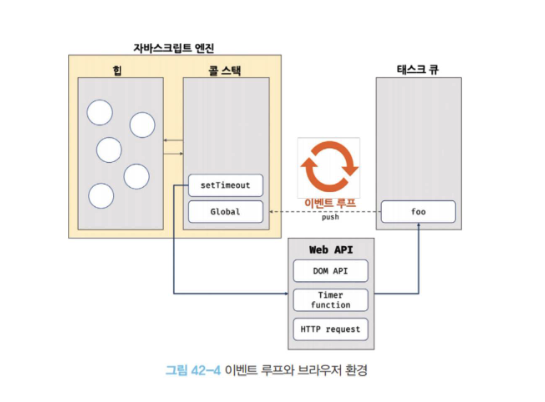

# 41장. 타이머

## 41.1 호출 스케줄링

- 자바스크립트는 타이머를 생성할 수 있는 타이머 함수 setTimeout, setInterval 그리고 타이머를 제거할 수 있는 타이머 함수 clearTimeout, clearInterval을 제공합니다.
- 타이머 함수는 ECMAScript 사양에 정의된 빌트인 함수가 아닙니다.
- 하지만 브라우저 환경과 Node.js 환경에서 모두 전역 객체의 메서드로서 타이머 함수를 제공합니다.
- 즉 타이머 함수는 호스트 객체입니다.

  ##### 다시 기어나온 호스트 객체
  - 호스트 객체는 ECMAScript 사양에는 없고, 자바스크립트를 실행하는 환경이 추가로 제공하는 객체입니다.
  - 어떤 것이 호스트 객체인가?
    - 브라우저가 주는 호스트 객체는 클라이언트 사이드 Web API입니다.
      - DOM: document, Element, Node
      - BOM: window, location, navigator, history
      - 타이머: setTimeout, setInterval
      - 통신: XMLHttpRequest, fetch
      - 저장소: localStorage, sessionStorage
      - 그 밖에도 Canvas, requestAnimationFrame, Web Worker 같은 Web API
    - Node.js에서는 fs, path, process처럼 Node가 자체적으로 제공하는 API가 호스트 쪽에 해당합니다.

  - 자주 헷갈리는 경계는 이렇습니다.
    - Promise, Array, Object, JSON, Math는 표준 빌트인입니다. 비동기와 자주 같이 쓰인다고 해서 Promise가 호스트 객체는 아닙니다.
    - setTimeout, console, fetch, document는 호스트입니다. setTimeout이 브라우저와 Node.js 양쪽에 있어도 ECMAScript 사양의 함수가 아니라, 각 환경이 따로 제공하는 API입니다. 타이머 ID가 브라우저에서는 숫자, Node.js에서는 객체인 것도 이 차이에서 옵니다.

## 41.2 타이머 함수

## 41.3 디바운스와 쓰로틀

- 디바운스와 쓰로틀은 짧은 시간 간격으로 연속해서 발생하는 이벤트를 그룹화해서 과도한 이벤트 핸들러의 호출을 방지하는 프로그래밍 기법 입니다.

### 디바운스

- 디바운스는 짧은 시간 간격으로 발생하는 이벤트를 그룹화해서 마지막에 한 번만 이벤트 핸들러가 호출되도록 합니다.
- debounce는 설정한 delay 시간보다 짧은 간격으로 이벤트가 발생하면 이전 타이머를 취소하고 새로운 타이머를 재설정 합니다.
- 따라서 delay보다 짧은 간격으로 이벤트가 연속해서 발생하면 함수의 콜백 함수는 호출되지 않다가 이후에 한 번만 호출되는 구조입니다.

### 쓰로틀

- 쓰로틀은 짧은 시간 간격으로 이벤트가 연속해서 발생하더라도 일정 시간 간격으로 이벤트 핸들러가 최대 한 번만 호출되도돍 합니다.
- 즉, 쓰로틀은 짧은 시간 간격으로 연속해서 발생하는 이벤트를 그룹화해서 일정 시간 단위로 이벤트 핸들러가 호출되도록 호출 주기를 만듭니다.

---

# 42장. 비동기 프로그래밍

## 42.1 동기 처리와 비동기 처리

- **자바스크립트 엔진은 단 하나의 실행 컨텍스트 스택을 갖습니다**
- 자바스크립트 엔진은 한 번에 하나의 태스크만 실행할 수 있는 싱글 스레드 방식으로 동작합니다.
- 싱글 스레드 방식은 한 번에 하나의 태스크만 실행할 수 있기 때문에 처리에 시간이 걸리는 태스크를 실행하는 경우 **블로킹**이 발생합니다.
- 이처럼 현재 실행중인 태스크가 종료할 때까지 다음에 실행될 태스크가 대기하는 방식을 동기 처리 라고 합니다.
  - 동기 처리 방식은 태스크를 순서대로 하나씩 처리하므로 실행 순서가 보장된다는 장점이 있지만, 앞선 태스크가 종료할 때까지 이후 태스크들이 블로킹되는 단점이 있습니다.
- 그리고 현재 실행 중인 태스크가 종료 되지 않은 상태라 해도 다음 태스크를 곧바로 실행하는 방식을 비동기 처리 라고 합니다.
  - 비동기 처리 방식은 현재 실행중인 태스크가 종료되지 않은 상태라 해도 다음 태스크를 곧바로 실행하므로 블로킹이 발생하지 않는다는 장점이 있지만, 태스크의 실행 순서가 보장되지 않는다는 단점이 있습니다.
- 비동기 처리를 수행하는 비동기 함수는 전통적으로 콜백 패턴을 사용합니다.
  - 비동기 처리를 위한 콜백 패턴은 콜백 헬을 발생시켜 가독성을 나쁘게 하고, 비동기 처리 중 발생한 에러의 예외 처리가 곤란하며, 여러 개의 비공기 처리를 한 번에 처리하는 데도 한계가 있습니다.
- **타이머 함수, HTTP 요청, 이벤트 핸들러는 비동기 처리 방식으로 동작합니다**

## 42.2 이벤트 루프와 태스크 큐

- 이벤트 루프는 브라우저에 내장되어 있는 기능 중 하나입니다.
  
- 구글의 V8 자바스크립트 엔진을 비롯한 대부분의 자바스크립트 엔진은 크게 2개의 영역으로 구분할 수 있습니다.
  - 콜 스택
    : 소스코드 평가 과정에서 생성된 실행 컨텍스트가 추가되고 제거되는 스택 자료구조인 실행 컨텍스트 스택이 바로 콜 스택 입니다.
  - 힙
    : 힙은 객체가 저장되는 메모리 공간입니다.
    콜 스택의 요소인 실행 컨텍스트는 힙에 저장된 객체를 참조합니다.
    메모리에 값을 저장하려면 먼저 값을 저장할 메모리 공간의 크기를 결정해야 합니다.
    객체는 원시 값과는 달리 크기가 정해져 있지 않으므로 할당해야 할 메모리 공간의 크기를 런타임에 결정해야 합니다.
    따라서 객체가 저장되는 메모리 공간인 힘은 구조화 되어 있지 않다는 특징이 있습니다.
- 이처럼 콜 스택과 힙으로 구성되어있는 자바스크립트 엔진은 단순히 태스크가 요청되면 콜 스택을 통해 요청된 작업을 순차적으로 실행할 뿐 입니다.
- **비동기 처리에서 소스코드 평가와 실행을 제외한 모든 처리는 자바스크립트 엔진을 구동하는 환경인 브라우저 또는 Node.js가 담당합니다.**
  > 비동기는 자바스크립트 엔진에서 처리되지 않고 브라우저의 이벤트 루프를 통해 처리되므로 자바스크립트 입장에서는 console 혹은 타이머 함수들이 호스트 객체이었던 거군요
  - 예를 들어 비공기 방식으로 동작하는 setTimeout 의 콜백 함수의 평가와 실행은 자바스크립트 엔진이 담당하지만 호출 스케줄링을 위한 타이머 설정과 콜백 함수의 등록은 브라우저 또는 Node.js가 담당합니다
- 이를 위해 브라우저 환경은 태스크 큐와 이벤트 루프를 제공합니다.
  - 태스크 큐
    : 비동기 함수의 콜백 함수 또는 이벤트 핸들러가 일시적으로 보관되는 영역 입니다.
    태스크 큐와는 별도로 프로미스의 후속 처리 메서드의 콜백 함수가 일시적으로 보관되는 마이크로태스크 큐도 존재합니다
  - 이벤트 루프
    : 이벤트 루프는 콜 스택에 현재 실행중인 실행 컨텍스트가 있는지, 그리고 태스크 큐에 대기중인 함수가 있는지 반복해서 확인합니다.
    만약 콜 스택이 비어있고 태스크 큐에 대기중인 함수가 있다면 이벤트 루프는 순차적으로 태스크 큐에 대기중인 함수를 콜 스택으로 이동시킵니다.
    이때 콜 스택으로 이동한 함수를 실행됩니다.
    즉, 태스크 큐에 일시 보관된 함수들은 비동기 처리 방식으로 동작합니다.
- 예제로 살펴보겠습니다.

  ```js
  function foo() {
    console.log("foo");
  }

  function bar() {
    console.log("bar");
  }

  setTimeout(foo, 0); // 0초(실제는 4ms) 후에 foo 함수가 호출된다.
  bar();
  ```

  1. 전역 코드가 평가되어 전역 실행 컨텍스트가 생성되고 콜 스택에 푸시됩니다.
  2. 전역 코드가 실행되기 시작하여 setTimeout 함수가 호출됩니다.
     이때 setTimeout 함수의 함수 실행 컨텍스트가 생성되고 콜스택에 푸시되어 현재 실행중인 실행 컨텍스트가 됩니다.
     브라우저의 Web API(호스트 객체)인 타이머 함수도 함수이므로 함수 실행 컨텍스트를 생성합니다.
  3. setTimeout 함수가 실행되면 콜백 함수를 호출 스케줄링하고 종료되어 콜 스택에서 팝 됩니다.
     이때 호출 스케줄링, 즉 타이머 설정과 타이머가 만료되면 콜백 함수를 태스크 큐에 푸시하는 것은 브라우저의 역할입니다.
  4. 브라우저가 수행하는 작업과 자바스크립트 엔진이 수행하는 작업은 이때 병렬(병행) 처리됩니다.
     1. 브라우저는 타이머를 설정하고 타이머의 만료를 기다립니다.
        이후 타이머가 만료되면 콜백 함수 foo가 태스크 큐에 푸시됩니다.
        예제의 경우 지연시간이 0 이지만 지연시간이 4ms 이하인 경우 최소 지연 시간 4ms가 지정됩니다.
        **따라서 4ms 후에 콜백 함수 foo가 태스크 큐에 푸시되어 대기하게 됩니다**
        이 처리 또한 자바스크립트 엔진이 아니라 브라우저가 수행합니다.
        이처럼 setTimeout 함수로 호출 스케줄링한 콜백 함수는 정확히 지연 시간 후에 호출된다는 보장은 없습니다.
        지연 시간 이후에 콜백 함수가 태스크 큐에 푸시되어 대기하게 되지만 콜 스택이 비어야 호출되므로 약간의 시간차가 발생할 수 있기 때문입니다.
     2. bar 함수가 호출되어 bar 함수의 함수 실행 컨텍스트가 생성되고 콜 스택에 푸시되어 현재 실행 중인 실행 컨텍스트가 됩니다.
        이후 bar 함수가 종료되어 콜 스택에서 팝 됩니다.
        **이때 브라우저가 타이머를 설정한 후 4ms가 경과했다면 foo 함수는 아직 태스크 큐에서 대기 중 입니다.**
  5. 전역 코드 실행이 종료되고 전역 실행 컨텍스트가 콜 스택에서 팝됩니다.
     이로서 콜 스택에는 아무런 실행 컨텍스트도 존재하지 않게 됩니다.
  6. 이벤트 루프에 의해 콜 스택이 비어 있음이 감지되고 태스크 큐에서 대기 중인 콜백 함수 foo가 이벤트 루프에 의해 콜 스택에 푸시됩니다.
     다시 말해, 콜백 함수 foo의 함수 실행 컨텍스트가 생성되고 콜 스택에 푸시되어 현재 실행중인 실행 컨텍스트가 됩니다.
     이후 foo 함수가 종료되어 콜 스택에서 팝 됩니다.

- 이처럼 **비동기 함수인 setTimeout의 콜백 함수는 태스크 큐에 푸시되어 대기하다가 콜 스택이 비게 되면, 다시 말해 전역 코드 및 명시적으로 호출된 함수가 모두 종료하면 비로소 콜 스택에 푸시되어 실행됩니다**
- **자바스크립트는 싱글 스레드 방식으로 동작합니다**
  - **이때 싱글 스레드 방식으로 동작하는 것은 브라우저가 아니라 브라우저에 내장된 자바스크립트 엔진이라는 것에 주의해야 합니다**
  - **만약 모든 자바크스립트 코드가 자바스크립트 엔진에서 싱글 스레드 방식으로 동작한다면 자바스크립트는 비동기로 동작할 수 없습니다**
  - **즉, 자바스크립트 엔진은 싱글 스레드로 동작하지만 브라우저는 멀티 스레드로 동작합니다**
- 브라우저는 자바스크립트 엔진 외에도 렌더링 엔진과 Web API를 제공합니다.
  - Web API는 ECMAScript 사양에 정의된 함수가 아니라 브라우저에서 제공하는 API이며, DOM API와 타이머 함수, HTTP 요청과 같은 비동기 처리를 포함합니다.
  - 위 예제에서 보았듯 브라우저의 Web API인 setTimeout 함수가 호출되면 자바스크립트 엔진의 콜 스택에 푸시되어 실행됩니다.
- 하지만 setTimeout 함수의 두 가지 기능인 타이머 설정과 타이머가 만료하면 콜백 함수를 태스크 큐에 등록하는 처리는 자바스크립트 엔진이 아니라 브라우저가 실행합니다.
  - 브라우저가 수행하는 4-1 과정과 자바스크립트 엔진이 수행하는 4-2는 벙행 처리됩니다.
  - 이처럼 브라우저와 자바스크립트 엔진이 협력하여 비동기 함수인 setTimeout 함수를 실행합니다.

---

# 추가 정리

## 힙 Heap

- 객체, 배열 등 참조 타입의 데이터가 저장되는 메모리 영역입니다.
  - 참조되는 모든 데이터는 힙에 저장됩니다.
- 동적 메모리 할당을 위해 관리되는 메모리 영역 입니다.
  - 객체 같은 경우는 프로퍼티가 동적으로 변경될 수 있으므로 동적 메모리 할당으로 관리될 필요가 있습니다.
- 스택이랑 비교해보면 조금 더 명확히 확인해보실 수 있습니다.

  ### 힙 vs 스택(Stack) 비교

  | 비교 항목   | 힙 (Heap)                 | 스택 (Stack)          |
  | ----------- | ------------------------- | --------------------- |
  | 할당 방식   | 동적 (런타임 중 결정)     | 정적 (컴파일 시 결정) |
  | 관리 주체   | 개발자/가비지 컬렉터      | 시스템 (자동 관리)    |
  | 접근 속도   | 상대적으로 느림           | 빠름                  |
  | 메모리 크기 | 큰 공간, 유연한 확장      | 제한적, 고정 크기     |
  | 사용 사례   | 객체, 배열, 동적 자료구조 | 지역 변수, 함수 호출  |

### 힙 메모리 관련 주의사항

- 메모리 누수 Memory Leak
  - 힙 메모리 할당 후 해제하지 않으면 메모리를 계속 차지하게 됩니다.
  - 예시로는 자바스크립트에서 불필요한 전역 변수 사용이 있습니다.

    ```js
    function createLeak() {
      globalVar = new Array(100_000_000_000);
    }
    ```

    - 사용도 되지 않고 전역에 대기상태로 GC가 되지 않는 객체

- 단편화 Fragmentation
  - 빈번한 할당 해제로 인해 메모리가 조각나면서 효율성이 떨어질 수 있습니다.
  - 예시로 아주아주 긴 배열 데이터를 다루는 경우
    - 10만명 목록
    - 주식 데이터 등등
    - 등이 있을때 slice 혹은 spread 문법으로 다시 클론 혹은 재할당 하는 경우 (힙메모리가 두배)
    - filter, reducs, reverce, map 함수 등 무의식적으로 사용하는 함수로 인해 빈번한 할당 해제가 이루어지는 경우
  - 이런 경우 할당 해제를 가급적 회피하면서 최적화를 진행
    - 코드 레벨에서 메모리 누수를 관리해보면 좋을거같음 feat. chrome devtools
    - WeakSet, WeakRef, WeakMap, 클로저 등
- 성능 오버헤드
  - 스택보다 할당 혹은 할당 해제 속도가 느립니다.

### 힙의 핵심 특징

- 동적 할당
  - 런타임중에 메모리 크기가 결정
  - 스택과 달리 사용자가 직접 할당 및 할당해제 가능 (GC)
- 생명주기
  - 명시적으로 해제되기 전까지 유지
  - 자바스크립트에서는 GC가 더이상 참조되지 않는 객체를 자동으로 정리합니다.
- 크기 유연성
  - 필요에 따라 메모리를 확장하거나 축소 가능
- 전역 접근 가능
  - 힙에 할당된 데이터를 프로그램의 어디에서나 접근 가능

### 힙메모리 누수의 원인

- 불필요한 전역 변수
- 분리된 DOM 요소 Detached DOM
  ```js
  const element = document.createElement("div");
  document.body.appentChild(element);
  document.body.removeChild(element); // DOM에서 제거됨
  // element 변수가 여전히 참조중이므로 GC되지 않음 -> 메모리 누수
  ```
- 클로저에 갇힌 큰 데이터
  - 클로저도 렉시컬 환경을 참조하기 때문에 GC가 이루어지지 않고 사용 가능하다고 이야기했었죠?
  - 이 경우 WeakMap, WeakSet을 사용 가능하다고 했죠?

    ```js
    const weakMap = new WeakMap();

    function createClosure() {
      const largeObj = {
        /* 큰 객체 */
      };
      const key = {}; // 약한 참조 키

      weakMap.set(key, largeObj);

      return function () {
        const obj = weakMap.get(key);
        console.log(obj.someProperty);
      };
    }
    // 키에 대한 강한 참조가 사라지면 largeObj도 GC 대상이 됨
    ```

- 미해제된 이벤트 리스너/타이머

  ```js
  element.addEventListener("scroll", heavyFunction);
  // 참조 형태로 데이터가 들어가있기 때문에 메모리를 계속 참조하고 있게 됨
  // removeEventListener를 사용해주어야 메모리 누수를 방지할 수 있음

  const timer = setInterval(() => {}, 1000);
  // clearInterval 이 없을 경우 누수 발생
  ```

## 이벤트 루프

- 스택, 힙, 이벤트 루프
- 자바스크립트 3요소 입니다 그냥 외우세요
- 이벤트 루프 안에 들어간 것들
  - 콜스택, 힙, 마이크로태스트큐, 매크로태스크큐, 브라우저 렌더링 파이프라인

### 태스크 큐

- 다른 말로 매크로태스크큐 라고 합니다.
- 타이머 함수, DOM, 이벤트핸들러, HTTP 요청 등의 콜백이 대기하게 됩니다.

### 마이크로태스크큐

- Promise, queueMicrotask, MutationObserver 콜백이 대기합니다.
- **매크로태스크큐보다 우선순위가 높습니다**
- 함수의 호출 순서에 따라 실행되는 콜 스택과는 달리 타이머함수와 프로미스 동작을 하는 로직이 있다면 그리고 프로미스 동작이 더 늦게 호출된다 해도 반드시 프로미스의 동작이 먼저 실행되게 됩니다.
  - [태스크 실행] → [마이크로태스크 전부 비움] → [rAF 콜백들] → [스타일→레이아웃→페인트] -> [한개의 매크로태스크큐만 실행]
  - CSS 계산, 레이아웃, 페인팅 작업이 마이크로태스크큐 이후, 매크로태스크큐 이전에 실행됩니다.

  ```js
  console.log("Start");

  setTimeout(() => console.log("Timeout"), 0);

  Promise.resolve()
    .then(() => console.log("Promise 1"))
    .then(() => console.log("Promise 2"));

  console.log("End");
  ```

---

# 43장. Ajax

## 43.1 Ajax란?

> Ajax: Asynchronous JavaScript And XML

- Ajax란 자바스크립트를 사용하여 브라우저가 서버에게 비동기 방식으로 데이터를 요청하고, 서버가 응답한 데이터를 수신하여 웹페이지를 동적으로 갱신하는 프로그래밍 방식을 이야기합니다.
- Ajax는 브라우저에서 제공하는 Web API인 XMLHttpRequest 객체를 기반으로 동작합니다.
  - XMLHttpRequest 는 HTTP 비동기 통신을 위한 메서드와 프로퍼티를 제공합니다.
- Ajax 등장 이전의 전통적인 방식은 아래와 같은 단점이 있었습니다.
  1. 이전 웹페이지와 차이가 없어서 변경할 필요가 없는 부분까지 포함된 완전한 HTML을 서버로부터 매번 다시 전송받기 때문에 불필요한 데이터 통신이 발생했습니다.
  2. 변경할 필요가 없는 부분까지 처음부터 다시 렌더링 합니다. 이로 인해 화면 전환이 일어나면 순간적으로 깜빡이는 현상이 발생합니다.
  3. 클라이언트와 서버와의 통신이 동기 방식으로 동작하기 때문에 서버로부터 응답이 있을때까지 다음 처리는 블로킹 됩니다.
- Ajax의 등장은 이전의 전통적인 패러타임을 획기적으로 전환했습니다.
  - 즉, 서버로부터 웹페이지의 변경에 필요한 데이터만 비동기 방식으로 전송받아 웹페이지를 변경할 필요가 없는 부분은 다시 렌더링하지 않고, 변경할 필요가 있는 부분만 한정적으로 렌더링하는 방식이 가능해진 것 입니다.
  - 이를 통해 브라우저에서도 데스크톱 애플리케이션과 유사한 빠른 퍼포먼스와 부드러운 화면 전환이 가능해졌습니다.
- Ajax는 전통적인 방식과 비교했을 때 아래와 같은 장점이 있습니다.
  1. 변경할 부분을 갱신하는 데 필요한 데이터만 서버로부터 전송받기 때문에 불필요한 데이터 통신이 발생하지 않습니다.
  2. 변경할 필요가 없는 부분은 다시 렌더링하지 않습니다. 따라서 화면이 순간적으로 깜박이는 현상이 발생하지 않습니다.
  3. 클라이언트와 서버와의 통신이 비동기 방식으로 동작하기 때문에 서버에게 요청을 보낸 이후 블로킹이 발생하지 않습니다.

## 43.2 JSON

> how is json?

> JavaScript Object Notation

- JSON은 클라이언트와 서버 간의 HTTP 통신을 위한 텍스트 데이터 포멧 입니다.
- 자바스크립트에 종속되지 않는 언어 독립형 데이터 포멧으로, 대부분의 프로그래밍 언어에서 사용할 수 있습니다.

## 43.3 XMLHttpRequest

- 브라우저는 주소창이나 HTML의 form 태그 또는 a 태그를 통해 HTTP 요청 전송 기능을 기본 제공합니다.
- 자바스크립트를 사용하여 HTTP 요청을 전송하려면 XMLHttpRequest 객체를 사용합니다.
- Web API인 XMLHttpRequest 객체는 HTTP 요청 전송과 HTTP 응답 수신을 위한 다양한 메서드와 프러퍼티를 제공합니다.

---

# 44장. REST API

- REST는 HTTP의 장점을 최대한 활용할 수 있는 아키텍처로 HTTP 프로토콜을 의도에 맞게 디자인하도록 유도하고 있습니다.
- REST의 기본 원칙을 성실히 지킨 서비스 디자인을 "RESTful" 이라고 표현합니다.
- 즉, REST는 HTTP를 기반으로 한 클라이언트가 서버의 리소스에 접근하는 방식을 규정한 아키텍처이고, REST API는 REST를 기반으로 서비스 API를 구현한 것을 의미합니다

## 44.1 REST API의 구성

- REST API는 자원, 행위, 표현의 3가지 요소로 구성됩니다.
  - 자원 resource
  - 행위 verb
  - 표현 representations
- REST는 자체 표현 구조로 구성되어 REST API만으로 HTTP 요청의 내용을 이해할 수 있습니다.
  

## 44.2 REST API 설계 원칙

- REST에서 가장 중요한 기본적인 원칙은 두 가지 입니다.
- **URI는 리소스를 표현**하는데 집중하고 **행위에 대한 정의는 HTTP 요청 메서드**를 통해 하는 것이 RESTful API를 설계하는 중심 규칙 입니다

#### URI는 리소스를 표현해야 합니다

- URI는 리소스를 표현하는데 중점을 두어야 합니다.
- 리소스를 식별할 수 있는 이름은 동사보다는 명사를 사용합니다.
- 따라서 이름에 get 같은 행위에 대한 표현이 들어가서는 안됩니다.

#### 리소스에 대한 행위는 HTTP 요청 메서드로 표현 합니다

- HTTP 요청 메서드는 클라이언트가 서버에게 요청의 종류와 목적(리소스에 대한 행위)을 알리는 방법 입니다.
- 주로 5가지 요청 메서드를 사용하여 CRUD를 구현합니다.
  - GET, POST, PUT, PATCH, DELETE 등
- 리소스에 대한 행위는 HTTP 요청 메서드를 통해 표현하며 URI에 표현하지 않습니다.

> REST API에 대한 설계 원칙만 알고 넘어가면 될듯한 챕터였습니다.

---

# 45장. 프로미스

- ES6에서는 비동기 처리를 위한 또 다른 패턴으로 프로미스를 도입했습니다
- 프로미스는 전통적인 콜백 패턴이 가진 단점을 보완하며 비동기 처리 시점을 명확하게 표현할 수 있다는 장점이 있습니다.

## 45.1 비동기 처리를 위한 콜백 패턴의 단점

### 45.1.1 콜백헬

- **비동기 함수를 호출하면 함수 내부의 비동기로 동작하는 코드가 완료되지 않았다고 해도 기다리지 않고 즉시 종료가 됩니다.**
  - **즉, 비동기 함수 내부의 비동기로 동작하는 코드는 비동기 함수가 종료된 이후에 완료됩니다**
  - **따라서 비동기 함수 내부의 비동기로 동작하는 코드에서 처리 결과를 외부로 반환하거나 상위 스코프의 변수에 할당하면 기대한 대로 동작하지 않습니다**
- 예시를 조금 더 이야기해보겠습니다.
  - setTimeout 함수는 비동기 함수 입니다.
  - setTimeout 함수가 비동기 함수인 이유는 콜백 함수의 호출이 비동기로 동작하기 때문입니다.
  - setTimeout 함수를 호출하면 콜백 함수를 호출 스케줄링한 다음, 타이머 id를 반환하고 즉시 종료됩니다.
  - 즉, 비동기 함수인 setTimeout 함수의 콜백 함수는 setTimeout 함수가 종료된 이후에 호출됩니다.
  - 따라서 setTimeout 함수 내부의 콜백 함수에서 처리 결과를 외부로 반환하거나 상위 스코프의 변수에 할당하면 기대한 대로 동작하지 않습니다.
- GET 요청을 전송하고 서버의 응답을 전달받는 get 함수도 비동기 함수입니다.
  - get 함수가 비동기 함수인 이유는 get 함수 내부의 **onload 이벤트 핸들러가 비동기로 동작하기 때문입니다**
  - get 함수를 호출하면 GET 요청을 전송하고 onload 이벤트 핸들러를 등록한 다음 undefined를 반환하고 즉시 종료됩니다.
  - 즉, 비동기 함수인 get 함수 내부의 onload 이벤트 핸들러는 get 함수가 종료된 이후에 실행됩니다.
  - 따라서 get 함수의 onload 이벤트 핸들러에서 서버의 응답 결과를 반환하거나 상위 스코프의 변수에 할당하면 기대한 대로 동작하지 않습니다.
- 예시 코드

  ```js
  let post;

  function loadPost() {
    fetch("https://jsonplaceholder.typicode.com/posts/1")
      .then((res) => res.json())
      .then((data) => {
        post = data; // 3. 응답이 도착한 뒤에야 할당된다
        console.log("응답 도착", post.id);
      });
    // 1. 여기서 함수는 이미 끝난다. fetch는 아직 진행 중이다
  }

  loadPost();
  console.log("호출 직후", post); // 2. undefined
  ```

  ```js
  function loadPost() {
    let result;

    fetch("https://jsonplaceholder.typicode.com/posts/1")
      .then((res) => res.json())
      .then((data) => {
        result = data;
      });

    return result; // data가 들어오기 전에 실행되므로 undefined
  }

  const post = loadPost();
  console.log(post); // undefined
  ```

#### 그렇다면 어떻게?

- 서버로부터 응답이 도착하면 xhr 객체에서 load 이벤트가 발생합니다.
  - 이때 **xhr.onload 핸들러 프로퍼티에 바인딩한 이벤트 핸들러가 즉시 실행되는 것이 아닙니다.**
  - **xhr.onload 이벤드 핸들러는 load 이벤트가 발생하면 일단 태스크 큐에 저장되어 대기하다가, 콜 스택이 비면 이벤트 루프에 의해 콜 스택으로 푸시되어 실행됩니다.**
  - 이벤트 핸들러도 함수이브로 이벤트 핸들러의 평가 -> 이벤트 핸들러의 실행 컨텍스트 생성 -> 콜스택에 푸시 -> 이벤트 핸들러 실행과정을 거치게 됩니다.
- 따라서 xhr.onload 이벤트 핸들러가 실행되는 시점에는 콜 스택이 빈 상태이어야 하므로 실행 컨텍스트에 있는 동기 실행 로직들은 이미 종료된 이후 입니다.
- **이처럼 비동기 함수는 비동기 처리 결과를 외부에 반환할 수 없고, 상위 스코프의 변수에 할당할 수도 없습니다**
  - **따라서 비동기 함수의 처리 결과에 대한 후속 처리는 비동기 함수 내부에서 수행해야 합니다**
  - **이때 비동기 함수를 범용적으로 사용하기 위해 비동기 함수에 비동기 처리 결과에 대한 후속 처리를 수행하는 콜백 함수를 전달하는 것이 일반적 입니다**
  - **필요에 따라 비동기 처리가 성공하면 호출될 콜백 함수와 비동기 처리가 실패하면 호출될 콜백 함수를 전달할 수 있습니다**
- 그리고 이처럼 콜백 함수를 통해 비동기 처리 결과를 하면서 또다시 비동기 함수를 호출해야 하는 상황에 콜백 함수 호출이 중첩되어 복잡도가 높아지는 현상을 콜백 헬 이라 합니다

> 비동기 함수의 처리 결과에 대한 후속 처리는 비동기 함수 내부에서 수행해야 합니다. 왜? 비동기 함수가 태스크큐에서 콜 스택으로 이동되어 실행되는 시점에는 콜 스택이 빈 상태이어야 하므로 동기 실행 로직은 이미 종료된 이후이기 때문 입니다\*\*

### 45.1.2 에러 처리의 한계

- 비동기 처리를 위한 콜백 패턴의 문제점 중에서 가장 심각한 것은 에러 처리가 곤란하다는 것 입니다.
- **에러는 호출자 방향으로 전파됩니다**
- 즉, 콜 스택의 아래 방향(실행중인 실행 컨텍스트가 푸시되기 직전에 푸시된 실행 컨텍스트 방향)으로 전파됩니다.

  ```js
  try {
    setTimeout(() => {
      throw new Error("이용훈 바보!");
    }, 1000);
  } catch (e) {
    console.log(e);
  }
  ```

  - setTimeout 함수의 콜백 함수를 호출하는 것은 setTimeout 함수가 아닙니다.
  - 따라서 setTimeout 함수의 콜백 함수가 발생시킨 에러는 catch 블록에서 캐치되지 않습니다.

## 45.2 프로미스의 생성

- ES6에서 도입된 Promise는 ECMAScript 사양에 정의된 표준 빌트인 객체 입니다.
- Promise 생성자 함수는 비동기 처리를 수행할 콜백 함수를 인수로 전달받는데 이 콜백 함수는 resolee와 reject 함수를 인수로 전달받습니다.
- 3가지 상태를 가지며 반드시 성공 실패 중 하나돌 settled 됩니다.
- **프로미스는 비동기 처리 상태와 처리 결과를 관리하는 객체 입니다**

## 45.3 프로미스의 후속 처리 메서드

- **프로미스의 비동기 처리 상태가 변화하면 후속 처리 메서드에 인수로 전달한 콜백 함수가 선택적으로 호출됩니다**
  - 이때 후속 처리 메서드의 콜백 함수에 프로미스의 처리 결과가 인수로 전달됩니다.
  - 모든 후속 처리 메서드는 프로미스를 반환하며, 비동기로 동작합니다

#### Promise.prototype.then

- 첫 번째 콜백 함수는 비동기 처리 성공 시 호출되는 성공 처리 콜백 함수이며, 두 번째 콜백 함수는 비동기 처리가 실패했을 때 호출되는 실패 처리 콜백 함수 입니다.

  ```js
  // fulfilled
  new Promise((resolve) => resolve("fulfilled")).then(
    (v) => console.log(v),
    (e) => console.error(e),
  ); // fulfilled

  // rejected
  new Promise((_, reject) => reject(new Error("rejected"))).then(
    (v) => console.log(v),
    (e) => console.error(e),
  ); // Error: rejected
  ```

  - then 메서드는 언제나 프로미스를 반환합니다
  - 만약 then 메서드의 콜백 함수가 프로미스를 반환하면 그 프로미스를 그대로 반환하고, 콜백 함수가 프로미스가 아닌 값을 반환하면 그 값을 암묵적으로 resolve 또는 reject 하여 프로미스를 생성하여 반환합니다

#### Promise.prototype.catch

- catch 메서드는 한 개의 콜백 함수를 인수로 전달받습니다.
- catch 메서드의 콜백 함수는 프로미스가 rejected 상태인 경우에만 호출됩니다.
- then 메서드와 마찬가지로 언제나 프로미스를 반환합니다.

#### Promise.prototype.finally

- finally 메서드는 한 개의 콜백 함수를 인수로 전달받습니다.
- finally 메서드의 콜백 함수는 프로미스의 성공 또는 실패와는 상관없이 무조건 한번 호출됩니다.
- finally 메서드도 언제나 프로미스를 반환합니다.

## 45.4 프로미스의 에러처리

## 45.5 프로미스의 체이닝

## 45.6 프로미스의 정적 메서드

#### Promise.resolve / Promise.reject

#### Promise.all

- 여러개의 비동기를 병렬 처리할 때 사용합니다.
- Promise.all 메서드는 프로미스를 요소로 갖는 배열 등의 이터러블을 인수로 전달받습니다.
- 그리고 전달받은 모든 프로미스가 모두 fulfilled 상태가 되면 모든 처리 결과를 배열에 저장하여 새로운 프로미스를 반환합니다.
- 그리고 인수로 전달받은 배열의 모든 프로미스가 모두 fulfilled 상태가 되면 종료합니다.
- 처리 순서 또한 보장됩니다.
- Promise.all 메서드는 인수로 전달받은 배열의 프로미스가 하나라도 rejected 상태가 되면 나머지 프로미스가 fulfilled 상태가 되는 것을 기다리지 않고 즉시 종료합니다.
- 인수로 전달받은 이터러블의 요소가 프로미스가 아닌 경우 Promise.resolve 메서드를 통해 프로미스로 래핑합니다.

#### Promise.race

#### Promise.allSettled

- 전달받은 프로미스가 모두 settled 상태가 되면 처리 결과를 배열로 반환합니다.

## 45.7 마이크로태스크 큐

- **마이크로태스크 큐는 매크로태스크 큐보다 우선순위가 높습니다**

## 45.8 fetch

- fetch 함수는 XMLHttpRequest 객체와 마찬가지로 HTTP 요청 전송 기능을 제공하는 클라이언트 사이드 Web API 입니다.
- fetch 함수는 XMLHttpRequest 객체보다 사용법이 간단하고 프로미스를 지원하기 때문에 비동기 처리를 위한 콜백 패턴의 단점에서 자유롭습니다.
- **fetch 함수는 HTTP 응답을 나타내는 Response 객체를 래핑한 Promise 객체를 반환합니다.**
- fetch 함수는 HTTP 응답을 나타내는 Response 객체를 래핑한 프로미스를 반환하므로 후속 처리 메서드 then을 통해 프로미스가 resolve 한 Response 객체를 전달받을 수 있으며 Response 객체는 HTTP 응답을 나타내는 다양한 프로퍼티를 제공합니다.
- **fetch 함수가 반환하는 프로미스는 기본적으로 HTTP 에러가 발생해도 에러를 reject 하지 않고 불리언 타입의 ok 상태를 false로 설정한 Response 객체를 resolve 합니다.**
  - **오프라인 등의 네트워크 장애나 CORS 에러에 의해 요청이 완료되지 못한 경우에만 프로미스를 reject 합니다**

---

# 추가 정리

## 콜백과 Promise

- 콜백은 함수를 인자로 전달하는 전통적인 비동기 방식
- Promise는 비동기 상태를 객체로 관리하는 방식

### 그런데 비동기란 뭘까...?

- 비동기는 코드의 실행이 순차적으로 진행되지 않고, 작업이 완료되는 것을 기다리지 않고 다음 작업을 수행하는 방식을 의미 합니다
- 동시에 여러 작업을 처리하거나 기다리는 시간을 효율적으로 활용 하는것이 핵심 입니다.

### 콜백

- 함수의 인자로 전달되는 함수 입니다.
- Promise가 나오기 전에는 비동기 처리는 항상 콜백 지옥이었음

### Promise의 탄생

- ES6 표준에서 Promise가 도입되었습니다. 그전에는 콜백 지옥으로 코드를 쓰는 경우가 많았음
- 객체 설명은 책에서 이미 진행했으므로 패스.

### Promise의 비동기 제어 패턴

#### Promise.all

- Promise.all은 프론트엔드에서 사용하기엔 리스크가 있는 비동기 제어 패턴 일수도 있습니다
- 이터러블 안에서 pending, 하나만 예외가 발생하는 등 발생할 수 있는 다른 상태에 대하여 제어하기가 많이 어렵습니다.
- 이미지 업로드를 하는 경우를 가정해보겠습니다.
  - 여러 이미지가 업로드 되는 경우 Promise.all을 사용한 경우?
  - 이터러블 안에서 이미지 업로드가 실패한 경우?
    - 예외처리가 안되어있어 이미지 업로드가 재시도 된 경우?
    - 저장에 성공한 이미지만 계속 서버에 고아 데이터로 업로드가 진행될 수 있는 시나리오
- 비동기 요청이 하나라도 실패하면 전체가 실패로 잡혀버리니까 리스크가 있다~

#### Promise.allSettled

- 비교적 최신 스펙입니다 ES2020
- 모든 프로미스가 완료될 때까지 기다렸다가 각 프로미스의 결과를 배열로 반환합니다.
- Promise.all 보다는 이걸 사용하는게 더 정교하게 비동기 관리를 할 수 있습니다.

  ```js
  const promises = [
    Promise.resolve("성공"),
    Promise.reject("실패"),
    Promise.resolve("또 다른 성공"),
  ];

  Promise.allSettled(promises).then((results) => {
    results.forEach((result) => {
      if (result.status === "fulfilled") {
        console.log("성공:", result.value);
      } else {
        console.log("실패:", result.reason);
      }
    });
  });
  ```

#### Promise.race

- 비동기의 경쟁처리로 가장 먼저 성공하는 비동기만 취급
- 동일한 요청에서 2개 이상의 소스에서 보낼때 사용하면 좋습니다!!!

##### 근데... 만약 race에서 첫번째 요청은 완료되었으나 이어서 진행되는 요청에서 에러가 발생했다면 catch가 발생하나요?

- 나머지 프로미스의 응답 결과 자체가 무시됩니다.
- Promise.race 의 대표적인 예시
  - 선배님들은 race를 이런식으로 활용해왔습니다~

    ```js
    function fetchWithTimeout(url, options = {}, timeout = 5000) {
      // API 호출 프로미스
      const fetchPromise = fetch(url, options).then((response) => {
        if (!response.ok) {
          throw new Error(`HTTP error! status: ${response.status}`);
        }
        return response.json();
      });

      // 타임아웃 프로미스
      const timeoutPromise = new Promise((_, reject) => {
        setTimeout(() => {
          reject(new Error(`Request timed out after ${timeout}ms`));
        }, timeout);
      });

      // 둘 중 먼저 완료되는 것 사용
      return Promise.race([fetchPromise, timeoutPromise]);
    }
    ```

    - API가 무한 pending 상태가 되는 경우
    - Promise는 pending에 대한 상태를 관리할 수 없습니다.
    - 이때 적용 가능한 방법이 race 안에 timeout 프로세스를 함께 경쟁시키는것

- 예시와 같이 모든 형태의 비동기 요청에 타임아웃과 같은 로직을 주입하고 싶다면 race를 사용하면 됩니다.

##### timeout과 함께 사용할 수 있는 AbortController 활용하기

- AbortController의 핵심 목적은 웹 요청을 클라이언트에서 취소하는 것입니다.
- AbortController 인터페이스는 하나 이상의 웹 요청을 취소할 수 있게 해준다. feat MDN
  - AbortSignal 객체를 사용해 DOM 요청과의 통신이 완료된다.
  - 참고 : `abort()`가 호출되면, `fetch()` promise는 `AbortError`으로 명명된 `DOMException`과 함께 reject된다.
    > [AbortController - MDN](https://developer.mozilla.org/ko/docs/Web/API/AbortController)

```js
function fetchWithAbortTimeout(url, options = {}, timeout = 5000) {
  const controller = new AbortController();
  const { signal } = controller;

  // API 호출 프로미스
  const fetchPromise = fetch(url, { ...options, signal })
    .then((response) => {
      if (!response.ok) {
        throw new Error(`HTTP error! status: ${response.status}`);
      }
      return response.json();
    })
    .catch((error) => {
      if (error.name === "AbortError") {
        throw new Error(`Request aborted after ${timeout}ms`);
      }
      throw error;
    });

  // 타임아웃 프로미스
  const timeoutPromise = new Promise((_, reject) => {
    setTimeout(() => {
      controller.abort();
      reject(new Error(`Request timed out after ${timeout}ms`));
    }, timeout);
  });

  return Promise.race([fetchPromise, timeoutPromise]);
}
```

```ts
export const linkQueries = {
  keys: linkKeys,
  // 저장 전 OG 메타데이터. LinkPreviewCard 가 useSuspenseQuery 로 소비.
  preview: (url: string) =>
    queryOptions({
      queryKey: linkKeys.preview(url),
      queryFn: async ({ signal }) => {
        const { data } = await apiClient.get<SuccessResponse<LinkPreview>>(
          "/links/preview",
          { params: { url }, signal },
        );

        return data.data;
      },
    }),
  // 단일 페이지 조회 — 홈 섹션처럼 상위 N개만 보여주는 곳이 쓴다. 목록 화면은 infiniteList.
  list: (params: LinkListParams = {}) =>
    queryOptions({
      queryKey: linkKeys.list(params),
      // 캐시에는 검증된 서버 응답을 그대로 두고, UI 모델 변환은 select 가 맡는다.
      queryFn: async ({ signal }) => {
        const { data } = await apiClient.get<SuccessResponse<unknown>>(
          "/links",
          { params, signal },
        );

        return linkListResponseSchema.parse(data.data);
      },
      select: selectLinks,
    }),
  // 목록 화면(폴더 상세·전체·최근 삭제)용 커서 페이지네이션 —
  // 서버 기본 limit(9)은 홈 섹션용이라 목록은 최대치(30)로 당긴다.
  infiniteList: (params: LinkListParams) =>
    infiniteQueryOptions({
      queryKey: linkKeys.infiniteList(params),
      queryFn: async ({ pageParam, signal }) => {
        const { data } = await apiClient.get<SuccessResponse<unknown>>(
          "/links",
          {
            params: {
              ...params,
              limit: LIST_PAGE_LIMIT,
              cursor: pageParam || undefined,
            },
            signal,
          },
        );

        return linkListResponseSchema.parse(data.data);
      },
      initialPageParam: "",
      getNextPageParam: (lastPage) =>
        lastPage.pagination.hasNext
          ? (lastPage.pagination.nextCursor ?? undefined)
          : undefined,
      select: selectLinkPages,
    }),
  // 링크 상세. queryFn 이 서버 응답을 검증·매핑해 UI LinkDetail 을 반환한다.
  detail: (linkId: string) =>
    queryOptions({
      queryKey: linkKeys.detail(linkId),
      queryFn: async ({ signal }) => {
        const { data } = await apiClient.get<SuccessResponse<unknown>>(
          `/links/${linkId}`,
          { signal },
        );

        return toLinkDetail(linkDetailResponseSchema.parse(data.data));
      },
    }),
};
```

- 프론트엔드 과제 코드 평가 시 반드시 들어가는 것
  1. request 반드시 들어감.
  2. global state 관리하는 것.
  3. props drilling 등 depth 관리
- 상식적으로 fetching에는 지원자들의 차이가 크게 없다.
  - tanstack query 쓰는거 어려움? ㄴㄴ
  - 그럼 이것보다 나은걸 보여줄 수 있어야 함
  - error 등 edge case 등을 제어하는 경우를 보여주어야 함
  - 이때 사용 가능한 것 AbortController 등등이 있습니다

#### Promise.any

- 주어진 Promise 중 하나라도 성공하면 즉시 반환하며 모두 실패하는 경우에만 reject
- 뭐라도 하나만 성공하면 되는 상황에서 사용
- 다양한 시도를 통해 하나만 실행하면 되는 시나리오에서 사용합니다
  1. 다중 CDN 주소에 대해서 리소스를 호출하는 경우
     - edge location을 통해 정적 자원들에 대하여 접근하는 경우
  2. 사용자 위치 정보 획득
     - 브라우저의 Geolocation API 획득
     - IP 기반 위치 획득
     - 사용자 설정 위치
  3. 실시간 데이터 소스 연결
     - 웹소켓
     - SSE
     - HTTP 폴링
- 병렬처리 Promise에서는 앞선 요청이 완료되었더라도 이후 요청이 계속 유지되므로 불필요한 요청을 중단 처리해주어야 합니다.
- 이 경우에도 AbortController로 최적화를 해주어야 한다~

#### Promise.withResolver

- 가장 최신 스펙입니다 ES2024
- 기존의 Promise는 언제나 인자로 성공과 실패에 대한 콜백 함수를 주입 받았습니다.
  - 그리고 항상 콜백을 주입받는 형태로만 코드가 짜여져 왔습니다.
- 만약 콜백함수가 다른 함수 등에서 관리되면 좋을거같은 상황이 있다면?
  - let 키워드로 성공과 실패에 대한 함수를 할당해서 사용되어 왔음
- 이런 패턴이 개선되어 나온 함수가 Promise.withResolvers 임

```js
const { promise, resolve, reject } = Promise.withResolvers();

// 나중에 resolve/reject 호출 가능
setTimeout(() => resolve("완료!"), 1000);

promise.then((result) => console.log(result));
```

- 외부에서 resolve/reject 를 제어해야 할 때 유용
- 기존 new Promise() 패턴의 대안
