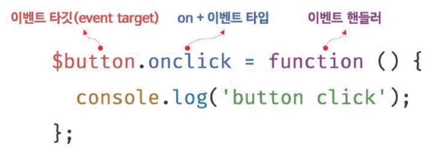
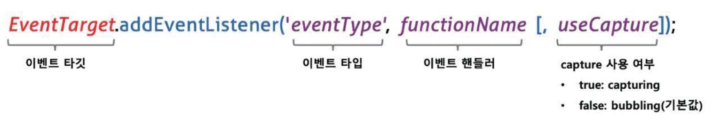
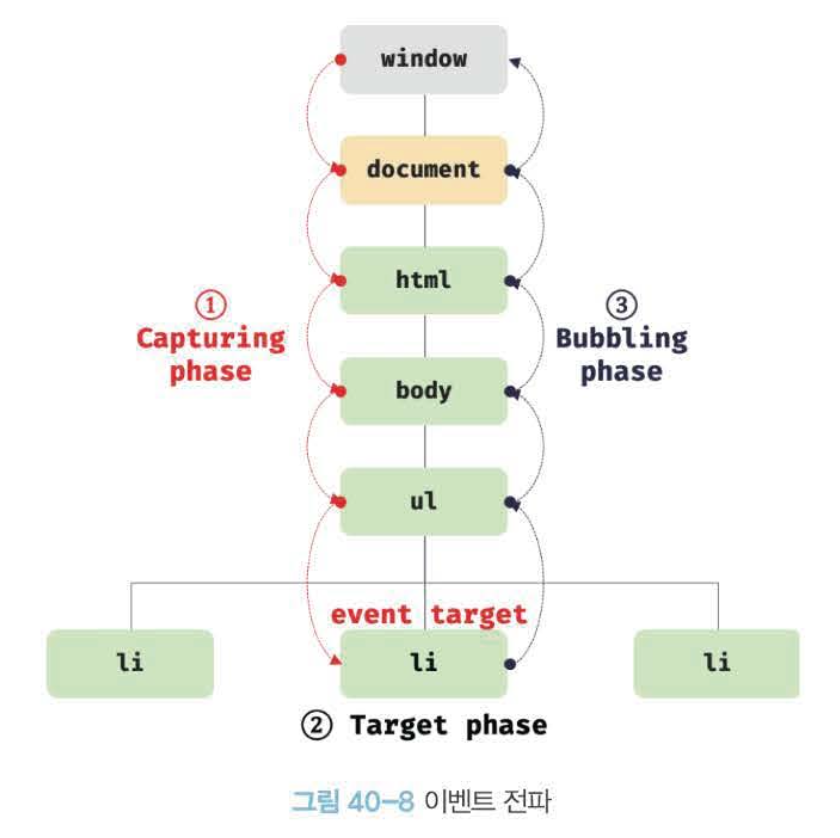
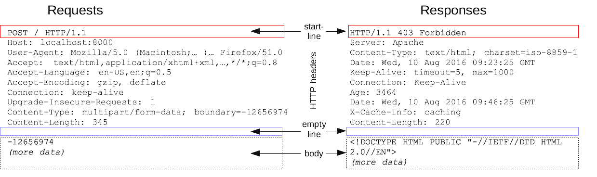
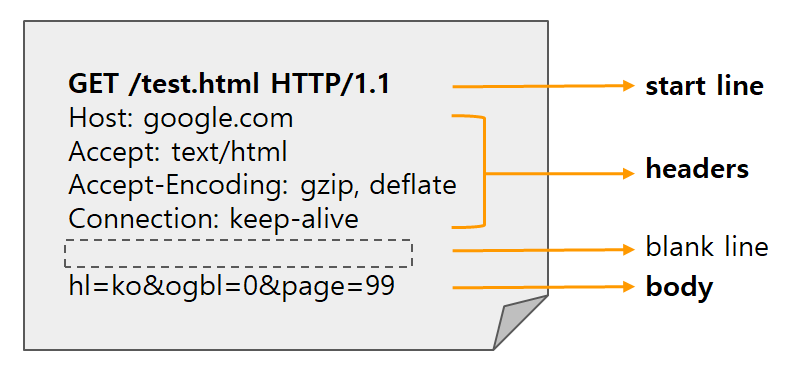

# 38ch 브라우저 렌더링 - React는 왜 존재할까?

38장을 React 관점으로 읽으면 완전히 다른 장이 됨!

```plain text
HTML 파싱 → DOM
CSS 파싱  → CSSOM
              ↓
         렌더 트리
              ↓
     레이아웃 (리플로우)   ← 위치·크기 계산. 비쌈
              ↓
       페인트 (리페인트)    ← 픽셀 칠하기
```

### 🔥 Virtual DOM은 정말 빠를까?

```javascript
// DOM을 직접 1000번 건드리면 → 리플로우 위험
for (let i = 0; i < 1000; i++) list.appendChild(item);
```

- 리플로우가 비싸다는 게 React가 Virtual DOM을 만든 출발점
- 변경을 모아서 한 번에 반영하자!

> 💡 그런데 Svelte 만든 Rich Harris는 "Virtual DOM is pure overhead"라는 글을 씀
>
> - 잘 짠 직접 조작보다 **빠를 수는 없음** (비교 작업이 하나 더 추가되니까)
> - Virtual DOM의 진짜 가치는 "개발자가 신경 안 써도 적당히 빠르게" + 선언적 코드
>
> → 즉 **속도가 아니라 생산성의 기술**에 가까움

### 🔥 CSR 첫 화면은 왜 하얄까?

```html
<!-- Vite로 만든 React 앱의 index.html -->
<body>
  <div id="root"></div>   <!-- 이게 전부 -->
  <script type="module" src="/main.jsx"></script>
</body>
```

38장 흐름대로 따라가보면

```plain text
① HTML 받음 → <div id="root"></div>  ← 빈 화면
② JS 다운로드 대기 ...
③ JS 파싱·실행 ...
④ React가 DOM 생성
⑤ 그제야 화면 표시
```

- ①~④ 동안 하얀 화면 → 이게 **Next.js(SSR)가 존재하는 이유** 중 하나
- 서버에서 HTML을 완성해서 보내면 ①에서 바로 내용이 보임
- SSR을 "SEO 때문"이라고만 알았는데, 38장 관점에선 **첫 렌더링까지의 시간** 문제이기도 함

### 🔥 애니메이션에 top 쓰면 안 되는 이유

```css
.box { transition: top 0.3s; }        /* ❌ 매 프레임 리플로우 */
.box { transition: transform 0.3s; }  /* ✅ 레이아웃을 다시 안 함 */
```

- top, left, width 변경 → 레이아웃부터 다시 (리플로우 + 리페인트)
- transform, opacity 변경 → 레이아웃을 건너뛰고 합성(composite) 위주로 처리
- 38.7 리플로우/리페인트를 알면 왜 transform을 쓰라는지 이유가 보임

---

### 여기서 알아두면 좋을 것들

- 스프레드는 **얕은 복사** → 중첩된 객체는 바뀌는 경로마다 펼쳐야 함
- Set, Map도 결국 객체 → `add`, `set`, `delete`는 원본을 바꾸는 mutator
- React는 **주소만 비교**함 → 새 객체·새 배열·새 Set을 만들어야 리렌더
- Map, Set은 JSON 직렬화가 안 됨
- 디스트럭처링 기본값은 undefined일 때만 → null 대비는 `??`
- `type="module"` 스크립트는 defer처럼 동작

# 39ch DOM

- **`DOM`**(Document Object Model)은 HTML 문서의 계층적 구조와 정보를 표현하며 이를 제어할 수 있는 API, 즉 프로퍼티와 메서드를 제공하는 트리 자료구조

## 📚 노드

- HTML 요소는 HTML 문서를 구성하는 개별적인 요소를 의미
- HTML 요소는 렌더링 엔진에 의해 파싱되어 DOM을 구성하는 요소 노드 객체로 변환됨
- 이때, HTML 요소의 어트리뷰트는 어트리뷰트 노드로, HTML 요소의 텍스트 콘텐츠는 텍스트 노드로 변환됨
- HTML 문서는 HTML 요소들의 집합으로 이뤄지며, HTML 요소는 **중첩 관계**를 가짐<br>⇒ HTML 요소의 콘텐츠 영역(시작 태그와 종료 태그 사이)에는 텍스트뿐만 아니라 다른 HTML 요소도 포함할 수 있음
- HTML 요소 간에 중첩 관계에 의해 계층적인 부자 관계가 형성됨
- HTML 요소를 객체화한 모든 노드 객체들을 트리 자료 구조로 구성함
- **`트리 자료구조`**
  - 노드들의 계층 구조로 이뤄지며, 즉 부모 노드와 자식 노드로 구성되어 노드 간의 계층적 구조를 표현하는 비선형 자료구조를 의미
  - 트리 자료구조는 하나의 최상위 노드에서 시작함
  - **최상위 노드**는 부모 노드가 없으며, **루트 노드**라 함
  - 루트 노드는 0개 이상의 자식 노드를 가짐
  - 자식 노드가 없는 노드를 **리프 노드**라 함
- 노드 객체들로 구성된 트리 자료구조를 DOM(Document Object Model)이라 함

### 노드 객체의 타입

- DOM은 노드 객체의 계층적인 구조로 구성됨
- 노드 객체는 종류가 있고 **상속 구조**를 가짐
- 노드 객체는 총 12개의 종류가 있으며 중요한 노드 타입은 아래의 4가지와 같음
  - **`문서 노드(document node)`**
    - DOM 트리의 최상위에 존재하는 루트 노드로서 **`document` 객체를 가리킴**
    - document 객체는 브라우저가 렌더링한 HTML 문서 전체를 가리키는 객체로서 전역 객체 `window`의 document 프로퍼티에 **바인딩**되어 있음
    - window.document, document로 참조 가능
    - HTML 문서당 document 객체는 유일함
    - DOM 트리의 노드들에 접근하기 위한 진입점 역할을 담당. 즉, 요소, 어트리뷰트, 텍스트 노드에 접근하려면 문서 노드를 통해야함
  - **`요소 노드(element node)`**
    - HTML 요소를 가리키는 객체
    - HTML 요소 간의 중첩에 의해 부자 관계를 가지며, 이 부자 관계를 통해 정보를 구조화함. 즉, 문서의 구조를 표현함
  - **`어트리뷰트 노드(attribute node)`**
    - HTML 요소의 어트리뷰트를 가리키는 객체
    - 어트리뷰트가 지정된 HTML 요소의 요소 노드와 연결되어 있음
    - 부모 노드와 연결되어 있지 않고 요소 노드에만 연결되어 있음
    - 어트리뷰트 노드는 부모노드가 없으므로 요소 노드의 형제 노드는 아님
    - 어트리뷰트를 참조하거나 변경하려면 먼저 요소 노드에 접근해야함
  - **`텍스트 노드(text node)`**
    - HTML 요소의 텍스트를 가리키는 객체
    - 문서의 정보를 표현함
    - 요소 노드의 자식 노드이며, 자식 노드를 가질 수 없는 **리프 노드**임
    - 텍스트 노드는 DOM 트리의 최종단이므로, 접근시 먼저 부모 노드인 요소 노드에 접근해야함

### 노드 객체의 상속 구조

- DOM을 구성하는 노드 객체는 자신의 구조와 정보를 제어할 수 있는 DOM API를 사용할 수 있음
- 노드 객체는 자신의 부모, 형제, 자식을 탐색할 수 있으며, 자신의 어트리뷰트와 텍스트를 조작할 수 있음
- DOM을 구성하는 노드 객체는 호스트 객체임
- 노드 객체도 자바스크립트 객체이므로 프로토타입에 의한 상속구조를 가짐

## 📚 요소 노드 취득

- HTML의 구조나 내용 또는 스타일 등을 동적으로 조작하려면 먼저 요소 노드를 취득해야함
- DOM은 요소 노드를 취득할 수 있는 다양한 메서드를 제공

### id를 이용한 요소 노드 취득

- `Document.prototype.getElementById` 메서드는 인수로 전달한 id 어트리뷰트 값을 갖는 하나의 요소 노드를 탐색하여 반환함
- id 값은 HTML 문서 내에서 유일한 값이어야함
- HTML 요소가 여러 개 존재하더라도 어떠한 에러가 발생하지 않음
- 인수로 전달된 id 값을 갖는 HTML 요소가 존재하지 않는 경우 getElementById 메서드는 `null`을 반환
- HTML 요소에 id 어트리뷰트를 부여하면 id 값과 동일한 이름의 전역 변수가 암묵적으로 선언되고 해당 노드 객체가 할당되는 부수 효과가 있음
- id 값과 동일한 이름의 전역 변수가 이미 선언되어 있으면 이 전역 변수에 노드 객체가 재할당되지 않음

### 태그 이름을 이용한 요소 노드 취득

- `Document.prototype/Element.prototype.getElementsByTagName` 메서드는 인수로 전달한 태그 이름을 갖는 모든 요소 노드들을 탐색하여 반환함
- `getElementsByTagName` 메서드는 여러 개의 요소 노드 객체를 갖는 DOM 컬렉션 객체인 HTMLCollection 객체를 반환
- HTML 문서의 모든 요소 노드를 취득하려면 `getElementsByTagName` 메서드의 인수로 `'*'`를 전달함

### class를 이용한 요소 노드 취득

- `Document.prototype/Element.prototype.getElementsByClassName` 메서드는 인수로 전달한 class 어트리뷰트 값을 갖는 모든 요소 노드들을 탐색하여 반환함

### CSS 선택자를 이용한 요소 노드 취득

- 스타일을 적용하고자 하는 HTML 요소를 특정할 때 사용

### 특정 요소 노드를 취득할 수 있는지 확인

- `Element.prototype.matches` 메서드는 인수로 전달한 CSS 선택자를 통해 특정 요소 노드를 취득할 수 있는지 확인
- 이벤트 위임할 때 사용하면 유용함

### HTMLCollection과 NodeList

- DOM API가 여러 개의 결과값을 반환하기 위한 DOM 컬렉션 객체임
- 모두 유사 배열 객체이면서 이터러블 → `for…of` 문으로 순회할 수 있으며 스프레드 문법을 사용하여 간단히 배열로 변환 가능
- 노드 객체의 상태 변화를 **실시간으로 반영**하는 살아있는 객체

## 📚 노드 탐색

- DOM 트리 상의 노드를 탐색할 수 있도록 `Node`, `Element` 인터페이스는 트리 탐색 프로퍼티를 제공
- 노드 탐색 프로퍼티는 모두 접근자 프로퍼티임
- 노드 탐색 프로퍼티는 setter없이 getter만 존재하므로 읽기 전용 접근자 프로퍼티임

## 📚 DOM 조작

- DOM 조작은 새로운 노드를 생성하여 DOM에 추가하거나 기존 노드를 삭제 또는 교체하는 것을 의미
- DOM에 새로운 노드가 추가되거나 삭제되면 **리플로우와 리페인트가 발생하는 원인**이 되므로 성능에 영향을 미침
- HTML 마크업이 포함된 문자열을 그대로 반환
- `innerHTML` 프로퍼티에 사용자로부터 입력받은 데이터를 그대로 할당하는 것은 `크로스 사이트 스크립팅 공격`(XSS)에 취약하므로 위험함

### 노드 생성과 추가

- **`요소 노드 생성`**
  - `createElement` 메서드의 매개변수 tagName에는 태그 이름을 나타내는 문자열을 인수로 전달
  - 요소 노드를 생성할 뿐 DOM에 추가하지는 않음 → 요소 노드를 DOM에 추가하는 별도의 처리가 필요
  - 아무런 자식 노드를 지니고 있지 않음
- **`텍스트 노드 생성`**
  - `Document.prototype.createTextNode(text)` 메서드는 텍스트 노드를 생성하여 반환
  - `createTextNode` 메서드의 매개변수 text에는 텍스트 노드의 값으로 사용할 문자열을 인수로 전달
- **`텍스트 노드를 요소 노드의 자식 노드로 추가`**
  - `Node.prototype.appendChild(childNode)` 메서드는 매개변수 **childNode**에게 인수로 전달한 노드를 **appendChild** 메서드를 호출한 노드의 마지막 자식 노드로 추가함
- **`요소 노드를 DOM에 추가`**
  - `Node.prototype.appendChild` 메서드를 사용하여 텍스트 노드와 부자 관계로 연결한 요소 노드를 요소 노드의 마지막 자식 요소로 추가함

### 복수의 노드 생성과 추가

- `DocumentFragment` 노드는 컨테이너 요소와 같이 자식 노드들의 부모 노드로서 별도의 서브 DOM을 구성하여 기존 DOM에 추가하기 위한 용도로 사용

# 40ch 이벤트

## 📚 이벤트 드리븐 프로그래밍

- 브라우저는 처리해야 할 특정 사건이 발생하면 이를 감지하여 `이벤트`를 발생시킴
- 만약 애플리케이션이 특정 타입의 이벤트에 대해 반응하여 어떤 일을 하고 싶다면 해당하는 타입의 이벤트가 발생했을 때 호출될 함수를 브라우저에게 알려 **호출을 위임**
- 이때, 이벤트가 발생했을 때 호출될 함수를 `이벤트 핸들러`, 이벤트가 발생했을 때 브라우저에게 이벤트 핸들러의 호출을 위임하는 것을 `이벤트 핸들러 등록`이라 함
- 브라우저는 사용자의 버튼 클릭을 감지하여 클릭 이벤트를 발생시킴 → 특정 버튼 요소에서 클릭 이벤트가 발생하면 특정 함수(이벤트 핸들러)를 호출하도록 브라우저에게 위임 가능
- 즉, **함수를 언제 호출할지 알 수 없으므로 개발자가 명시적으로 함수를 호출하는 것이 아니라 브라우저에게 함수 호출을 위임하는 것**
- `Window`, `Document`, `HTMLElement` 타입의 객체는 `onclick`과 같이 특정 이벤트에 대응하는 다양한 이벤트 핸들러 프로퍼티를 갖고 있음
- 이 이벤트 핸들러 프로퍼티에 함수를 할당하면 해당 이벤트가 발생했을 때 할당한 함수가 브라우저에 의해 호출됨
- 프로그램의 흐름을 이벤트 중심으로 제어하는 프로그래밍 방식을 `이벤트 드리븐 프로그래밍`이라 함

## 📚 이벤트 타입

- `이벤트 타입`은 이벤트의 종류를 나타내는 문자열로, 약 200여가지가 있음

**마우스 이벤트**

| 이벤트 타입 | 이벤트 발생 시점 |
| --- | --- |
| click | 마우스 버튼을 클릭했을 때 |
| dblclick | 마우스 버튼을 더블 클릭했을 때 |
| mousedown | 마우스 버튼을 눌렀을 때 |
| mouseup | 누르고 있던 마우스 버튼을 놓았을 때 |
| mousemove | 마우스 커서를 움직였을 때 |
| mouseenter | 마우스 커서를 HTML 요소 안으로 이동했을 때(버블링 되지 않음) |
| mouseover | 마우스 커서를 HTML 요소 안으로 이동했을 때(버블링 됨) |
| mouseleave | 마우스 커서를 HTML 요소 밖으로 이동했을 때(버블링되지 않음) |
| mouseout | 마우스 커서를 HTML 요소 밖으로 이동했을 때(버블링 됨) |

**키보드 이벤트**

| 이벤트 타입 | 이벤트 발생 시점 |
| --- | --- |
| keydown | 모든 키를 눌렀을 때 발생(단, 문자, 숫자, 특수 문자, enter 키를 눌렀을 때는 연속적으로 발생하지만 그 외의 키를 눌렀을 때는 한 번만 발생함) |
| keypress | 문자 키를 눌렀을 때 연속적으로 발생함(폐지되었으므로 사용 비추) |
| keyup | 누르고 있던 키를 놓았을 때 한 번만 발생함 |

**포커스 이벤트**

| 이벤트 타입 | 이벤트 발생 시점 |
| --- | --- |
| focus | HTML 요소가 포커스를 받았을 때(버블링되지 않음) |
| blur | HTML 요소가 포커스를 잃었을 때(버블링되지 않음) |
| focusin | HTML 요소가 포커스를 받았을 때(버블링 됨) |
| focusout | HTML 요소가 포커스를 잃었을 때(버블링 됨) |

**폼 이벤트**

| 이벤트 타입 | 이벤트 발생 시점 |
| --- | --- |
| submit | 1. form 요소 내의 input, select 입력 필드에서 엔터키를 눌렀을 때<br>2. form 요소 내의 submit 버튼(`<button>`, `<input type='submit'>`)을 클릭했을 때<br>\* submit 이벤트는 form 요소에서 발생함 |
| reset | form 요소 내의 reset 버튼을 클릭했을 때(최근에는 사용 안 함) |

**값 변경 이벤트**

| 이벤트 타입 | 이벤트 발생 시점 |
| --- | --- |
| input | input, select, textarea 요소의 값이 입력되었을 때 |
| change | input, select, textarea 요소의 값이 변경되었을 때 |
| readystatechange | HTML 문서의 로드와 파싱 상태를 나타내는 document.readyState 프로퍼티 값('loading', 'interactive', 'complete')이 변경될 때 |

**뷰 이벤트**

| 이벤트 타입 | 이벤트 발생 시점 |
| --- | --- |
| resize | 브라우저 윈도우(window)의 크기를 리사이즈할 때 연속적으로 발생함<br>\* 오직 window 객체에서만 발생 |
| scroll | 웹페이지(document) 또는 HTML 요소를 스크롤할 때 연속적으로 발생함 |

**리소스 이벤트**

| 이벤트 타입 | 이벤트 발생 시점 |
| --- | --- |
| load | DOMContentLoaded 이벤트가 발생한 이후, 모든 리소스(이미지, 폰트 등)의 로딩이 완료되었을 때(주로 window 객체에서 발생) |
| unload | 리소스가 언로드될 때(주로 새로운 웹페이지를 요청한 경우) |
| abort | 리소스 로딩이 중단되었을 때 |
| error | 리소스 로딩이 실패했을 때 |

## 📚 이벤트 핸들러 등록

- `이벤트 핸들러`: 이벤트가 발생했을 때 브라우저에 호출을 위임한 함수
- `이벤트 핸들러 등록`: 이벤트가 발생했을 때 브라우저에게 이벤트 핸들러의 호출을 위임하는 것

### 이벤트 핸들러 어트리뷰트 방식

- 이벤트 핸들러 어트리뷰트의 이름은 onclick과 같이 on 접두사와 이벤트의 종류를 나타내는 이벤트 타입으로 이루어져있음
- 이벤트 핸들러 어트리뷰트 값으로 함수 호출문 등의 문을 할당하면 이벤트 핸들러가 등록됨

```html
<!DOCTYPE html>
<html>
<body>
  <button onclick="sayHi('Lee')">Click me!</button>
  <script>
    function sayHi(name) {
      console.log(`hi! ${name}. `);
    }
  </script>
</body>
</html>
```

- 이벤트 핸들러 어트리뷰트 값으로 함수 참조가 아닌 함수 호출문 등의 문을 할당한다는 주의점이 있음
- 콜백 함수와 마찬가지로 함수 참조를 등록해야 브라우저가 이벤트 핸들러 호출이 가능함
- 함수 호출문을 등록하면 함수 호출문의 평가 결과가 이벤트 핸들러로 등록됨

```javascript
function onclick(event) {
  sayHi('Lee');
}
```

- 이벤트 핸들러 어트리뷰트 값은 사실 암묵적으로 생성될 이벤트 핸들러의 함수 몸체를 의미함
- 이처럼 동작하는 이유는 이벤트 핸들러에 인수를 전달하기 위해서임
- 이벤트 핸들러 어트리뷰트 값으로 할당한 문자열은 암묵적으로 생성되는 이벤트 핸들러의 함수 몸체임. 즉, 이벤트 핸들러 어트리뷰트 값으로 다음과 같이 여러 개의 문을 할당할 수 있음

```html
<button onclick="console.log('hi! '); console.log('Lee');">Click me!</button>
```

- CBD(Component Based Development) 방식의 Angular/React/Svelte/Vue.js 같은 프레임워크/라이브러리에서는 이벤트 핸들러 어트리뷰트 방식으로 이벤트를 처리함
  - HTML, CSS, JavaScript를 관심사가 다른 개별적인 요소가 아닌, 뷰를 구성하기 위한 구성 요소로 보기 때문에 관심사가 다르다고 생각하지 않음

### 이벤트 핸들러 프로퍼티 방식

- 이벤트 핸들러를 등록하기 위해서는 이벤트를 발생시킬 객체인 `이벤트 타겟`과 이벤트의 종류를 나타내는 문자열인 `이벤트 타입` 그리고 `이벤트 핸들러`를 지정할 필요가 있음

  

  - 이벤트 핸들러는 대부분 이벤트를 발생시킬 이벤트 타깃에 바인딩함
  - 이벤트 핸들러는 이벤트 타깃 또는 전파된 이벤트를 캐치할 DOM 노드 객체에 바인딩함

### addEventListener 메서드 방식

- addEventListener 메서드의 첫 번째 매개변수에는 이벤트의 종류를 나타내는 문자열인 이벤트 타입을 전달
- 이벤트 핸들러 프로퍼티 방식과는 달리 on 접두사를 붙이지 않음
- 두 번째 매개변수에는 이벤트 핸들러를 전달함
- 마지막 매개변수에는 이벤트를 캐치할 이벤트 전파 단계(캡처링 또는 버블링)를 지정

  

- addEventListener 메서드는 하나 이상의 이벤트 핸들러를 등록할 수 있음 → 이벤트 핸들러는 등록된 순서대로 호출됨

## 📚 이벤트 핸들러 제거

- addEventListener 메서드로 등록한 이벤트 핸들러를 제거하려면 `EventTarget.prototype.removeEventListener` 메서드를 사용
- addEventListener 메서드에 전달한 인수와 removeEventListener 메서드에 전달한 인수가 일치하지 않으면 이벤트 핸들러가 제거되지 않음
- 무명 함수를 이벤트 핸들러로 등록한 경우 제거할 수 없음. 이벤트 핸들러를 제거하려면 이벤트 핸들러의 참조를 변수나 자료구조에 저장하고 있어야함
- 이벤트 핸들러 프로퍼티 방식으로 등록한 이벤트 핸들러는 `removeEventListener` 메서드로 제거할 수 없음

## 📚 이벤트 객체

- 이벤트가 발생하면 이벤트에 관련한 다양한 정보를 담고 있는 이벤트 객체가 동적으로 생성됨 → **생성된 이벤트 객체는 이벤트 핸들러의 첫 번째 인수로 전달됨**
- 브라우저가 이벤트 핸들러를 호출할 때 이벤트 객체를 인수로 전달함
- 이벤트 객체를 전달받으려면 이벤트 핸들러를 정의할 때 이벤트 객체를 전달받을 매개변수를 명시적으로 선언해야함
- 이벤트 핸들러 어트리뷰트 방식의 경우 이벤트 객체를 전달받으려면 이벤트 핸들러의 첫 번째 매개변수 이름이 반드시 event여야 함
- 이벤트 핸들러 어트리뷰트 값은 사실 암묵적으로 생성되는 이벤트 핸들러의 함수 몸체를 의미하기 때문

### 이벤트 객체의 상속 구조

- 이벤트가 발생하면 이벤트 타입에 따라 다양한 타입의 이벤트 객체가 생성됨
- `CustomEvent` 타입의 이벤트 객체는 자바스크립트 코드에 의해 인위적으로 생성한 이벤트 객체

### 이벤트 객체의 공통 프로퍼티

- `Event` 인터페이스의 이벤트 관련 프로퍼티는 모든 이벤트 객체가 상속받는 공통 프로퍼티
- 이벤트 객체의 `currentTarget` 프로퍼티는 이벤트 핸들러가 바인딩된 DOM 요소를 가리킴

### 마우스 정보 취득

- 마우스 포인터 좌표는 `MouseEvent` 타입의 이벤트 객체에서 제공함
- keyup 이벤트가 발생하면 생성되는 `KeyboardEvent` 타입의 이벤트 객체는 입력한 키 값을 문자열로 반환하는 key 프로퍼티를 제공함

## 📚 이벤트 전파

- `이벤트 전파`: DOM 트리 상에 존재하는 DOM 요소 노드에서 발생한 이벤트는 DOM 트리를 통해 전파되는 것
- 생성된 이벤트 객체는 이벤트를 발생시킨 DOM 요소인 이벤트 타깃을 중심으로 DOM 트리를 통해 전파됨

```html
<!DOCTYPE html>
<html>
<body>
  <ul id="fruits">
    <li id="apple">Apple</li>
    <li id="banana">Banana</li>
    <li id="orange">Orange</li>
  </ul>
</body>
</html>
```

- 생성된 이벤트 객체는 이벤트를 발생시킨 DOM 요소인 `이벤트 타겟`을 중심으로 DOM 트리를 통해 전파됨

  

  - `캡처링 단계`: 이벤트가 상위 요소에서 하위 요소 방향으로 전파
  - `타깃 단계`: 이벤트가 이벤트 타겟에 도달
  - `버블링 단계`: 이벤트가 하위 요소에서 상위 요소 방향으로 전파

```html
<!DOCTYPE html>
<html>
<body>
  <ul id="fruits">
    <li id="apple">Apple</li>
    <li id="banana">Banana</li>
    <li id="orange">Orange</li>
  </ul>
  <script>
    const $fruits = document.getElementById('fruits');

    // #fruits 요소의 하위 요소인 li 요소를 클릭한 경우
    $fruits.addEventListener('click', e => {
      console.log(`이벤트 단계: ${e.eventPhase}`); // 3: 버블링 단계
      console.log(`이벤트 타깃: ${e.target}`); // [object HTMLLIElement]
      console.log(`커런트 타깃: ${e.currentTarget}`); // [object HTMLUListElement]
    });
  </script>
</body>
</html>
```

- 클릭 이벤트 객체는 window에서 시작해서 이벤트 타깃 방향으로 전파됨(`캡처링 단계`)
- 이벤트 객체는 이벤트를 발생시킨 이벤트 타겟에 도달(`타깃 단계`)
- 이벤트 객체는 이벤트 타겟에서 시작해서 window 방향으로 전파됨(`버블링 단계`)
- 이벤트 핸들러 어트리뷰트/프로퍼티 방식으로 등록한 이벤트 핸들러는 타깃 단계와 버블링 단계의 이벤트만 캐치할 수 있음
  → `addEventListener` 메서드 방식으로 등록한 이벤트 핸들러는 타깃 단계와 버블링 단계뿐만 아니라 캡처링 단계의 이벤트도 선별적으로 캐치 가능
- 이벤트는 이벤트를 발생시킨 이벤트 타깃은 물론 상위 DOM 요소에서도 캐치할 수 있음
- 대부분의 이벤트는 캡처링과 버블링을 통해 전파됨
- 아래와 같은 이벤트는 버블링을 통해 전파되지 않음
  - `포커스` 이벤트: focus/blur
  - `리소스` 이벤트: load/unload/abort/error
  - `마우스` 이벤트: mouseenter/mouseleave
- 위와같은 이벤트는 버블링되지 않으므로 이벤트 타깃의 상위 요소에서 위 이벤트를 캐치하려면 캡처링 단계의 이벤트를 캐치해야함
- focus/blur → focusin/focusout 으로 대체시 버블링을 통해 전파됨
- mouseenter/mouseleave → mouseover/mouseout 으로 대체 버블링을 통해 전파됨

## 📚 이벤트 위임

- `이벤트 위임`: 여러 개의 하위 DOM 요소에 각각 이벤트 핸들러를 등록하는 대신 하나의 상위 DOM 요소에 이벤트 핸들러를 등록하는 방법
  - 이벤트 위임을 통해 상위 DOM 요소에 이벤트 핸들러를 등록하면 여러 개의 하위 DOM 요소에 이벤트 핸들러를 등록할 필요가 없음
  - 동적으로 하위 DOM 요소를 추가하더라도 일일이 추가된 DOM 요소에 이벤트 핸들러를 등록할 필요가 없음
- 이벤트 위임을 통해 하위 DOM 요소에서 발생한 이벤트를 처리할 때 주의할 점 = 이벤트를 실제로 발생시킨 DOM 요소가 개발자가 기대한 DOM 요소가 아닐 수 있다는 것
- 이벤트에 반응이 필요한 DOM 요소에 한정하여 이벤트 핸들러가 실행되도록 이벤트 타겟을 검사할 필요가 있음

## 📚 DOM 요소의 기본 동작 조작

### DOM 요소의 기본 동작 중단

- 이벤트 객체의 `preventDefault` 메서드는 이러한 DOM 요소의 **기본 동작을 중단**시킴

### 이벤트 전파 방지

- 이벤트 객체의 `stopPropagation` 메서드는 **이벤트 전파를 중지**시킴
- `stopPropagation` 메서드는 하위 DOM 요소의 이벤트를 개별적으로 처리하기 위해 이벤트의 전파를 중단시킴

## 📚 이벤트 핸들러 내부의 this

### 이벤트 핸들러 어트리뷰트 방식

```html
<!DOCTYPE html>
<html>
<body>
  <button onclick="handleClick()">Click me</button>
  <script>
    function handleClick() {
      console.log(this); // window
    }
  </script>
</body>
</html>
```

- handleClick 함수 내부의 this는 전역 객체 window를 가리킴
- 이벤트 핸들러를 호출할 때 인수로 전달한 this는 이벤트를 바인딩한 DOM 요소를 가리킴
- 이벤트 핸들러 어트리뷰트 방식에 의해 암묵적으로 생성된 이벤트 핸들러 내부의 this는 이벤트를 바인딩한 DOM 요소를 가리킴 → 이벤트 핸들러 프로퍼티 방식과 동일

### 이벤트 핸들러 프로퍼티 방식과 addEventListener 메서드 방식

- 이벤트 핸들러 프로퍼티 방식과 addEventListener 메서드 방식 모두 이벤트 핸들러 내부의 this는 이벤트를 바인딩한 DOM 요소를 가리킴
- 화살표 함수로 정의한 이벤트 핸들러 내부의 this는 상위 스코프의 this를 가리킴

## 📚 커스텀 이벤트

### 커스텀 이벤트 생성

- 이벤트가 발생하면 암묵적으로 생성되는 이벤트 객체는 발생한 이벤트의 종류에 따라 이벤트 타입이 결정됨
- Event, UIEvent, MouseEvent 같은 이벤트 생성자 함수를 호출하여 명시적으로 생성한 이벤트 객체는 임의의 이벤트 타입을 지정할 수 있음. 이처럼 개발자의 의도로 생성된 이벤트를 `커스텀 이벤트`라 함
- 첫 번째 인수로 이벤트 타입을 나타내는 문자열을 전달받음
- 생성된 커스텀 이벤트 객체는 버블링되지 않으며 preventDefault 메서드로 취소할 수도 없음
- 커스텀 이벤트 객체는 bubbles와 cancelable 프로퍼티의 값이 false로 기본 설정이 됨<br>→ true로 설정하려면 두 번째 인수로 bubbles 또는 cancelable 프로퍼티를 갖는 객체를 전달함

```javascript
// MouseEvent 생성자 함수로 click 이벤트 타입의 커스텀 이벤트 객체를 생성
const customEvent = new MouseEvent('click', {
  bubbles: true,
  cancelable: true
});

console.log(customEvent.bubbles); // true
console.log(customEvent.cancelable); // true
```

### 커스텀 이벤트 디스패치

- `dispatchEvent` 이벤트 객체를 인수로 전달하면서 호출하면 인수로 전달한 이벤트 타입의 이벤트가 발생함
- 일반적으로 이벤트 핸들러는 `비동기 처리 방식`으로 동작
- **dispatchEvent** 메서드는 이벤트 핸들러를 `동기 처리 방식`으로 호출 → 해당 메서드를 호출하면 커스텀 이벤트에 바인딩된 이벤트 핸들러를 직접 호출하는 것과 같음

# 41ch 타이머

## 📚 호출 스케줄링

- `호출 스케줄링`: 함수를 명시적으로 호출하지 않고 일정 시간이 경과된 이후에 호출되도록 함수 호출을 예약하려면 타이머 함수를 사용
- JS는 타이머를 생성할 수 있는 타이머 함수 `setTimeout`, `setInterval` 과 타이머를 제거할 수 있는 타이머 함수 `clearTimeout`, `clearInterval`을 제공함
- 타이머 함수는 호스트 객체임
- setTimeout과 setInterval은 모두 일정 시간이 경과된 이후 콜백 함수가 호출되도록 타이머를 생성
- `setTimeout` 함수가 생성한 타이머는 단 한 번 동작
- `setInterval` 함수가 생성한 타이머는 반복 동작
- 즉, setTimeout 함수의 콜백 함수는 타이머가 만료되면 단 한 번 호출되고, setInterval 함수의 콜백 함수는 타이머가 만료될 때마다 반복 호출됨
- JS 엔진은 `하나의 실행 컨텍스트 스택`을 갖고있음 = `싱글 스레드`로 동작함 → setTimeout과 setInterval은 비동기 처리 방식으로 동작함

## 📚 타이머 함수

### setTimeout / clearTimeout

- setTimeout 함수의 콜백 함수는 두 번째 인수로 전달받은 시간 이후 단 한 번 실행되도록 호출 스케줄링됨

```javascript
const timeoutId = setTimeout(func|code[, delay, param1, param2, ...]);
```

| 매개변수 | 설명 |
| --- | --- |
| func | 타이머가 만료된 뒤 호출될 콜백 함수<br>\* 콜백 함수 대신 코드를 문자열로 전달할 수 있음 |
| delay | 타이머 만료 시간(밀리초(ms) 단위). setTimeout 함수는 delay 시간으로 단 한 번 동작하는 타이머를 생성함. 인수 전달을 생략한 경우 기본값이 0이 지정됨<br>\* delay 시간이 설정된 타이머가 만료되면 콜백 함수가 즉시 호출되는 것이 보장되지는 않음. delay 시간은 태스크 큐에 콜백 함수를 등록하는 시간을 지연할 뿐임 |
| param1,<br>param2, … | 호출 스케줄링된 콜백 함수에 전달해야 할 인수가 존재하는 경우 세 번째 이후의 인수로 전달할 수 있음 |

- `setTimeout` 함수는 생성된 타이머를 식별할 수 있는 고유한 타이머 id를 반환함 → id는 브라우저 환경인 경우 **숫자**이며 Node.js 환경인 경우 **객체**
- 반환한 타이머 id를 clearTimeout 함수의 인수로 전달하여 타이머를 취소할 수 있음

### setInterval / clearInterval

- `setInterval` 함수는 두 번째 인수로 전달받은 시간으로 반복 동작하는 타이머를 생성함
- 첫 번째 인수로 전달받은 콜백 함수가 반복 호출됨
- 즉, setInterval 함수의 콜백 함수는 두 번째 인수로 전달받은 시간이 경과할 때마다 반복 실행되도록 호출 스케줄링됨

```javascript
const timerId = setInterval(func|code[, delay, param1, param2, ...]);
```

- 고유한 타이머 id를 반환 → id는 브라우저 환경인 경우 **숫자**이며 Node.js 환경인 경우 **객체**
- 반환한 타이머 id를 clearInterval 함수의 인수로 전달하여 타이머를 취소할 수 있음

## 📚 디바운스와 스로틀

- scroll, resize, input, mousemove 같은 이벤트는 짧은 시간 간격으로 연속해서 발생함 → 이벤트에 바인딩한 이벤트 핸들러는 **과도하게 호출**되어 **성능에 문제**를 일으킴
- **`디바운스와 스로틀`** 은 짧은 시간 간격으로 연속해서 발생하는 이벤트를 그룹화해서 과도한 이벤트 핸들러의 호출을 방지하는 프로그래밍 기법

### 디바운스

- 짧은 시간 간격으로 이벤트가 연속해서 발생하면 이벤트 핸들러를 호출하지 않다가 일정 시간이 경과한 이후에 이벤트 핸들러가 한 번만 호출되도록 함
- 즉, **짧은 시간 간격으로 발생하는 이벤트를 그룹화해서 마지막에 한 번만 이벤트 핸들러가 호출되도록 함**

```html
<!DOCTYPE html>
<html>
<body>
  <input type="text">
  <div class="msg"></div>
  <script>
    const $input = document.querySelector('input');
    const $msg = document.querySelector('.msg');

    const debounce = (callback, delay) => {
      let timerId;
      // debounce 함수는 timerId를 기억하는 클로저를 반환한다.
      return (...args) => {
        // delay가 경과하기 이전에 이벤트가 발생하면 이전 타이머를 취소하고
        // 새로운 타이머를 재설정한다.
        // 따라서 delay보다 짧은 간격으로 이벤트가 발생하면 callback은 호출되지 않는다.
        if (timerId) clearTimeout(timerId);
        timerId = setTimeout(callback, delay, ...args);
      };
    };

    // debounce 함수가 반환하는 클로저가 이벤트 핸들러로 등록된다.
    // 300ms보다 짧은 간격으로 input 이벤트가 발생하면 debounce 함수의 콜백 함수는
    // 호출되지 않다가 300ms 동안 input 이벤트가 더 이상 발생하면 한 번만 호출된다.
    $input.oninput = debounce(e => {
      $msg.textContent = e.target.value;
    }, 300);
  </script>
</body>
</html>
```

- debounce 함수가 반환한 함수는 debounce 함수에 두번째 인수로 전달한 시간(delay)보다 짧은 간격으로 이벤트가 발생하면 이전 타이머를 취소하고 새로운 타이머를 재설정
- delay보다 짧은 간격으로 이벤트가 연속해서 발생하면 debounce 함수의 첫 번째 인수로 전달한 콜백 함수는 호출되지 않다가 delay 동안 input 이벤트가 더 이상 발생하지 않으면 한 번만 호출됨
- **짧은 시간 간격으로 이벤트가 연속해서 발생하면 이벤트 핸들러를 호출하지 않다가 일정 시간 동안 이벤트가 더이상 발생하지 않으면 이벤트 핸들러가 한 번만 호출되도록 함**
- resize 이벤트 처리, input 요소에 입력된 값으로 ajax 요청하는 입력 필드 자동 완성 UI 구현, 버튼 중복 클릭 방지

### 스로틀

- 짧은 시간 간격으로 이벤트가 연속해서 발생하더라도 일정 시간 간격으로 이벤트 핸들러가 최대 한 번만 호출되도록 함
- 짧은 시간 간격으로 연속해서 발생하는 이벤트를 그룹화해서 일정 시간 단위로 이벤트 핸들러가 호출되도록 호출 주기를 만듦

```html
<!DOCTYPE html>
<html>
<head>
  <style>
    .container {
      width: 300px;
      height: 300px;
      background-color: rebeccapurple;
      overflow: scroll;
    }

    .content {
      width: 300px;
      height: 1000vh;
    }
  </style>
</head>
<body>
  <div class="container">
    <div class="content"></div>
  </div>
  <div>
    일반 이벤트 핸들러가 scroll 이벤트를 처리한 횟수:
    <span class="normal-count">0</span>
  </div>
  <div>
    스로틀 이벤트 핸들러가 scroll 이벤트를 처리한 횟수:
    <span class="throttle-count">0</span>
  </div>

  <script>
    const $container = document.querySelector('.container');
    const $normalCount = document.querySelector('.normal-count');
    const $throttleCount = document.querySelector('.throttle-count');

    const throttle = (callback, delay) => {
      let timerId;
      // throttle 함수는 timerId를 기억하는 클로저를 반환한다.
      return (...args) => {
        // delay가 경과하기 이전에 이벤트가 발생하면 아무것도 하지 않다가
        // delay가 경과했을 때 이벤트가 발생하면 새로운 타이머를 재설정한다.
        // 따라서 delay 간격으로 callback이 호출된다.
        if (timerId) return;
        timerId = setTimeout(() => {
          callback(...args);
          timerId = null;
        }, delay);
      };
    };

    let normalCount = 0;
    $container.addEventListener('scroll', () => {
      $normalCount.textContent = ++normalCount;
    });

    let throttleCount = 0;
    // throttle 함수가 반환하는 클로저가 이벤트 핸들러로 등록된다.
    $container.addEventListener('scroll', throttle(() => {
      $throttleCount.textContent = ++throttleCount;
    }, 100));
  </script>
</body>
</html>
```

- **짧은 시간 간격으로 연속해서 발생하는 이벤트의 과도한 이벤트 핸들러의 호출을 방지하기 위함**
- 일정 시간 단위로 이벤트 핸들러가 호출되도록 호출 주기를 만듦
- `throttle` 함수에 두 번째 인수로 전달한 시간(delay)이 경과하기 이전에 이벤트가 발생하면 아무것도 하지 않다가 delay 시간이 경과했을 때 이벤트가 발생하면 콜백 함수를 호출하고 새로운 타이머를 재설정. 따라서 delay 시간 간격으로 콜백 함수가 호출됨
- scroll 이벤트 처리, 무한 스크롤 UI 구현

# 42ch 비동기 프로그래밍

- 함수가 실행되려면 '함수 코드 평가 과정'에서 생성된 함수 실행 컨텍스트가 실행 컨텍스트 스택에 푸시되어야함
- 즉, 실행 컨텍스트 스택에 함수 실행 컨텍스트가 푸시되는 것은 바로 함수 실행의 시작을 의미
- 자바스크립트 엔진은 단 하나의 실행 컨텍스트 스택을 가짐
- '실행 중인 실행 컨텍스트'를 제외한 모든 실행 컨텍스트는 모두 실행 대기 중인 태스크들임
- 한 번에 하나의 태스크만 실행할 수 있기 때문에 처리에 시간이 걸리는 태스크를 실행하는 경우 `블로킹(작업 중단)`이 발생함
- `동기 처리`: 현재 실행 중인 태스크가 종료할 때까지 다음에 실행될 태스크가 대기하는 방식
  - 태스크를 순서대로 하나씩 처리하므로 실행 순서가 보장된다는 장점이 있지만, 앞선 태스크가 종료할 때까지 이후 태스크들이 블로킹되는 단점 존재
- `비동기 처리`: 현재 실행 중인 태스크가 종료되지 않은 상태라 해도 다음 태스크를 곧바로 실행하는 방식
  - 현재 실행 중인 태스크가 종료되지 않은 상태라 해도 다음 태스크를 곧바로 실행하므로 블로킹이 발생하지 않는다는 장점이 존재
  - 태스크의 실행 순서가 보장되지 않는다는 단점
  - 비동기 처리를 수행하는 비동기 함수는 전통적으로 콜백 패턴을 사용
- 타이머 함수인 setTimeout, setInterval, HTTP 요청, 이벤트 핸들러는 비동기 처리 방식으로 동작하며, **이벤트 루프**와 **태스크 큐**와 깊은 관계가 있음

> ⭐️ fetch가 동기면 데이터가 올 때까지 뒷 작업이 블로킹 상태가 됨 → 비동기로 빼는 이유
>
> JS 엔진에 있는 콜스택이 실행 컨텍스트인데, 엔진에 들어가는건 실행 컨텍스트 스택(함수 호출하면 호출이 쌓이고 그러던게 콜스택임) 태스크 큐 돌리기 전에 콜스택이 비었는지 확인을 하니까, 이벤트 루프가 실행컨텍스트 스택이랑은 관련이 있음

## 📚 이벤트 루프와 태스크 큐

- 이벤트 루프: 자바스크립트의 동시성을 지원
  - 브라우저에 내장되어 있는 기능 중 하나
  - 콜스택: 소스코드 평가 과정에서 생성된 실행 컨텍스트가 추가되고 제거되는 스택 자료구조인 실행 컨텍스트 스택으로, 최상위 실행 컨텍스트가 종료되어 콜 스택에서 제거되기 전까지는 다른 어떤 태스크도 실행되지 않음
  - 힙: 객체가 저장되는 메모리 공간으로, 메모리에 값을 저장하려면 먼저 값을 저장할 메모리 공간의 크기를 결정해야 함
- 콜 스택과 힙으로 구성되어 있는 자바스크립트 엔진은 태스크가 요청되면 콜 스택을 통해 요청된 작업을 순차적으로 실행할 뿐
- 비동기 처리에서 소스코드의 평가와 실행을 제외한 모든 처리는 자바스크립트 엔진을 구동하는 환경인 **브라우저** 또는 **Node.js**가 담당
  - 태스크 큐: 콜백 함수 또는 이벤트 핸들러가 일시적으로 보관되는 영역
  - 이벤트 루프: 현재 실행 중인 실행 컨텍스트가 있는지
- 자바스크립트 엔진은 싱글 스레드로 동작하지만 `브라우저는 멀티 스레드로 동작`
  - 비동기 함수인 setTimeout의 콜백 함수는 태스크 큐에 푸시되어 대기하다가 콜 스택이 비게 되면, 다시 말해 전역 코드 및 명시적으로 호출된 함수가 모두 종료하면 비로소 콜 스택에 푸시되어 실행됨
  - 자바스크립트는 싱글 스레드 방식으로 동작하는데, 이때 싱글 스레드 방식으로 동작하는 것은 브라우저가 아니라 브라우저에 내장된 자바스크립트 엔진이라는 것에 주의해야함
  - 만약 모든 자바스크립트 코드가 자바스크립트 엔진에서 싱글 스레드 방식으로 동작한다면 자바스크립트는 비동기로 동작할 수 없음

# 43ch Ajax

- `Ajax`(Asynchronous JavaScript and XML): 자바스크립트를 사용하여 브라우저가 서버에게 비동기 방식으로 데이터를 요청하고, 서버가 응답한 데이터를 수신하여 웹페이지를 동적으로 갱신하는 프로그래밍 방식
  - 브라우저에서 제공하는 Web API인 XMLHttpRequest 객체를 기반으로 동작
- 이전의 웹페이지들의 단점
  1. 이전 웹페이지와 차이가 없어서 변경할 필요가 없는 부분까지 포함된 완전한 HTML을 서버로부터 매번 다시 전송받기 때문에 불필요한 데이터 통신이 발생
  2. 변경할 필요 없는 부분까지 처음부터 다시 렌더링함. 이로 인해 화면 전환이 일어나면 화면이 순간적으로 깜박이는 현상이 발생
  3. 클라이언트와 서버와의 통신이 동기 방식으로 동작하기 때문에 서버로부터 응답이 있을 때까지 다음 처리는 블로킹됨
  - 즉, 서버로부터 웹페이지의 변경에 필요한 데이터만 비동기 방식으로 전송받아 웹페이지를 변경할 필요가 없는 부분은 다시 렌더링하지 않고, 변경할 필요가 있는 부분만 한정적으로 렌더링하는 방식이 가능해짐 = 빠른 퍼포먼스와 부드러운 화면 전환이 가능함
- Ajax의 장점
  1. 변경할 부분을 갱신하는데 필요한 데이터만 서버로부터 전송받기 때문에 불필요한 데이터 통신이 발생하지 않음
  2. 변경할 필요가 없는 부분은 다시 렌더링하지 않음. 따라서 화면이 순간적으로 깜박이는 현상이 발생하지 않음
  3. 클라이언트와 서버와의 통신이 비동기 방식으로 동작하기 때문에 서버에게 요청을 보낸 이후 블로킹이 발생하지 않음

## 📚 JSON

- 클라이언트와 서버 간의 HTTP 통신을 위한 텍스트 데이터 포맷
- 자바스크립트에 종속되지 않는 언어 독립형 데이터 포맷으로, 대부분의 프로그래밍 언어에서 사용 가능

### JSON.stringify

- `JSON.stringify` 메서드는 객체를 JSON 포맷의 문자열로 변환. 클라이언트가 서버로 객체를 전송하려면 객체를 문자열화해야 하는데 이를 `직렬화`라 함

### JSON.parse

- `JSON.parse` 메서드는 JSON 포맷의 문자열을 객체로 변환함. `역직렬화`라함

# 44ch REST API

## 📚 REST API의 구성

- `자원`, `행위`, `표현` 3가지 요소로 구성됨
- 자체 표현 구조로 구성되어 REST API만으로 HTTP 요청의 내용 이해가능

| 구성 요소 | 내용 | 표현 방법 |
| --- | --- | --- |
| 자원(resource) | 자원 | URI(엔드포인트) |
| 행위(verb) | 자원에 대한 행위 | HTTP 요청 메서드 |
| 표현(representations) | 자원에 대한 행위의 구체적 내용 | 페이로드 |

## 📚 REST API 설계 원칙

- URI는 리소스를 표현하는 데 집중하고 **행위에 대한 정의는 HTTP 요청 메서드**를 통해 하는 것이 RESTful API 설계의 중심
- 리소스를 표현하기
  - 리소스를 식별할 수 있는 이름은 동사보다는 명사를 사용
- 리소스에 대한 행위는 HTTP 요청 메서드로 표현
  - 5가지 요청 메서드(GET, POST, PUT, PATCH, DELETE 등)를 사용하여 CRUD를 구현

## http 통신, request와 response의 개념

### HTTP(HyperText Transfer Protocol)

- HTTP는 하이퍼텍스트(HTML) 문서와 같은 리소스들을 가져와 데이터들을 교환하기 위한 주된 프로토콜을 의미해요
- HTTP는 웹에서 이루어지는 모든 데이터 교환의 기초이며, **클라이언트-서버 프로토콜**이기도 하며, 요청이 초기화되는 프로토콜을 의미해요
- 기본적인 작동방식은 클라이언트(보통 웹 브라우저)가 서버에 요청(request)을 보내고, 서버가 이 요청에 대한 응답(response)을 반환하는 방식이에요
- TCP/IP 기반

> 💡 **프로토콜**<br>
> 컴퓨터 내부에서, 또는 컴퓨터 사이에서 데이터의 교환 방식을 정의하는 규칙 체계
>
> **TCP/IP**<br>
> 다양한 하위 프로토콜로 구성되어 있으며, 이는 인터넷의 기능을 다양화하고 확장하는 데 기여해요.<br>
> 예를 들어, HTTP와 같은 프로토콜들은 모두 TCP/IP 위에서 동작하며, 각각 웹 페이지 전송, 파일 전송, 등의 기능을 담당합니다.
>
> 이메일 전송은 이를 기반으로한 프로토콜 SMTP이고 연결지향적이에요!

### 무상태(Stateless)

HTTP는 상태를 저장하지 않는데 이는 곧 서버가 클라이언트의 이전 상태를 보존하지 않는다는 것을 의미해요. 마치 쿠키나 토큰 등을 통해 내가 누구인지 인증을 하기 위해 요청을 하는 것처럼요!

→ 각 HTTP 요청이 필요한 모든 정보를 포함해야 하며, 각 요청을 별개로 처리해야 해요

- 장점
  - 단순성 및 확장성: 서버가 클라이언트 상태를 유지할 필요가 없으므로, 구현이 단순하고 서버 자원을 효율적으로 관리할 수 있음
  - 서버 부하 감소: 클라이언트의 상태 정보를 저장하고 관리할 필요가 없으므로, 서버의 부하가 감소함
- 단점
  - 기능 제한: 클라이언트와 서버 간의 지속적인 상태를 유지하기 위해서는 각 요청에 상태 정보를 포함해야 하며, 이는 추가적인 데이터 전송량을 필요로 함

### 비연결성(Connectionless)

클라이언트가 서버에 요청을 하고 응답을 받으면 바로 그 요청에 대해 응답을 한 후 연결을 끊어 유지 하지 않는 것을 의미해요. 즉, 서버는 응답을 완료한 후 즉시 연결을 종료하며, 각 요청/응답 사이클이 끝날 때마다 연결이 해제돼요

한 번 한 번 요청을 보낼 때 요청에 연관관계가 없다는 것은 마치 이와 같아요. 서버 입장에서는 a가 요청하고 b가 요청한 다음 다시 a가 들어와도 누가 누군지 모르는 것과 같이요!

- 장점
  - 서버 자원 절약: 동시에 많은 클라이언트를 처리할 수 있으며, 각 클라이언트와의 연결을 지속적으로 유지할 필요가 없음
- 단점
  - 성능: 각 요청마다 새로운 연결이 필요하므로 연결 설정에 추가적인 시간이 소요될 수 있음

⇒ 따라서 무상태와 비연결성은 **서버의 간단한 구현**, **자원 사용의 효율성**과 **높은 확장성**을 가능하게 한다고 볼 수 있어요

### request, response

- 클라이언트와 서버들은 개별적인 메시지 교환에 의해 통신
- request: 브라우저인 클라이언트에 의해 전송되는 메시지를 요청<br>(브라우저는 항상 요청을 보내는 개체이기도 해요!)
- response: request에 대해 서버에서 응답으로 전송되는 메시지 응답





**start line**

```plain text
GET /test.html HTTP/1.1
[HTTP Method] [Request target] [HTTP version]
```

- HTTP method: 메서드별로 서버에 대한 특정한 종류의 작업을 의미
  - `GET`: ***존재하는 자원에 대한 요청***으로 데이터를 검색하는 데 사용되며, 데이터를 변경하지 않음
  - `POST`: ***새로운 자원을 전송할 때 사용***되며, 주로 폼 데이터를 서버에 제출시 및 새로운 데이터를 생성시 사용
  - `PUT`: ***존재하는 자원에 대한 변경***으로 서버에 파일을 업로드하거나 자원을 업데이트할 때 사용
    - PUT 요청은 대상 자원이 이미 존재한다면 업데이트하고, 존재하지 않는다면 새로 생성
  - `DELETE`: ***존재하는 자원에 대한 삭제***
  - `PATCH`: 자원의 전체가 아닌 ***일부분만 수정***할 때 사용
  - `+@`
  - 그치만 ,,기술적으로 그러도록 제한이 되어있는건 아니라는 거! 예시로 POST 요청인데 데이터를 지우게 만드는것도 기술적으로 불가능하지 않듯 말이에요

```json
// user가 123인 사용자의 '이메일 주소만' 새로 변경하기 위해 보내는 요청과 같아요
// 아래에 있는 요청 본문에는 변경하고자 하는 데이터의 일부만 포함되어 있어요

PATCH /user/123 HTTP/1.1
Host: mjulikelion.com
Content-Type: application/json

{
  "email": "hyeinee@mjulikelion.com"
}
```

- Request target: HTTP Request가 전송되는 목표 주소
- version: version에 따라 Request 메시지 구조나 데이터가 다를 수 있어서 version을 명시

**headers**

- 클라이언트와 서버가 요청 또는 응답으로 부가적인 정보를 전송할 수 있도록 해주는 역할
- 해당 request에 대한 추가 정보를 담고있는 부분을 의미
  - Host: 요청하려는 서버 호스트 이름과 포트 번호
  - Accept: 클라이언트가 처리 가능한 미디어 타입 종류 나열
  - Authorization: 인증 토큰을 서버로 보낼 때 쓰이는 Header<br>(tmi. 인증과 관련된 건 이를 통해 보내자 한 것일뿐 기술적으로는 사실 보내지 않아도 됩니당)
  - Cookie: 클라이언트와 서버 간의 상태 정보를 저장하고 전송하는 데 사용되며, 쿠키 값은 key-value로 표현. *서버 컨트롤이 가능한 유일한 헤더예요*

**body**

- HTTP request가 전송하는 데이터를 담고있는 부분
- body에 담긴 데이터는 HTTP 요청 또는 응답과 관련된 내용을 담고있음
- GET요청은 body가 필요 없음(GET요청시 리소스는 절대 변하면 안돼요!)
- 사용 목적에 따라 다르게 불림
  - `메시지 바디(message body)`
    - 일반적으로 HTTP 요청이나 응답의 본문을 가리키는 데 사용됨. 데이터의 실제 내용을 담고 있으며, 이 내용은 HTTP 헤더에 지정된 '**Content-Type**'에 따라 형식이 결정
  - `요청 바디(request body)`
    - 클라이언트가 서버로 보내는 데이터(예: POST 메소드를 사용하여 제출된 폼 데이터, PUT 요청으로 전송된 파일 등)를 포함

    ```json
    //사용자가 JSON 형식으로 사용자 정보를 등록하는 API에 POST 요청을 보내는 상황

    POST /api/users HTTP/1.1
    Host: example.com
    Content-Type: application/json
    Content-Length: 53

    { //요청 바디
    "username": "hyein",
    "email": "hyein@example.com",
    "age": 26
    }
    ```

  - `응답 바디(response body)`
    - HTTP 응답에서 메시지 바디의 내용을 가리키며, 서버가 클라이언트에게 보내는 데이터(예: 웹 페이지, 이미지, API 호출 결과 등)를 포함

    ```json
    //서버가 JSON 형식으로 사용자 정보를 응답하는 상황

    HTTP/1.1 200 OK
    Content-Type: application/json
    Content-Length: 68

    { //응답 바디
      "username": "hyein",
      "email": "hyein@example.com",
      "age": 26,
      "status": "active"
    }
    ```

> 🔥 여기서 잠깐! **`Content-Type`** 이란?<br>
> 클라이언트에게 반환된 컨텐츠의 유형이 실제로 무엇인지를 알려줘요. 즉, 자원의 형식을 명시하기 위해 헤더에 실리는 정보라고 할 수 있어요

```json
//Request
POST /api/data HTTP/1.1 //요청 라인
Host: example.com
Content-Type: application/json
//현재 예시에서는 클라이언트가 서버로 JSON형식의 데이터를 전송하고 있음을 알 수 있어요

{
  "name": "John Doe",
  "age": 30
}

//Response
HTTP/1.1 200 OK
Content-Type: application/json
//서버가 클라이언트로 JSON 형식의 응답 데이터를 보내고 있음을 알 수 있어요

{
  "status": "success",
  "message": "Data received successfully"
}
```

### HTTP 상태 코드

HTTP 응답 상태 코드는 특정 HTTP 요청이 성공적으로 완료되었는지 알려줘요. 응답은 5개의 그룹으로 나뉘며 `정보를 제공하는 응답`, `성공적인 응답`, `리다이렉트`, `클라이언트 에러`, `서버 에러`로 구분이 돼요.

- **1xx** : 정보 응답
  - 100(Continue): 지금까지의 상태가 괜찮으며 클라이언트가 계속해서 요청을 하거나 이미 요청을 완료한 경우에는 무시해도 되는 것을 알려줘요
  - 101(Switching Protocol): 서버가 클라이언트가 요청한 프로토콜 변경을 승인했음을 나타내요
  - 102(Processing): 서버가 요청을 수신하였으며 이를 처리하고 있지만, 아직 제대로 된 응답을 알려줄 수 없음을 의미해요
- **2xx**: 성공 응답
  - 200(OK): 요청이 성공적으로 수행되었음을 의미해요
  - 201(Created): 요청이 성공적이었으며 그 결과로 새로운 리소스가 생성되었음을 알려줘요. 이 응답은 일반적으로 POST 요청 또는 일부 PUT 요청 이후에 따라와요
  - 204(No Content): 요청에 대해서 보내줄 수 있는 콘텐츠가 없지만, 헤더는 의미있을 수 있음을 알려줘요. 사용자-에이전트는 리소스가 캐시된 헤더를 새로운 것으로 업데이트 할 수 있어요
- **3xx**: 리다이렉션 메시지
  - 301(Moved Permanently): 요청한 리소스가 영구적으로 새 위치로 이동했음을 나타내요
  - 302(Found): 요청한 리소스가 일시적으로 다른 URI로 변경되었음을 나타내요
  - 304(Not Modified): 이전에 방문했던 리소스가 변경되지 않았으므로, 캐시된 데이터를 사용할 수 있음을 나타내요
- **4xx**: 클라이언트 오류
  - 400(Bad Request): 서버가 요청을 이해하지 못했음을 나타내요
  - 401(Unauthorized): 요청이 인증을 필요로 함을 나타내요
  - 403(Forbidden): 서버가 요청을 이해했으나, 승인을 거부함을 나타내요
  - 404(Not Found): 서버가 요청한 리소스를 찾을 수 없음을 나타내요
- **5xx**: 서버 오류
  - 500(Internal Server Error): 서버가 요청을 처리할 수 없음을 나타내요
  - 503(Service Unavailable): 서버가 일시적으로 요청을 처리할 준비가 되어 있지 않음을 나타내요. 일반적으로 임시적인 과부하나 유지보수 때문에 발생하기도 해요

⇒ [추가적인 상태를 더 확인을 하고싶다면?!(click)](https://developer.mozilla.org/ko/docs/Web/HTTP/Status)

### API(Application Programming Interface)

소프트웨어간의 상호작용을 가능하게 하는 규칙, 프로토콜과 같아요

- API에서 Application은 고유한 기능을 가진 모든 소프트웨어, Interface는 두 애플리케이션 간의 서비스 계약과 비슷하다고 볼 수 있어요

> 💡 **REST & REST API**
>
> `REST`는 Representational State Transfer의 줄임말로 네트워크 자원을 정의하고 처리하는 방법 전반을 의미해요
>
> - 웹의 기존 기술과 HTTP 프로토콜을 그대로 활용을 할 수 있기 때문에 웹의 장점을 최대한 사용할 수 있는 **아키텍처 스타일**
> - 네트워크상에서 클라이언트와 서버 사이의 통신 방식 중 하나
> - 자원(URI), 행위(HTTP Method), 표현으로 구성이 되어있음
>   - `자원:` 클라이언트는 URI를 이용해서 자원을 지정하고 해당 자원에 대한 조작을 서버에 요청
>   - `행위:` HTTP 프로토콜의 Method를 사용하며 GET, POST, PUT, DELETE와 같은 메서드를 제공
>   - `표현:` 클라이언트가 자원의 상태 혹은 정보에 대한 조작을 요청하면 서버는 이에 적절한 응답을 보내며, JSON 혹은 XML를 통해 데이터를 주고 받는 것이 흔함
>
> ✋🏻 JSON은 JavaScript Object Notation라는 의미로 데이터를 저장하거나 전송할 때 많이 사용되는 경량의 Data 교환 형식이에요! key와 value가 존재할 수 있으며 key값이나 문자열은 항상 ""를 이용해서 표시해요
>
> `REST API`는 REST 기반으로 서비스 API를 구현해둔 것을 의미해요. 즉, REST API는 **HTTP를 잘 활용하기 위한 원칙**이라고 할 수 있어요
