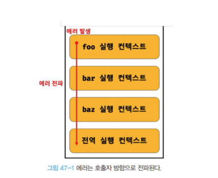

# 46장. 제너레이터와 async/await

## 46.1 제너레이터란?

- ES6에서 도입된 제너레이터는 코드 블록의 실행을 일시 중지했다가 필요한 시점에 재개할 수 있는 특수한 함수 입니다.
- 제너레이터와 일반 함수의 차이는 다음과 같습니다.

#### 1. 제너레이터 함수는 함수 호출자에게 함수 실행의 제어권을 양도할 수 있습니다.

- 일반 함수를 호출하면 제어권이 함수에게 넘어가고 함수 코드를 일괄 실행합니다.
- 즉, 함수 호출자는 함수를 호출한 이후 함수 실행을 제어할 수 없습니다.
- 제너레이터 함수는 함수 실행을 함수 호출자가 제어할 수 있습니다.
- 다시 말해, 함수 호출자가 함수 실행을 일시 중지시키거나 재개시킬 수 있습니다.
- 이는 함수의 제어권을 함수가 독점하는 것이 아니라 함수 호출자에게 양도할 수 있다는 것을 의미합니다.

#### 2. 제너레이터 함수는 함수 호출자와 함수의 상태를 주고받을 수 있습니다.

- 일반 함수를 호출하면 매개변수를 통해 함수 외부에서 값을 주입받고 함수 코드를 일괄 실행하여 결과값을 함수 외부로 반환합니다.
- 즉, 함수가 실행되고 있는 동안에는 함수 외부에서 함수 내부로 값을 전달하여 함수의 상태를 변경할 수 없습니다.
- 제너레이터 함수는 함수 호출자와 양방향으로 함수의 상태를 주고받을 수 있습니다.
- 다시 말해, **제너레이터 함수는 함수 호출자에게 상태를 전달할 수 있고 함수 호출자로부터 상태를 전달받을 수 있습니다**

#### 3. 제너레이터 함수를 호출하면 제너레이터 객체를 반환합니다.

- 일반 함수를 호출하면 함수 코드를 일괄 실행하고 값을 반환합니다.
- **제너레이터 함수를 호출하면 함수 코드를 실행하는 것이 아니라 이터러블이면서 동시에 이터레이터인 제너레이터 객체를 반환합니다**

## 46.2 제너레이터 함수의 정의

- 제너레이터 함수는 function\* 키워드로 선언합니다.
- 그리고 하나 이상의 yield 표현식을 포함합니다.

```js
// 제너레이터 함수 선언문
function* genDecFunc() {
  yield 1;
}

// 제너레이터 함수 표현식
const genExpFunc = function* () {
  yield 1;
};

// 제너레이터 메서드
const obj = {
  *genObjMethod() {
    yield 1;
  },
};

// 제너레이터 클래스 메서드
class MyClass {
  *genClsMethod() {
    yield 1;
  }
}
```

- 애스터리스크(\*)의 위치는 function 키워드와 함수 이름 사이라면 어디든지 상관없습니다.
- 하지만 일관성을 유 지하기 위해 function 키워드 바로 뒤에 붙이는 것을 권장합니다.
- 제너레이터 함수는 화살표 함수로 정의할 수 없습니다.
- 제너레이터 함수는 new 연산자와 함께 생성자 함수로 호출할 수 없습니다.

## 46.3 제너레이터 객체

- **제너레이터 함수를 호출하면 일반 함수처럼 함수 코드 블록을 실행하는 것이 아니라 제너레이터 객체를 생성하여 반환합니다.**
- **제너레이터 함수가 반환한 제너레이터 객체는 이터러블이면서 동시에 이터레이터 입니다**

  #### 복습해보는 이터러블과 이터레이션
  - 이터러블은 값을 순서대로 꺼낼 수 있는 데이터 소스이고, 이터레이터는 그 값을 하나씩 꺼내는 순회 장치 입니다.
  - 이 둘은 Symbol.iterator 와 next 메서드로 연결됩니다.
  - 이터러블은 Symbol.iterator 메서드를 가집니다. 이 메서드를 호출하면 이터레이터가 나옵니다.
  - 이터레이터는 next 메서드를 가집니다. next 메서드를 호출하면 이터레이터 리절트 객체 `{ value, done }`을 반환합니다.

- 다시 말해, 제너레이터 객체는 Symbol.iterator 메서드를 상속받는 이터러블이면서 value, done 프로퍼티를 갖는 이터레이터 리절트 객체를 반환하는 next 메서드를 소유하는 이터레이터 입니다.
- 제너레이터 객체는 next 메서드를 갖는 이터레이터 이지만 이터레이터에는 없는 return, throw 메서드를 갖습니다.
  - 제너레이터 객체의 세 개의 메서드를 호출하면 다음과 같이 동작합니다.
    - next 메서드를 호출하면 제너레이터 함수의 yield 표현식까지 코드 블록을 실행하고 yield된 값을 value 프로퍼티 값으로, done: false 프로퍼티를 갖는 이터레이터 리절트 객체를 반환합니다.
    - return 메서드를 호출하면 인수로 전달받은 값을 value 프로퍼티 값으로, true를 done 프로퍼티 값으로 갖는 이터레이터 리절트 객체를 반환합니다.
    - throw 메서드를 호출하면 인수로 전달받은 에러를 발생시키고 undefiend를 value 프로퍼티 값으로, true를 done 프로퍼티 값으로 갖는 이터레이터 리절트 객체를 반환합니다.

## 46.4 제너레이터의 일시 중지와 재개

- 제너레이터는 yield 키워드와 next 메서드를 통해 실행을 일시 중지했다가 필요한 시점에 다시 재개할 수 있습니다.
- 일반 함수는 호출 이후 제어권을 함수가 독점하지만 제너레이터는 함수 호출자에게 제어권을 양도하여 필요한 시점에 함수 실행을 재개할 수 있습니다.
- 제너레이터 함수를 호출하면 제너레이터 함수 코드 블록이 실행되는 것이 아니라 제너레이터 객체를 반환한다고 했습니다.
  - 이터러블이면서 동시에 이터레이터인 제너레이터 객체는 next 메서드를 갖습니다.
  - 제너레이터 객체의 next 메서들르 호출하면 제너레이터 함수의 코드 블록을 실행합니다.
  - 단, 일반 함수처럼 한 번에 코드 블록의 모든 코드를 일괄 실행하는 것이 아니라 yield 표현식까지만 실행합니다.
  - **yield 키워드는 제너레이터 함수의 실행을 일시 중지시키거나 yield 키워드 뒤에 오는 표현식의 평가 결과를 제너레이터 함수 호출자에게 반환합니다.**

  ```js
  // 제너레이터 함수
  function* genFunc() {
    yield 1;
    yield 2;
    yield 3;
  }

  // 제너레이터 함수를 호출하면 제너레이터 객체를 반환한다.
  // 이터러블이면서 동시에 이터레이터인 제너레이터 객체는 next 메서드를 갖는다.
  const generator = genFunc();

  // 처음 next 메서드를 호출하면 첫 번째 yield 표현식까지 실행되고 일시 중지된다.
  // next 메서드는 이터레이터 리절트 객체({value, done})를 반환한다.
  // value 프로퍼티에는 첫 번째 yield 표현식에서 yield된 값 1이 할당된다.
  // done 프로퍼티에는 제너레이터 함수가 끝까지 실행되었는지를 나타내는 false가 할당된다.
  console.log(generator.next()); // {value: 1, done: false}

  // 다시 next 메서드를 호출하면 두 번째 yield 표현식까지 실행되고 일시 중지된다.
  // next 메서드는 이터레이터 리절트 객체({value, done})를 반환한다.
  // value 프로퍼티에는 두 번째 yield 표현식에서 yield된 값 2가 할당된다.
  // done 프로퍼티에는 제너레이터 함수가 끝까지 실행되었는지를 나타내는 false가 할당된다.
  console.log(generator.next()); // {value: 2, done: false}

  // 다시 next 메서드를 호출하면 세 번째 yield 표현식까지 실행되고 일시 중지된다.
  // next 메서드는 이터레이터 리절트 객체({value, done})를 반환한다.
  // value 프로퍼티에는 세 번째 yield 표현식에서 yield된 값 3이 할당된다.
  // done 프로퍼티에는 제너레이터 함수가 끝까지 실행되었는지를 나타내는 false가 할당된다.
  console.log(generator.next()); // {value: 3, done: false}

  // 다시 next 메서드를 호출하면 남은 yield 표현식이 없으므로 제너레이터 함수의 마지막까지 실행한다.
  // next 메서드는 이터레이터 리절트 객체({value, done})를 반환한다.
  // value 프로퍼티에는 제너레이터 함수의 반환값 undefined가 할당된다.
  // done 프로퍼티에는 제너레이터 함수가 끝까지 실행되었음을 나타내는 true가 할당된다.
  console.log(generator.next()); // {value: undefined, done: true}
  ```

  - 제너레이터 객체의 next 메서드를 호출하면 yield 표현식까지 실행되고 일시 중지됩니다. 이때 함수의 제어권이 호출자로 양도 됩니다.
  - 이때 제너레이터 객체의 next 메서드는 value, done 프로퍼티를 갖는 이터레이터 리절트 객체를 반환합니다.
  - next 메서드가 반환한 이터레이터 리절트 객체의 value 프로퍼티에는 yield 표현식에서 yield된 값이 할당되고 done 프로퍼티에는 제너레이터 함수가 끝까지 실행되었는지를 나타내는 done 불리언 값이 할당됩니다.
  - 이터레이터의 next 메서드와는 달리 제너레이터 객체의 next 메서드에는 인수를 전달할 수 있습니다.
  - 제너레이터 객체의 next 메서드에 전달한 인수는 제너레이터 함수의 yield 표현식을 할당받는 변수에 할당됩니다.

## 46.5 제너레이터의 활용

### 46.5.1 이터러블의 구현

- 제너레이터 함수를 사용하면 이터레이션 프로토콜을 준수하여 이터러블을 생성하는 방식보다 간단히 이터러블을 구현할 수 있습니다.

### 46.5.2 비동기 처리

- 제너레이터 함수는 next 메서드와 yield 표현식을 통해 함수 호출자와 함수의 상태를 주고받을 수 있습니다.
- 이러한 특성을 활용하면 프로미스를 사용한 비동기 처리를 동기 처리처럼 구현할 수 있습니다.
- 다시 말해, 프로미스의 후속 처리 메서드 then catch finally 없이 비동기 처리 결과를 반환하도록 구현할 수 있습니다.

## 46.6 async / await

- ECMAScript2017 에서는 제너레이터보다 간단하고 가독성 좋게 비동기 처리를 동기 처리처럼 동작하도록 구현할 수 있는 async/await이 도입되었습니다
- async/await은 프로미스를 기반으로 동작합니다.
- async/await을 사용하면 프로미스의 then, catch, finally 후속 처리 메서드에 콜백 함수를 전달해서 비동기 처리 결과를 후속 처리할 필요 없이 마치 동기 처리처럼 프로미스를 사용할 수 있습니다.
  - 다시 말해, 프로미스의 후속 처리 메서드 없이 마치 동기 처리처럼 프로미스가 처리 결과를 반환하도록 구현할 수 있습니다.

### 46.6.1 async 함수

- await 키워드는 반드시 async 함수 내부에서 사용해야 합니다.
- async 함수는 언제나 프로미스를 반환합니다.
- async 함수가 명시적으로 프로미스를 반환하지 않더라도 async 함수는 암묵적으로 반환값을 resolve 하는 프로미스를 반환합니다.

### 46.6.1 await 키워드

- await 키워드는 프로미스가 settled 상태가 될 때까지 대기하다가 settled 상태가 되면 프로미스가 resolve한 처리 결과를 반환합니다.
  - 다음 실행을 일시 중지시켰다가 프로미스가 settled 상태가 되면 다시 재개한다는 의미 입니다.

### 46.6.3 에러 처리

- 비동기 처리를 위한 콜백 패턴의 단점 중 가장 심각한 것은 에러 처리가 곤란하다는 것 입니다.
- 에러는 호출자 방향으로 전파됩니다. 즉, 콜 스택의 아래 방향(실행중인 실행 컨텍스트가 푸시되기 직전에 푸시된 실행 컨텍스트 방향)으로 전파됩니다.
- 하지만 비동기 함수의 콜백 함수를 호출한 것은 비동기 함수가 아니기 때문에 try...catch 문을 사용하여 에러를 캐치할 수 없습니다.
  ```js
  try {
    setTimeout(() => {
      throw new Error("Error!");
    }, 1000);
  } catch (e) {
    // 에러를 캐치하지 못한다
    console.error("캐치한 에러", e);
  }
  ```
- async/await에서 에러처리는 try...catch 문을 사용할 수 있습니다.
- 콜백 함수를 인수로 전달받는 비동기 함수와는 달리 프로미스를 반환하는 비동기 함수는 명시적으로 호출할 수 있기 때문에 호출자가 명확합니다.

  ```js
  const fetch = require("node-fetch");

  const foo = async () => {
    try {
      const wrongUrl = "https://wrong.url";

      const response = await fetch(wrongUrl);
      const data = await response.json();
      console.log(data);
    } catch (err) {
      console.error(err); // TypeError: Failed to fetch
    }
  };

  foo();
  ```

---

# 47장. 에러처리

## 47.1 에러 처리의 필요성

- 에러는 호출자 방향으로 전파된다고 이야기했습니다.
- 콜 스택의 아래 방향으로 전파될 때 각 스택에서 에러를 캐치해주지 못한다면 프로그램은 강제 종료될 것 입니다.
- 이럴때 에러 혹은 엣지케이스에 대한 바운더리를 설정해고 적절히 핸들링을 해주는 섬세한 설계가 필요하다고 개인적으로는 생각해봅니다.
  

---

## 49.2 Webpack

- 웹팩은 의존 관계에 있는 자바스크립트, CSS, 이미지 등의 리소스들을 하나(또는 여러개)의 파일로 번들링하는 모듈 번들러 입니다.
- 웹팩을 사용하면 의존 모듈이 하나의 파일로 번들링 되므로 별도의 모듈 로더가 필요 없습니다.
- 그리고 여러 개의 자바스크립트 파일을 하나로 번들링 하므로 HTML 파일에서 script 태그로 여러 개의 자바스크립트 파일을 로드해야 하는 번거로움도 사라집니다.
- babel은 트랜스파일러인듯

---

# 추가 정리

## 리액트에서의 에러처리

- 개인 생각: try...catch 문을 리액트에 비유해보면 catch 문 자체가 ErrorBoundary같다는 인상을 자주 느끼게 됩니다.
- 컴포넌트 에러 로깅같은 경우 아무리 AI로 로깅 로직을 각 컴포넌트에 손쉽고 빠르게 구성 가능한 시대라고 이야기 할 수 있겠지만, 근본적으로 더 좋은 구조를 알고있다면 더 좋은 구조로 진행될 수 있도록 요구 및 설계가 가능한 시대라고 생각합니다.

### HOC 기반 에러처리

- 모든 컴포넌트에서 발생할 수 있는 에러를 한곳에서 처리 가능한 방법 입니다.
  - 하나하나 로그가 각 위치에 붙는것 자체가 리소스 낭비인거임
  - 고차 함수로 에러 로직을 분리하고 불변성을 유지하며 상태 업데이트가 가능함
- 에러 발생 시 대체 UI를 표현합니다.
- API 호출, 렌더링 에러 등 다양한 케이스를 커버할 수 있습니다.

#### 과거 클래스형 컴포넌트 방식 + 에러 바운더리 HOC 패턴

```js
import React, { Component } from "react";

// 1. HOC 정의 (컴포넌트를 인자로 받아 새로운 컴포넌트 반환)
const withErrorBoundary = (WrappedComponent, FallbackComponent) => {
  return class ErrorBoundary extends Component {
    state = { hasError: false, error: null };

    // 2. 생명주기 메서드로 에러 캐치
    static getDerivedStateFromError(error) {
      return { hasError: true, error };
    }

    // 3. 커스텀 에러 로깅 (선택 사항)
    componentDidCatch(error, errorInfo) {
      console.error("Error caught by HOC:", error, errorInfo);
    }

    render() {
      // 4. 에러 발생 시 대체 UI 렌더링
      if (this.state.hasError) {
        return <FallbackComponent error={this.state.error} {...this.props} />;
      }
      return <WrappedComponent {...this.props} />;
    }
  };
};

// 5. 대체 UI 컴포넌트 (순수 함수)
const ErrorFallback = ({ error }) => (
  <div style={{ color: "red", padding: "20px" }}>
    <h3>Something went wrong!</h3>
    <p>{error.message}</p>
    <button onClick={() => window.location.reload()}>Reload Page</button>
  </div>
);

// 6. 사용 예시: HOC로 컴포넌트 감싸기
const UserProfile = ({ user }) => {
  if (!user) throw new Error("User data missing!"); // 의도적 에러
  return <div>{user.name}</div>;
};

const UserProfileWithErrorBoundary = withErrorBoundary(
  UserProfile,
  ErrorFallback,
);

// 7. 앱에서 사용
function App() {
  return <UserProfileWithErrorBoundary user={null} />; // 에러 발생 시 Fallback 표시
}
```

- 이걸 함수형이 아닌 선언형으로 표현한다면 ErrorBoundary 컴포넌트가 되는거임
- Promise.then.catch 방식이랑 try...catch문의 차이처럼 느껴지기도 함
- 명령형 프로그래밍 vs 선언형 프로그래밍 어떤 방식들을 사용하고 계신가요?
  - 명령형 프로그래밍은 how에 집중한다고 표현됩니다.

    ```js
    if (isLoading) return <div>loading</div>;
    ```

    - 앞선 코드에서 조건부 렌더링이 적용되고 있는 경우 if 문을 통해 설명해주고 있는 구조입니다.

  - 반면에 선언형은 What에 집중합니다.
    - 에러가 나오면 모두 ErrorBoundary에서 처리하다, 로딩은 모두 suspense에서 처리하라 와 같이 무엇에 대한 답을 가지고 있습니다.
    - 그리고 suspense는 데이터 패칭용 컴포넌트가 아닌 loading에 대한 상태를 선언적으로 관리하도록 돕는 컴포넌트 입니다
      - 자식 컴포넌트가 부모 컴포넌트와 Promise로 소통하는 관계가 되지 않으면 Suspense를 사용하는 것이 의미가 없는것이죠

## 제너레이터 활용법

- 함수의 실행을 일시 중지하고 나중에 다시 재개할 수 있는 특별한 함수 입니다

```js
function* 중국집배달() {
  yield "짜장면";
  yield "탕수육";
  yield "짜장면";
}

const 배달전화 = 중국집배달();

배달전화.next().value; // 짜장면
배달전화.next().value; // 탕수육
배달전화.next().value; // 짜장면

// 여러번 호출해도 결과는 그때그때 느낌따라 바뀔 수 있는
```

```js
function* generatorWithInput() {
  const name = yield "이름을 입력하세요";
  const age = yield `${name}님의 나이를 입력하세요`;
  yield `${name}님은 ${age}세입니다`;
}

const gen = generatorWithInput();
console.log(gen.next().value); // "이름을 입력하세요"
console.log(gen.next("김코딩").value); // "김코딩님의 나이를 입력하세요"
console.log(gen.next(30).value); // "김코딩님은 30세입니다"
```

### 사용 예시

#### 무한스크롤

```js
function* infiniteScroll() {
  let page = 0;
  while (true) {
    yield fetch(`/api/items?page=${page++}`).then((res) => res.json());
  }
}

const scrollGen = infiniteScroll();

// 스크롤 이벤트에서 다음 페이지 로드
window.addEventListener("scroll", async () => {
  if (nearBottomOfPage()) {
    const { value: nextPage } = scrollGen.next();
    const data = await nextPage;
    renderItems(data);
  }
});
```

#### 리덕스 사가의 상태관리

```js
function* watchUserActions() {
  while (true) {
    const action = yield take("USER_CLICK");
    yield put({ type: "SHOW_LOADING" });

    try {
      const user = yield call(fetchUser, action.payload.userId);
      yield put({ type: "USER_LOADED", payload: user });
    } catch (error) {
      yield put({ type: "LOAD_ERROR", error });
    }
  }
}
```

#### 애니메이션 시퀀스 제어

```js
function* animateElement(el) {
  yield fadeIn(el, 1000);
  yield moveTo(el, { x: 100, y: 200 }, 500);
  yield pause(200);
  yield fadeOut(el, 500);
}

function runAnimation(gen) {
  const iterator = gen();
  function iterate({ value, done }) {
    if (done) return;
    value.then(() => iterate(iterator.next()));
  }
  iterate(iterator.next());
}

runAnimation(() => animateElement(document.getElementById("box")));
```

- 시퀀스를 알아보기 쉽죠?
- 인덱스로 관리하고 제어하는 방식보다는 제너레이트를 사용해도 좋을거같습니다.
- 예시로 스크롤 위치에 따라서 yield로 분기처리를 진행한 뒤 시퀀스 제어가 가능할것 같습니다.

#### 데이터 스트림 처리 (Chunk 처리)

- 대용량 동영상 다운로드 진행 시 한번에 진행하는 것이 아닌 청크 단위로 잘게 쪼갠 뒤 스트림 처리가 됨
-

```js
async function* streamJSON(url) {
  const response = await fetch(url);
  const reader = response.body.getReader();
  const decoder = new TextDecoder();
  let buffer = "";

  while (true) {
    const { done, value } = await reader.read();
    if (done) break;

    buffer += decoder.decode(value, { stream: true });
    const parts = buffer.split("\n");
    buffer = parts.pop();

    for (const part of parts) {
      if (part) yield JSON.parse(part);
    }
  }
}

// 사용 예시
for await (const item of streamJSON("/api/stream")) {
  console.log(item);
  updateUI(item);
}
```

### 주의 사항

1. 브라우저 호환성: 구형 브라우저에서는 지원되지 않아서 폴리필이 필요할 수도 있음
2. 디버깅: 비동기 제너레이터는 디버깅이 어려울 수 있습니다.
3. 가독성: 익숙하지 않은 개발자는 제너레이트 문법의 코드 앞에서 상대적 박탈감을 느낄 수 있음

## 고급 제너레이트 활용법

#### 고급 기능: 지연 평가 구현

- 백엔드에서는 페이지당 최소사이즈 100_000개를 제공하고 있음
- 클라이언트에서 10개의 데이터만 필터링을 해주어야 하는 상황
  - 범부 특: array.filter 써서 구현 진행함
    - 커다란 array를 아무 의미없이 순회하는 안티패턴으로 빠지게 됨

```js
function* lazyMap(iterable, mapper) {
  for (const item of iterable) {
    yield mapper(item); // 필요할 때만 변환 수행
  }
}

function* lazyFilter(iterable, predicate) {
  for (const item of iterable) {
    if (predicate(item)) {
      yield item; // 조건에 맞는 항목만 필터링
    }
  }
}

// 사용 예시
const numbers = [1, 2, 3, 4, 5 , ... , 100_000];
const result = lazyMap(
  lazyFilter(numbers, (x) => x % 2 === 0),
  (x) => x * 2,
);

// 실제 계산은 next() 호출 시점에 수행
console.log([...result]); // [4, 8]
```

- 성능 이점:
  - 불필요한 계산 방지(필요한 요소만 처리)
  - 메모리 효율성 향상(전체 배열을 새로 생성하지 않음)
  - 조기 종료가 가능한 구조로 확장 가능

#### 메모이제이션과 캐싱 전략

- 피보나치 수열 연산이 대표적인 케이스임

```js
function* memoizedFibonacci() {
  let cache = [0, 1];
  yield cache[0];
  yield cache[1];

  let i = 2;
  while (true) {
    cache[i] = cache[i - 1] + cache[i - 2];
    yield cache[i];
    i++;
  }
}

const fib = memoizedFibonacci();
console.log(fib.next().value); // 0 (캐시 없음)
console.log(fib.next().value); // 1 (캐시 없음)
console.log(fib.next().value); // 1 (캐시 사용)
console.log(fib.next().value); // 2 (캐시 사용)
```

- 중복 계산 회피 가능
- 이전 결과 재활용으로 계산 비용 절감 가능
- 캐시 크기 조절 가능함

#### 무한한 데이터의 스트림 처리

```js
function* naturalNumbers() {
  let n = 0;
  while (true) yield n++;
}

function* take(iterable, limit) {
  let count = 0;
  for (const item of iterable) {
    if (count++ >= limit) return;
    yield item;
  }
}

// 100만 개의 숫자 중 처음 10개만 처리
const first10 = take(naturalNumbers(), 10);
console.log([...first10]); // [0, 1, 2, 3, 4, 5, 6, 7, 8, 9]
```

- 메모리 사용량 감소
- 조기 종료로 불필요한 처리 방지
- 실시간 데이터 스트림에 적합

#### 웹 워커와 함께 사용도 가능함

- 웹 워커를 통해 싱글스레드의 한계를 벗어나야 하는 상황이 필요함
- 굉장히 커다란 데이터가 있다면 그 데이터를 각 청크로 처리해주는 웹 워커로 전달
- 청크 단위로 처리 가능

```js
// 메인 스레드
function* chunkedWorkerTask(data, chunkSize) {
  const worker = new Worker('worker.js');
  let result = [];

  for (let i = 0; i < data.length; i += chunkSize) {
    const chunk = data.slice(i, i + chunkSize);
    worker.postMessage(chunk);
    yield new Promise(resolve => {
      worker.onmessage = e => {
        result = result.concat(e.data);
        resolve(result);
      };
    });
  }
  worker.terminate();
  return result;
}

// 사용 예시
async function processLargeData() {
  const data = /* 대량의 데이터 */;
  const processor = chunkedWorkerTask(data, 1000);

  let result;
  while (true) {
    const { value, done } = processor.next();
    if (done) {
      result = value;
      break;
    }
    await value; // 청크 단위로 처리
    updateProgressUI(); // UI 업데이트 가능
  }
  return result;
}
```

#### 고급 최적화 기법: 트램펄린

- 재귀 호출 스택 오버플로우 방지

```js
function* trampoline(fn) {
  let result = fn();
  while (typeof result === "function") {
    yield;
    result = result();
  }
  return result;
}
```

#### 고급 최적화 기법: 백 프레셔 관리

- 데이터 생산자와 소비자 간 속도 조절
- 버퍼보다 데이터가 과잉생산 되는 경우 대기를 시켜줄 수 있음
- 생산자의 생산 템포를 조절해줄 수 있음
- 데이터가 너무 커다랗거나 과도한 경우 이런 최적화 기법을 사용하게 됨

```js
async function* withBackpressure(iterable, bufferSize = 1) {
  const buffer = [];
  let resolveWait;

  const producer = async () => {
    for await (const item of iterable) {
      buffer.push(item);
      if (resolveWait) resolveWait();
      if (buffer.length >= bufferSize) {
        await new Promise((r) => (resolveWait = r));
      }
    }
  };
  producer();

  while (true) {
    if (buffer.length === 0) {
      await new Promise((r) => (resolveWait = r));
    }
    yield buffer.shift();
  }
}
```

#### 고급 최적화 기법: 시간 분할

- 장기 실행을 작은 청크로 분할

```js
function* timeslice(iterable, chunkSize) {
  let buffer = [];
  for (const item of iterable) {
    buffer.push(item);
    if (buffer.length >= chunkSize) {
      yield buffer;
      buffer = [];
      yield; // 다음 이벤트 루프 틱에 실행 양보
    }
  }
  if (buffer.length > 0) yield buffer;
}
```
